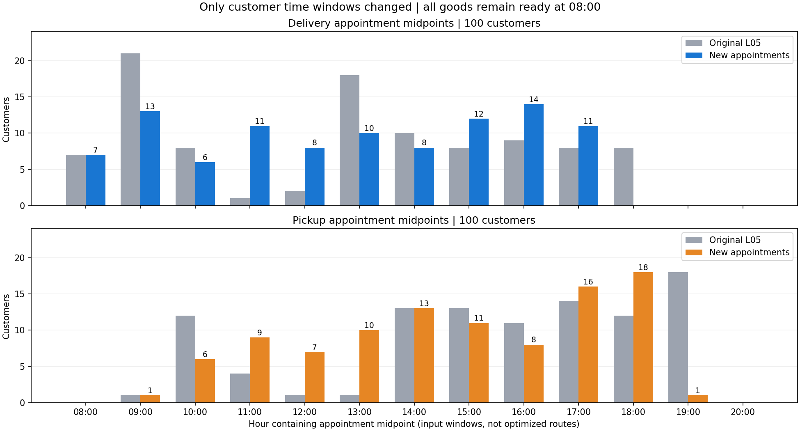
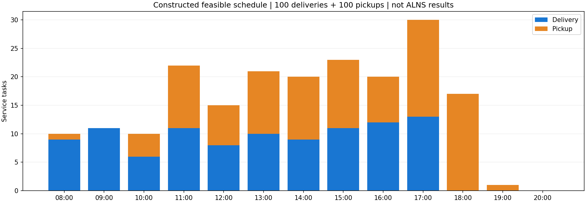

# 新旧时间窗分布核查

新算例的模型3/8只修改顾客四个取送窗口端点。所有100单货物仍在08:00就绪，一客一箱、货物重量、固定配送站、服务时间、最低使用时间、原参考日历、车辆和费用均保持一致。

上图按输入预约窗口的中点统计，不是ALNS运行结果。配送预约中点在08—17时每小时6—14单；构造见证的实际配送任务每小时6—13单，取送在日内交错。回收受先送后取约束，分布会整体后移。

5个配置独立检查全部通过（5通过、0失败、0跳过），包括连续两个运营周期的物理重放。未运行ALNS或Gurobi，不能据此宣称多批费用更低。
验证用4批安排与单批安排有相同的二级路线和服务时间，但一级运输分别20趟和5趟；因此这里只验证时间窗均匀及可行性，不将额外一级运输隐藏为正常业务需要。

模型8完整允许K=1～100，并没有固定为验证见证中的4批。

