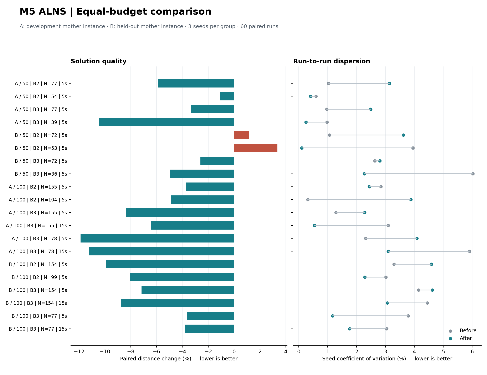

# M5 多批次 ALNS：距离质量与稳定性优化

已接入正式 M5 入口。在注册的 60 对同预算运行中，距离配对平均下降 **5.58%**，
53 次改善、7 次退步；两版各 60 个结果全部通过独立审计和连续两周期重放。
逐场景的种子变异系数均值从 **2.74% 降到 2.45%**，20 组中有 18 组的最差距离改善。
这是相对现有基线的工程改进，不是路线全局最优性或所有场景都稳定改善的证明。

后续实现和新母例验证见 [第二轮：解码与分仓邻域复用](model5_alns_round2_20261001.md)。
本页保留第一轮冻结版本的原始结论。

## Material Passport

- Origin Skill: academic-research-suite / experiment-agent
- Origin Mode: run + validate
- Verification Status: ANALYZED。运行、可行性、源码/输入快照和统计复算已核验；墙钟限时结果不保证逐次精确重现。
- 范围：当前 V2 派生数据，固定分仓，固定批次，距离目标，有限容器池，M5 ALNS。

## 实现

核心改动位于 [搜索器](../../models/routing/solvers/alns/solver.py) 与
[多批次局部改进](../../models/routing/solvers/alns/intensification.py)。原有 M5 API 和 CLI 自动使用新版。

1. 围绕已审计最好解，生成二级任务移动、路线反转、整笔配送/回收请求迁移与交换候选。
   整笔请求可以跨过单任务迁移的局部障碍，减少不必要的趟次。
2. 系统尝试一级配送仓点移动/交换、回收车辆与访问顺序。
   两个仓点同时交换可以跨过单点迁移造成的容量障碍。
3. 采用有界距离候选列表；距离增量支持非对称、非度量矩阵。
   一级方案变化时复用未改变的二级距离枚举，但重新检查时序。
4. 初始改善阶段使用固定辅助种子 0；达到总时间 40%、600 次迭代或总迭代上限的三分之一时
   切换至用户指定种子。两阶段共享同一总预算。默认约三分之二的搜索步骤尝试局部改进，
   其余保留原有随机破坏/修复等邻域。多批次退火温度系数从 0.05 调为 0.01。
5. 重启候选从最好状态继续修复，返回值始终保留已审计最好解。
   新增初解距离、逐次改善轨迹、辅助搜索迭代数和候选诊断，便于检查收敛与预算使用。

局部时序/容量检查只用于启发式筛选；完整解码仍重算所有批次的回收归属、一级回运、
清洗释放、库存和车辆连续复用。更新最好解前必须通过独立审计。
局部筛选不能证明不可行，ALNS 也不报告全局最优或伪造 gap。

## 对照设计与结果

执行前注册 60 个作业并冻结输入，基线和最终版本各运行一次：

- 两个 Zhou 母实例的 50 顾客嵌套子集及完整 100 顾客，B2/B3。
- 全池 N=Q；紧池 N=max(最大单批需求, ceil(0.5Q))。
- 每组种子 42、43、44；全部场景 5 秒，100 顾客 B3 另测 15 秒。
- 两版均设置最多 100000 次迭代，避免默认 5000 次限制提前结束长预算。
- 新进程逐作业串行执行，保留完整时间表、日志、独立审计、失败以及全部中间试验。
- 母例 `100-5-1b` 用于调试，`100-5-2` 作为保留集。开发集平均变化为 -6.72%，
  保留集为 -4.44%。最终版本冻结后未根据保留集结果继续调参。

100 顾客三批次、15 秒的结果如下，每格统计三个种子；距离为 Zhou 坐标单位。

| 母例 | 箱池 N | 距离均值：前 → 后 | CV：前 → 后 |
|---|---:|---:|---:|
| 开发集 100-5-1b | 155 | 3734.65 → 3492.31 | 3.10% → 0.55% |
| 开发集 100-5-1b | 78 | 4174.35 → 3693.73 | 5.91% → 3.09% |
| 保留集 100-5-2 | 154 | 2501.29 → 2277.36 | 4.45% → 3.07% |
| 保留集 100-5-2 | 77 | 2597.94 → 2498.94 | 3.04% → 1.76% |

完整的 5 秒/15 秒结果见 [实验报告](../../output/experiments/model5_alns_optimization_20260930/report.md)，
包含全部 20 组的均值、最差距离和 CV。



**限制与退步均保留：** 7 次退步均发生在保留集的 50 顾客场景，最大配对退步约 8.05%。
只有 11/20 组 CV 降低，不能从总体 CV 下降推断每组更稳定。100 顾客三批的四个
15 秒组均改善了距离均值和 CV，但 5 秒下部分组的波动仍然增加。
只有两个母例、三个种子，且 50/100 顾客数据嵌套；没有进行显著性检验，不能当成大规模独立样本研究。
共同初始搜索阶段属于新版算法的一部分，所报告的 CV 是该完整算法的种子波动。

## 测试和源码核验

新增测试覆盖有向非度量距离、完整任务覆盖、输入隔离、迭代上限、零迭代、短预算、
保留已审计热启动、固定迭代复现、最好解轨迹单调性，以及需要同时交换两个一级仓点的容量障碍。
汇总测试防止丢弃失败作业、错配种子或重复作业导致虚假改善。

- 本轮首次全仓库回归：378 passed，见 [记录](../../output/experiments/model5_alns_optimization_20260930/pytest.log)。
- 其他工作同期新增单批次/精确求解代码后，全仓库复查为 435 passed、1 failed；失败项是
  `test_exact_strengthening.py::test_tree_timeout_keeps_every_unresolved_assignment_in_global_bound`，
  不调用 M5 ALNS。保留了其他工作中的改动，见 [复查记录](../../output/experiments/model5_alns_optimization_20260930/pytest_final.log)。
- 当前 M5 相关机制、邻域、独立加载和静态多批次实验测试：**103 passed**，见
  [专项回归](../../output/experiments/model5_alns_optimization_20260930/pytest_m5.log)。
- [最终核验](../../output/experiments/model5_alns_optimization_20260930/verification_final.json) 确认 120 个结果的
  审计/周期重放和距离一致性、配对统计复算、单调改善轨迹，以及当前 M5 搜索主体与冻结版本一致。
  共享入口后来增加的 B=1 分流没有改变 M5 主体；相关 M5 依赖文件也与实验版本一致。

中间试验 `pilot_01` 至 `pilot_07` 均保留。包括成对迁移枚举过慢、过早局部评分挤占预算、
确定性下降阶段过长等退步尝试。最终表只使用 `before` 与 `after`，没有逐例挑选最好的中间版本。

## 使用与复现

单次求解当前 100 顾客、三批、78 箱案例：

```sh
.venv/bin/python main.py route \
  --case data/multi_batch/large/zhou_Set2_100-5-1b/b3/case.json \
  --solver alns --time 15 --iterations 100000 --seed 42 --container-pool-size 78
```

在本工作区按已冻结源码与输入重跑最终 60 个作业，输出到新的阶段目录：

```sh
.venv/bin/python tools/audit/benchmark_model5_alns.py \
  --output output/experiments/model5_alns_optimization_20260930 \
  --phase reproduce_after \
  --source output/experiments/model5_alns_optimization_20260930/after/source
```

复算报告和图表：

```sh
.venv/bin/python tools/audit/summarize_model5_alns.py \
  --output output/experiments/model5_alns_optimization_20260930 --plot
```

单个候选计算及最终审计可能略微超过墙钟预算；本次最终版本的最大外层超出约 0.088 秒。
墙钟截断与机器负载会影响迭代次数，因此复跑目标值可能有小幅变化，不能保证与表格逐位相同。
