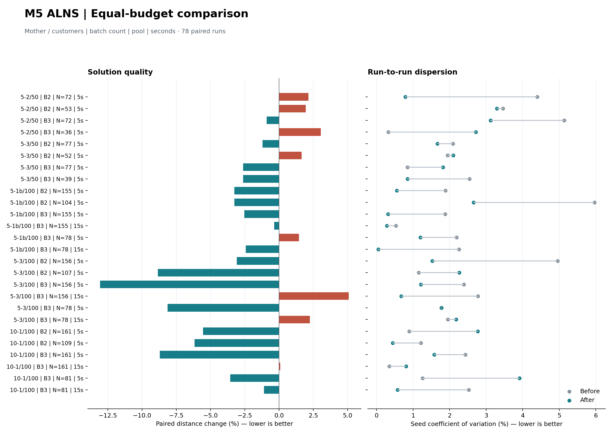

# M5 多批次 ALNS 第二轮：复用解码与分仓邻域

第二轮已接入正式 M5 入口。78 对同预算运行中，距离配对平均下降 **2.30%**，
53 次改善、25 次退步；新的保留集平均下降 **3.48%**。
分组种子变异系数 CV 的均值从 **2.27% 降至 1.58%**，26 组中 20 组的最差距离改善。
两版共 156 个方案全部通过独立审计和两周期重放；最终全仓库测试 **459 项通过**。
这是平均质量和波动的工程改善，部分长预算场景仍退步，不能保证每个场景都改善或接近全局最优。
后续预算延长与搜索策略的未采用试验见 [第三轮记录](model5_alns_round3_20261001.md)；本页保留第二轮冻结结果。

## Material Passport

- Origin Skill: academic-research-suite / experiment-agent
- Origin Mode: run + validate
- Verification Status: ANALYZED。冻结输入/源码、156 个方案的重审计、统计复算和当前 M5 源码一致性已核验。
- 范围：固定分仓、固定多批次、有限容器池、回收清洗与周期复用的 M5。

## 改动及边界

一级回收解码缓存以**全部批次**的配送路径、回收访问顺序、车辆提示、截止时刻归属数量为键。
只有这些输入完全相同时才复用一级时间表、违规项和清洗释放事件。
每次候选仍重新计算二级时序依赖、物理车辆复用、回收数量归属和洁净库存。
缓存属于单次求解，最多保存 256 个一级方案；返回时间表另行复制，调用者修改结果不会污染缓存。

二级距离邻域按卫星仓分别枚举。同仓任务次序未变化时，复用已有距离候选；
保存的是局部路线索引，使用时重新映射到当前完整状态，避免其他仓删除路线后索引错位。
最多缓存 64 个仓内状态，仍保留全局最多 256 个距离候选。
车辆和等待时间不影响距离枚举，但会影响可行性，因此每次提案重新筛查时间与容量。
分仓合并可能改变距离相同候选的排列，不能把整个限时搜索看作逐步不变。

所有最好解仍经过独立审计；没有放宽时间窗、容器池、车辆或清洗约束。

## 注册对照

第一轮已有结果的母例现在均视为已观察数据。本轮开发集选取 `100-5-2` 的 50 顾客子集
及 `100-5-1b` 的完整 100 顾客；新的最终保留集为 `100-5-3` 的 50/100 顾客和
`100-10-1` 的 100 顾客。保留集在最终候选冻结前不查看求解质量。

- 共 78 对运行：B2/B3，全池与紧池，种子 42/43/44。
- 全池 N=总箱需求 Q；紧池 N=max(最大单批需求, ceil(0.5Q))。
- 全部组合 5 秒；100 顾客 B3 另测 15 秒；最多 100000 次迭代。
- 每个版本注册求解预算共 570 秒，每个作业独立进程串行运行。
- 基线是本轮开始时的工作区快照，包含同期已存在的通用修复加速，因此本轮基线不等同于
  第一轮报告的旧快照。不可直接把两轮百分比相加。
- 候选源自这一基线，仅替换本轮涉及的 M5 文件，以免混入其他聊天同期开展的改动。

原始记录位于 [实验目录](../../output/experiments/model5_alns_round2_20260930/benchmark_manifest.json)。
目录沿用开始注册时的 9 月 30 日，工作完成日期为 10 月 1 日。
50/100 顾客样本嵌套，三个种子只能描述本轮离散程度；不做显著性检验或最优性声明。

本轮只试验一个候选。开发试运行 30 次均通过审计，22 次改善、8 次退步，配对距离平均下降
1.91%，分组 CV 均值由 2.80% 降至 2.02%；据此冻结候选。
随后重新执行全部 78 个正式作业，包括开发集。主结果只采用 `before` / `after`，
没有从试运行中逐个选择更好结果。开发集正式复跑的平均距离下降 0.42%，CV 均值降至 1.50%，
与试运行不同，反映了墙钟截断及运行负载对搜索轨迹的影响。
[候选选择记录](../../output/experiments/model5_alns_round2_20260930/selection.json) 和
[开发试运行明细](../../output/experiments/model5_alns_round2_20260930/pilot01_comparison.json) 均保留。

## 正式结果与退步

开发集配对平均变化 -0.42%，新保留集 -3.48%，全部 78 对为 -2.30%。
26 组中 18 组距离均值改善，17 组 CV 下降，20 组最差种子距离改善。
三个种子按场景、池和预算分别统计；整体均值不能代替逐组判断。

100 顾客、B3、15 秒的全部六组如下，每组包含三个种子：

| 母例 | 箱池 N | 距离均值：前 → 后 | 配对变化 | CV：前 → 后 |
|---|---:|---:|---:|---:|
| 开发 100-5-1b | 155 | 3501.23 → 3488.67 | -0.36% | 0.53% → 0.28% |
| 开发 100-5-1b | 78 | 3745.69 → 3653.23 | -2.43% | 2.26% → 0.05% |
| 保留 100-5-3 | 156 | 2519.84 → 2646.93 | +5.08% | 2.78% → 0.67% |
| 保留 100-5-3 | 78 | 2804.83 → 2867.53 | +2.26% | 1.95% → 2.18% |
| 保留 100-10-1 | 161 | 2576.04 → 2578.27 | +0.09% | 0.35% → 0.81% |
| 保留 100-10-1 | 81 | 2647.27 → 2616.73 | -1.11% | 2.52% → 0.58% |

**退步未隐藏：** 25/78 个配对距离变差，最大退步为 8.80%；8/26 组距离均值变差。
此前薄弱的 `100-5-2_subset50` B2 本轮也没有解决：全池与紧池的配对均值分别退步 2.14% 和 1.94%。
`100-5-3` 在 5 秒下改善较多，但两个 15 秒 B3 组均退步，说明缓存增加搜索量并不保证搜索轨迹更好。
保留集结果没有用于再次调整本轮候选。后续应重点改善这些场景的搜索轨迹，而不能只增加枚举数量。

完整 26 组及全部种子见 [正式实验报告](../../output/experiments/model5_alns_round2_20260930/report.md)。



## 计算量与核验

最终版一级回收缓存的查询命中率为 35.35%，仓内距离枚举缓存的查询命中率为 71.38%。
相同作业的迭代数比值（新版/基线）均值为 1.60，中位数为 1.49。
迭代包含不同算子与无效提案，机器其他负载也未隔离，因此不能把该比值直接当作纯代码加速比。
外层实测最大预算超出约 0.051 秒，包含末次候选及收尾审计。详见
[运行诊断](../../output/experiments/model5_alns_round2_20260930/diagnostics.json)。

- 新增四项缓存测试覆盖：160 次随机移动中的完整解码一致性、包含全部批次/回收数量的缓存键、
  返回结果修改隔离、等待变化后的时序重查、其他卫星仓路线索引移动后的正确映射。
- 新增与既有 M5 专项合计 13 项测试通过。
- 首次全仓库运行 457 passed、2 failed，失败为同期更新中的单批次下降测试；这些测试在另一项工作中更新后，
  原始解码器与本轮解码器各自复查均通过。没有修改其他工作中的单批次实现或测试。
- 最终全仓库回归 **459 passed**，见 [最终测试日志](../../output/experiments/model5_alns_round2_20260930/pytest_final.log)
  和 [测试 XML](../../output/experiments/model5_alns_round2_20260930/pytest_final.xml)。首次日志也保留。
- [最终核验](../../output/experiments/model5_alns_round2_20260930/verification_final.json) 确认 156 个方案的审计与两周期重放、
  距离一致性、改善轨迹单调性、注册参数和统计复算；12 个当前 M5 入口、搜索、解码及审计相关文件均与冻结版本一致。

## 复现

例如运行 100 顾客、三批、78 箱案例：

```sh
.venv/bin/python main.py route \
  --case data/multi_batch/large/zhou_Set2_100-5-1b/b3/case.json \
  --solver alns --time 15 --iterations 100000 --seed 42 --container-pool-size 78
```

本轮没有突破或修改调用者的迭代上限；要复现本次时间预算对照，应显式使用 100000 次上限。
沿用 5000 次上限可能提前结束搜索，不能直接套用本页的质量改善百分比。

最终源码和输入冻结后，可在当前工作区新建阶段复跑：

```sh
.venv/bin/python tools/audit/benchmark_model5_alns.py \
  --output output/experiments/model5_alns_round2_20260930 \
  --phase reproduce_after \
  --source output/experiments/model5_alns_round2_20260930/after/source
```

统计和独立复核命令：

```sh
.venv/bin/python tools/audit/summarize_model5_alns.py \
  --output output/experiments/model5_alns_round2_20260930 --plot
.venv/bin/python tools/audit/verify_model5_benchmark.py \
  --output output/experiments/model5_alns_round2_20260930
```

墙钟截止受机器负载影响；一次候选计算和最终审计可能使外层耗时略超预算。
