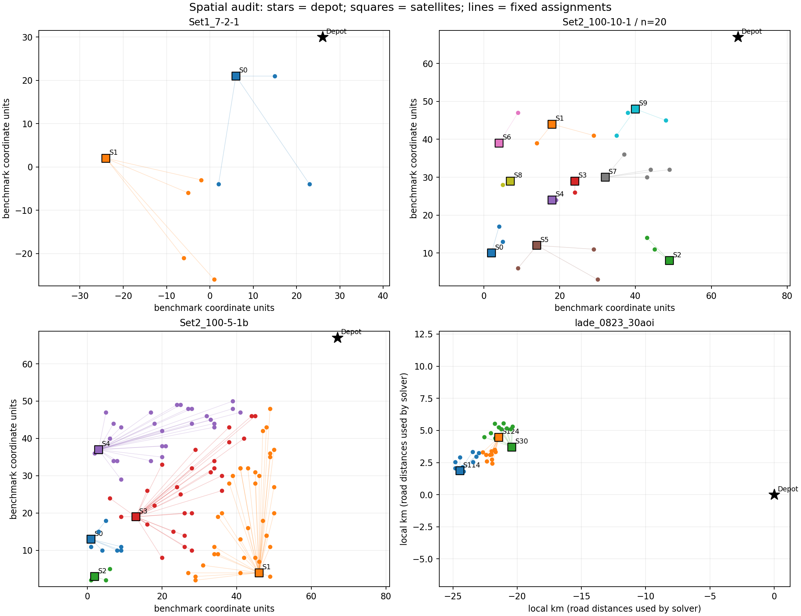
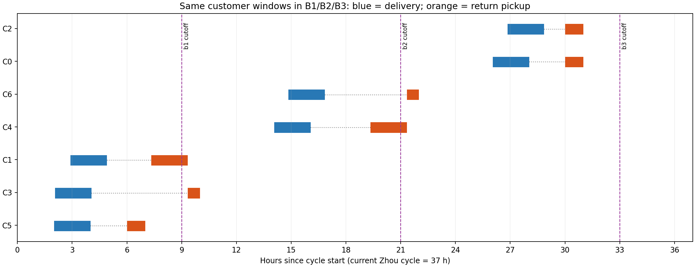

## Material Passport

- Origin Skill: academic-research-suite / experiment-agent
- Origin Mode: validate
- Origin Date: 2026-09-30
- Verification Status: VERIFIED（本地描述统计、确定性复算和箱池证书；业务真实性仍待校准）
- Version Label: dataset_design_review_v1

# 顾客、前置仓、订单与容器回收时间窗设计审查

**版本说明：本报告审查的是 V1 历史输入。后续修订已落地为 V2，当前状态与验收结果见 [数据集 V2 修订](dataset_redesign_v2_20260930.md)。以下数字保留为原问题的证据。**

**结论：当前数据通过了形式可行性检查，但尚不足以直接作为正式算法与运营经济性结论的依据。** 原先的验收主要回答“输入是否一致、能否构造可行解”，没有充分回答“布局、资源、使用时长及回收节奏是否代表目标业务”。本次逐项审查发现，若直接继续扩大求解，部分结论会主要反映数据生成规则。

位置数据有可保留的来源，路径合并和自由选仓也仍有优化空间；需要修正的是业务解释、时间结构、资源压力与比较设计。不能把这份报告解读为全部既有结果无效，也不能通过刻意调整数据保证某个模型胜出。

## 1. 范围、方法和证据

审查现行 `data/manifest.json` 中 **93 个基础场景、279 个 B1/B2/B3 配置**：Zhou 70 组、LaDe 21 组、人工机制 2 组。Zhou 仍为 7/10/12/20/30/50/100 顾客，每档 10 例。本次没有修改订单、网络、车队、日程、箱池或模型，也没有恢复暂停的精确求解。

执行内容包括：逐点坐标和分仓统计、单客可达性、送取窗口与使用时间的关系、资源与需求比例、构造时间表的独立审计、连续两周期库存重放，以及在降低箱池后重放同一时间表。279 个默认 M3/M5 配置均有通过审计的可行构造；这不是 M1–M5 的距离最优性证明或 ALNS 性能比较。

证据以 [最终审查输出](../output/experiments/dataset_design_audit_20260930/final/metrics.json) 为准：

- [逐场景统计](../output/experiments/dataset_design_audit_20260930/final/families.csv)、[逐订单统计](../output/experiments/dataset_design_audit_20260930/final/orders.csv)、[逐配置审计](../output/experiments/dataset_design_audit_20260930/final/cases.csv)。
- [箱池下界与可行证书](../output/experiments/dataset_design_audit_20260930/final/pool_certificates.json)、[代表性显式时间表](../output/experiments/dataset_design_audit_20260930/final/selected_witnesses.json)。
- [审查脚本](../tools/audit/audit_dataset_design.py)、[源码哈希](../output/experiments/dataset_design_audit_20260930/final/audit_sources.json)、[复算核对记录](../output/experiments/dataset_design_audit_20260930/verification.json)。

## 2. 顾客点与前置仓

### Zhou：基准几何可以保留，固定分仓与仓库密度需要明确

Zhou 原始项目研究两级同时取送货问题，是基准实例来源，并不是顾客使用可循环容器后返还的实测资料。[原始项目](https://github.com/zll-hust/2E-VRPTWSPD)

本项目转换器用欧氏距离最近仓生成 `assigned_sat`；现行数据保留的是这个派生分仓，不能称为原论文或真实企业提供的客户归属。70 个情景中，所有订单的固定仓都是欧氏最近仓。

| 顾客数 | 每档情景数 | 前置仓数 | 可用二级车辆总数 | 存在空仓的情景数 | 不同空间布局数 |
| ---: | ---: | ---: | ---: | ---: | ---: |
| 7 | 10 | 2 | 8 | 0 | 5 |
| 10 | 10 | 2 | 8 | 0 | 5 |
| 12 | 10 | 2 | 8 | 0 | 5 |
| 20 | 10 | 5 或 10 | 20–40 | 8 | 10 |
| 30 | 10 | 5 或 10 | 20–60 | 6 | 10 |
| 50 | 10 | 5 或 10 | 35–50 | 4 | 10 |
| 100 | 10 | 5 或 10 | 125–250 | 4 | 5 |

**22/70 个情景存在没有分配顾客的前置仓。** 例如 `zhou_Set2_100-10-2_subset20_scenario02` 有 20 个顾客、10 个仓，其中 4 个空仓、7 个仓至多分到 2 笔订单。原因是从 100 顾客母例抽子集时保留了全部仓。该布局不是数学错误，但代表“仓多、需求稀疏”的特殊情景，不适合未经说明就代表一般城市配送。

空仓仍可能成为 M2/M4 的候选仓；不能只在固定分仓模型中删除、却让自由分仓模型使用。若设计仓数较少的运营情景，必须在 M1–M4 以及 B1/B2/B3 中一致调整，并保存新版本。保留原基准仓数的情景则应单独标明仓库密度。

17/70 个情景有顾客共坐标组。例如 `Set1_10-2-2b` 的 C1、C4 同在 `(0,-8)`；100 顾客母例也有共址顾客。共址来自来源资料，不应为使算法表现更好而随机挪点或直接删掉。需要同时记录订单数和不同物理位置数，并明确允许同地点多顾客。

单客松弛可达性检查显示，所有 Zhou 订单都有其他仓可选。因此最近仓分配没有把自由选仓完全锁死；但这仅是必要条件检查，不保证所有订单同时换仓仍可行，也不预先保证 M4 一定改进。

### LaDe：有真实配送位置基础，仓库和时间窗是代理量

LaDe-D 提供配送订单、位置与配送过程时间等字段；当前派生资料没有实测的可循环容器交回记录。[官方数据集](https://huggingface.co/datasets/Cainiao-AI/LaDe-D)

本地处理记录明确：三个前置仓取自各区域快递员接单 GPS 的中位数，中心仓使用萧山机场旧货运中心代理点。**这些坐标不等于经过确认的真实运营仓库。** 顾客节点为 AOI 聚合区域；一个节点当天包含多笔包裹，不能等同于 Zhou 的一名顾客、一笔订单。

21 个 LaDe 情景没有空仓或共坐标节点。按道路距离计算，53.3% 的订单归属最近仓，其余按区域归属。若研究自由选仓，需要声明服务区允许跨仓及其成本，否则 M2/M4 获得的灵活性可能超出实际业务权限。

已有 OSRM 道路矩阵优于直接把经纬度当距离，但仍是保存的 driving 路网快照。机场代理点吸附到道路的距离约 387 米，S30 约 76.6 米；应确认入口、车辆类型与旅行时间。当前没有交通时段或企业车辆速度的校准证据。



## 3. 订单需求与配送时间

所有订单在周期开始前已知；现行数据没有另行建模订单到达时刻。`delivery_ready/due` 表示允许服务的时间范围，不能解释成真实下单时间。静态单批／多批研究可以采用这个假设，但应写明。

**Zhou 的周期实际为 2220 分钟，即 37 小时。** 三个需求时段间隔 720 分钟；B3 配送批次从 0、12、24 小时开始，回收截点在 9、21、33 小时。B1 合并为一次初始补货，仍保留三个相隔 12 小时的需求时段。它可以表示跨日周期内的一次补货，却不能直接称为“同一天的一次配送”。

Zhou 的每个配送窗固定宽 120 分钟，起点是“时段起点 + 120 + 来源 ready 对 60 取模”，2290 条情景订单均没有原样保留来源配送窗。单客直接配送测试中，车辆均可在窗开始前到达，每条订单都保留完整的 120 分钟窗口余量。这个测试不能证明合并路线的窗口不紧，但说明现有可行性很容易由等待和大量车辆获得。

LaDe 当前周期是 08:00–21:00，共 13 小时。它的配送窗由历史完成时间分位数扩宽得到，通常为 6–12 小时；这是服务时段代理，不是顾客承诺的预约窗。本地中间资料的旧跨日回收率和延迟分布已被现行同周期 100% 回收情景替换，不能拿旧说明解释新订单。

## 4. 顾客使用时长与容器交回窗口

模型使用的基本关系为：

`取回开始 ≥ 送达开始 + 送达服务时间 + 最短使用时间`。

这条关系保证先送后取，但不能替代业务依据。容器装的是即卸即回的周转货箱，还是需长时间使用的包装，会直接决定日内复用是否现实；目前这项业务信息尚未确定。

### Zhou：最短使用时间完全冗余

当前所有订单设置 `min_use_time=30` 分钟，但全部满足：

`回收窗起点 ≥ 配送窗终点 + 服务时间 + 30`。

因此 **2290/2290 条情景订单的“至少使用 30 分钟”约束被窗口自动满足**。即使把这个参数降为 0，现有送取窗口允许的时间表集合也不因此扩大。窗口本身隐含的最短使用时长在 51–310 分钟之间，中位数 107 分钟；这些是窗口推导的界，不是实测使用时长。

回收窗按固定的早回、跨截点、迟回三类生成；最终需求时段强制采用早回。因此它能验证跨截点规则，却不足以单独说明算法处理了多样的顾客使用行为。应独立生成使用时长、预约回收窗口和需求批次，避免三者由同一个序号机械决定。



### LaDe：回收窗口反过来大幅压缩配送期限

**415/420 条聚合订单（98.8%）满足“回收窗终点 − 服务时间 − 最短使用时间 < 配送窗终点”。** 这不直接构成不可行，但意味着 nominal 配送期限并不是实际可用的最晚送达时间。

例如 `lade_0823_30aoi` 的 C13875：配送窗 09:30–18:00，回收窗 11:10–11:30，服务 5.7 分钟，最短使用 15 分钟。由先送后取关系，最晚只能在 **11:09:18** 开始送达服务，而不是 18:00。这种设计只有在上午必须交回容器的业务中才有解释；当前没有对应观测。

更严重的是：LaDe 第一批全部 **114 条聚合订单** 的回收窗都是 11:10–11:30，而第一轮回收截点为 11:00，必定错过。生成器用相同的 `index` 选择配送阶段与迟返类别，造成两者耦合。第一批箱子不可能在 12:00 第二批开始前清洗复用；即使使用松弛旅行下界，最早清洁可用也在 15:39–15:41:24。

本次对 **全部 21 个 LaDe 情景的 B2、B3 最小箱池** 均取得“必要下界 = 已重放的可行上界”证书，而且每组 B2 与 B3 的值完全相同。该结论限定在当前固定分仓、日程和资源下，不是距离最优性结论。增加第三批无法进一步降低这些现行案例的最小箱池，不能把这一结果归咎于 ALNS 没搜索好。

## 5. 车辆、容量和箱池

车队生成规则按最拥挤的“仓×需求批次”扩充车辆，再把相同数量配给每个仓；一级车辆至少每仓一辆，一级单车容量至少覆盖该仓整个周期的订单。

因此所有 70 个 Zhou 和 21 个 LaDe 情景，在每个仓的每个需求批次内，都允许一笔订单占用一辆二级车辆。尤其是 100 顾客例可用 125–250 辆二级车，不能据此代表车辆紧张的运营环境。车辆是否实际被使用还由优化决定，但供给上限没有充分约束并行调度。

Zhou 二级单车体积容量是 5 箱，合并路线仍有容量限制；不能说容量约束全部消失。但全周期需求除以所有二级车辆一次满载容量，仅为 8%–30%。LaDe 对应比例更低，为 2.8%–5.4%；二级车设为 1500 kg、12 m³，最大场景的 255 箱总需求也只有 7.65 m³、1020 kg（按当前货物与箱重假设）。空间、时间和分仓仍有限制，但容量很难成为主要矛盾。

默认池是 **N=Q，即箱数足够覆盖整个周期需求**，运行时共享池配置当前也是需求比例 1.0。该设置适合作为宽松参照；它不能充分检验依靠周期内回收来维持供给的能力。B1 在当前“所有箱子期初发出”的规则下需要 N=Q；不应为追求同一个小 N 而强迫 B1 不可行，再把不可行解释为多批方案的全面优势。

在不改变任何路线和服务时刻的情况下，把构造时间表的箱池降至其实际需求并重新审计，结果如下：

| Zhou 顾客数 | B3 必要箱池下界 | 可行构造所需箱池 | 已证明最小箱池的情景数 |
| ---: | ---: | ---: | ---: |
| 7 | 3 | 3 | 10/10 |
| 10 | 5 | 5 | 10/10 |
| 12 | 6 | 6 | 10/10 |
| 20 | 10 | 10 或 11 | 8/10 |
| 30 | 14 | 14 | 10/10 |
| 50 | 23 | 23 | 10/10 |
| 100 | 45 | 45 | 10/10 |

**68/70 个 Zhou B3 情景无需优化搜索就已能证得最小箱池。** 未闭合的是 `zhou_Set2_100-5-3_subset20_scenario02` 与 `zhou_Set2_100-10-1_subset20_scenario02`：下界 10、构造上界 11，不能声称最小值为 11。B2 的 70 例均已闭合。

这说明当前箱池收益很大程度被统一的批次与早迟返数量决定，最小箱数这个指标本身难以区分算法质量。路线成本在同一箱池下仍有优化意义，后续应比较“箱池规模—总成本—求解质量”，并设置使用时间、车辆压力和截点关系的变化。

审计构造的等待占比很高，例如 Zhou B1 二级车工作区间中的等待比例中位数约 94.2%。这是早出发、单客送取构造的特征，**不是优化后也必然如此**；它只提示应进一步核对营业时长、司机工时与等待成本。

## 6. 十个算例是否形成有效重复

每档 10 个情景来自“5 个来源块×2 个派生情景”；70 个情景合计使用 20 个不同来源实例、50 套不同几何。20/30/50/100 顾客还共享五个 100 顾客来源母例。算法随机种子不增加空间样本数。

7/10/12/100 档的两个同源情景主要改变时间分配；20/30/50 档还改变顾客子集。35 对同源情景中，有 5 对连车辆数也随之改变。因此两情景间的差异不能单独归因为回收窗口；跨规模差异也不能单独归因为顾客数。

小规模仓服务时间为 10 分钟，中大规模来源仓服务时间为 0，车队又在 100 顾客档切换配置，均应作为解释变量记录。LaDe 三档只有三套空间布局、各复用七天，七天也不是七个独立城市。

建议保留用户确定的七档、每档 10 例。对模型做逐例配对比较；按来源块分组汇总。若要声称 10 个独立空间重复，需要另建来源充分且独立的空间设计，不能靠改名或换算法种子实现。

## 7. 修订顺序与验收要求

以下是根据本次审查提出的下一版设计要求，**尚未替换活动数据**。目标是形成可解释的难度与机制差异，不设定某个模型必须赢多少。

| 优先级 | 调整事项 | 可检查的验收要求 |
| --- | --- | --- |
| P0 | 明确目标业务、周期和使用时长 | 指明货物/容器用途、一天或多天、实际交回规则；37 小时不能写成单日；若改周期，旅行时间、营业时间、回收与清洗一起校准 |
| P0 | 解耦批次与回收类别 | 修复 LaDe 第一批必迟返的机械耦合；用独立且固定种子生成时长/窗口；同时保留可早回、临界、确实无法赶上下一批的情况 |
| P0 | 让配送与回收窗口含义一致 | 对每单报告有效最晚送达时间；避免保留宽配送窗却暗中由回收窗把其缩为上午；最短使用时间只在合理业务范围内变化 |
| P1 | 采用事先确定的仓库和车队情景 | 不再为每例按“每单一车”自动扩容；将仓数、车辆数和容量作为明确控制参数；空仓、共址和仓间负载分布有记录 |
| P1 | 分开宽松资源与受限资源检验 | N=Q 保留作参照；以必要下界和可行上界构建箱池扫描；固定模型规则并记录不可行、超时和未证明状态 |
| P1 | 稳定每档十例的比较口径 | 保留来源块；若两个情景专门比较时间窗，则固定同一顾客子集、分仓与车队；同一情景的 B1/B2/B3 继续严格配对 |
| P2 | 校准 LaDe 代理点与成本 | 确认仓址/入口、车辆类型、实际交回与清洗记录；价格、寿命、损耗有独立来源，不能把坐标单位直接当公里或真实人民币成本 |

建议先对 7 顾客档生成新版本并逐图、逐窗验收，再按同一规则扩展到其余六档。车辆紧、时间窗紧、箱池紧应先分别变化，再组合，便于定位算法失效原因。新数据要保留固定生成种子、参数版本、来源与失败记录；不能依据 M4/M5 优势、ALNS 成功或精确求解速度筛选后才保留。

空间方面可以保留 Zhou 原基准布局作为一组参照；运营情景的仓数则由服务范围与需求密度决定，不能仅为提高模型差异随意移动仓。LaDe 更适合作为真实配送基础上的补充情景，当前尚不是完整真实闭环数据集。

模型比较继续按已确定的范围进行：M1/M2 是固定／自由分仓的单批纯配送，M3/M4 是固定／自由分仓的单批可循环容器，M5 是当前固定分仓的多批容器模型。先比较 M1–M2、M3–M4 的分仓作用，再比较 M1–M3、M2–M4 的包装总成本，以及 M3–M5 的批次作用。回收方案多了取回任务，不能只凭路线长短评价经济性。

## 8. 复算、解释边界与统计检查

审查命令如下；输出目录必须为空，脚本拒绝覆盖既有结果：

```sh
.venv/bin/python tools/audit/audit_dataset_design.py \
  --output output/experiments/dataset_design_audit_20260930/final

# 用同一脚本独立复算一次，已执行
.venv/bin/python tools/audit/audit_dataset_design.py \
  --output output/experiments/dataset_design_audit_20260930/reproduction
```

最终与复算的统计、CSV、时间表及箱池证书逐字节一致；输入清单与其管理的所有文件在审查前后通过哈希核对。绘图环境出现字体缓存目录不可写提示，两张图已生成并检查；该提示不影响数值核验。早期探索输出及 `verified/` 是过程记录，其中后者曾因未更新内存中结果的池配置快照产生 `POLICY_MISMATCH`；已修正并在 `final/` 与 `reproduction/` 重新全量核验，勿引用中间证书。

箱池证书只证明当前固定分仓、日程、资源下的最小初始箱数，不证明最短路径、最低经济成本或自由分仓下的最小池。单客可达性忽略订单竞争；直接回仓的截点敏感性忽略绕行；本报告不把这些松弛测试解释成联合充分条件。全需求池可行也不保证任意缩车、缩窗后仍可行。

统计检查覆盖 **11/11** 项。本报告为现行数据的描述性全量审查，不报告 p 值、置信区间或现实总体因果效应。

| 检查项 | 结论与限制 |
| --- | --- |
| 辛普森悖论 | 按来源和顾客数分层；没有汇总算法优劣的推断 |
| 生态谬误 | AOI 聚合量不能直接解释为单个顾客的使用时长或交回行为 |
| Berkson／选样偏差 | Zhou 使用限定来源，LaDe 选活跃高量 AOI；不能代表所有城市订单 |
| 碰撞变量偏差 | 未做回归控制；后续不能仅筛选“求解成功”案例比较算法 |
| 忽略基率 | 给出原始分母；情景中的早迟返比例不是现实发生率 |
| 均值回归 | 未做极端组前后改善分析，不适用 |
| 幸存者偏差 | 现行 279 配置全部纳入；新设计中的失败、超时和不可行也须保留记录 |
| 多重检验／到处寻找显著性 | 未做显著性检验；未来多模型多种子比较需预先确定主要指标 |
| 分析路径自由度 | 数据已多次扩展，保留生成版本和来源；未来冻结规则后再比较 |
| 相关不等于因果 | 可行性和仿真节约不能直接证明企业实际经济收益 |
| 反向因果 | 不允许依据求解优势反向选择“合理”数据；本次未如此筛选 |

目前还缺业务标的、实际使用时长、实际交回预约、仓址与资源校准。已经查明的问题不依赖这些信息；待业务口径明确后，才能把修订参数确定为有解释力的实验配置。
