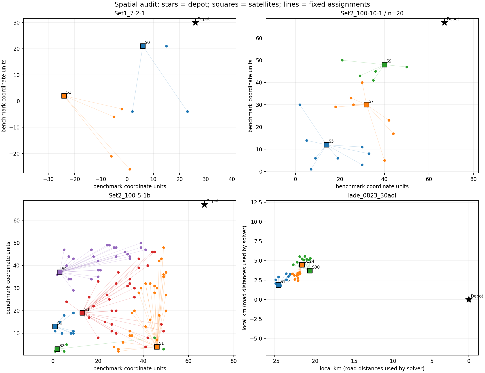
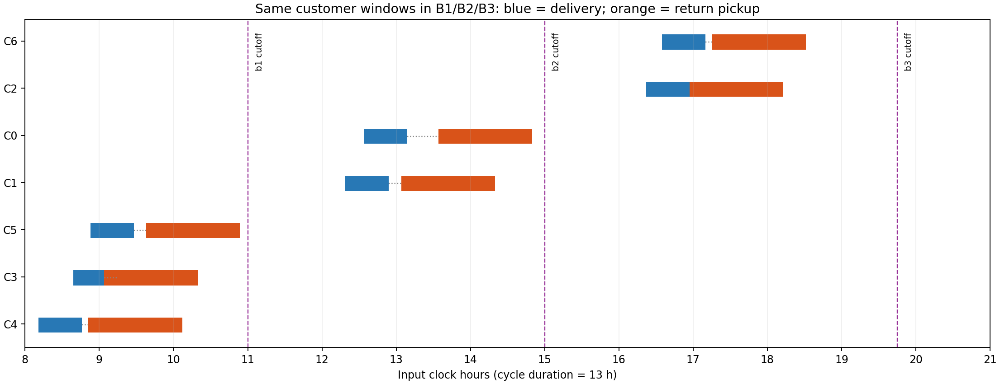

## Material Passport

- Origin Skill: academic-research-suite / experiment-agent
- Origin Mode: validate
- Origin Date: 2026-09-30
- Verification Status: VERIFIED（数据构造、重复生成、独立审计和求解入口；业务参数为情景假设）
- Version Label: static_batch_suite_v2 / operational_scenarios_v2

# 数据集 V2 修订与验收

**现行数据已完成重建并通过验收，可以开展明确假设下的算法对比。** Zhou 继续保留小型 7/10/12、中型 20/30、大型 50/100 顾客，每档 10 例；共 70 个 B1 算例和 140 个 B2/B3 配置。加上 LaDe 21 组及机制 2 组，合计 93 组、279 个配置。

业务暂按“当天配送周转箱、顾客卸货或短时使用后交回、清洗后供后续批次使用”的研究情景处理。20–60 分钟使用时长、车辆及清洗参数均为公开假设，不冒充实测。它适用于检验日内周转机制；消费包装长期持有或跨日归还需要另外校准。

活动输入入口是 [data/README.md](../data/README.md)，参数集中在 [static_batch_v2.json](../config/datasets/static_batch_v2.json)。[原审查报告](dataset_design_review_20260930.md) 的数字属于 V1，不能再描述当前输入。

## 1. 已完成的修订

| 项目 | V1 问题 | V2 实现与结果 |
| --- | --- | --- |
| 运营周期 | Zhou 37 小时，容易误解为日内运营 | Zhou/LaDe 统一 08:00–21:00；补货阶段 08:00、12:00、16:00；末轮回收截点 19:45，预留回仓与清洗 |
| 仓库布局 | 子集保留全部 5/10 个仓，22 个 Zhou 情景有空仓 | 按规模保留 2/2/2/3/3/4/5 个来源仓；公开距离与分区规则，70 个情景均无空仓；坐标不挪动 |
| 二级车辆 | 100 顾客配 125–250 辆 | 同档固定资源，100 顾客为 25 辆；不按每例订单数自动扩车 |
| 同源比较 | 第二情景同时改变子集、窗口，有时还改变车队 | 同源两个情景共用子集、分仓、需求阶段、货量、箱数和车队，只改变使用与回收节奏 |
| 跨规模子集 | 20/30/50 的顾客子集不嵌套 | 按同一母例固定哈希排序，20⊂30⊂50⊂100；跨规模仍需控制仓数等变化 |
| Zhou 使用时间 | 100% 被窗口自动满足 | 冗余比例降至 4.98%；约 95.02% 订单的使用时间不再被窗口自动保证 |
| LaDe 时间一致性 | 98.8% 订单的回收窗隐含更早送达期限 | 每单显式配送截止满足最短使用时间与回收截止关系，隐含提前比例为 0 |
| LaDe 第一批 | 114 条订单全部必迟返 | 需求阶段、使用时长和预约延迟分开生成；现行第一批 175 条聚合订单中，单客直达必迟返为 0，47 条窗口允许跨截点选择 |
| 箱池实验 | 只用 N=Q，缺少压力 | N=Q 作为共同参照；多批清单提供最大批需求及 50%/65%/80%/100% Q 的扫描档，保留不可行情形 |
| ALNS 初解 | 单车逐客送取会等待至回收，耽误其他短窗订单 | 加入按容量与重叠预约分组的初解；只读取问题输入，不读取数据生成参考路线 |

“非冗余”表示该约束不由窗口单独推出，不等于它在每个最优解中都取等号。截点敏感性为单客直接回仓检查，联合路径仍需完整审计。

## 2. 空间与资源配置

| Zhou 顾客数 | 每档情景 | 仓数 | 每仓二级车 | 二级车总数 |
| ---: | ---: | ---: | ---: | ---: |
| 7 | 10 | 2 | 1 | 2 |
| 10 | 10 | 2 | 2 | 4 |
| 12 | 10 | 2 | 2 | 4 |
| 20 | 10 | 3 | 2 | 6 |
| 30 | 10 | 3 | 3 | 9 |
| 50 | 10 | 4 | 4 | 16 |
| 100 | 10 | 5 | 5 | 25 |

Zhou 每车体积容量为 6 个基准单位，箱数按 `ceil(来源货量/15)` 映射；例如 7 个顾客可以对应 12 箱需求，不能再直接把顾客数当箱数。顾客服务时间与货量保留来源值，仓服务时间统一 3 分钟，速度为每分钟 2 个基准坐标单位。以上均为情景参数，坐标单位不转称实际公里。

LaDe 使用已有道路矩阵、AOI/日需求与原区域归属，二级车改为 300 kg、1.2 m³，每仓 1 或 2 辆。全周期箱量除以二级车队一次总容量的比例，Zhou 从 8%–30% 提高到约 58%–108%，LaDe 从 2.8%–5.4% 提高到约 74%–109%。这个比例衡量资源供给尺度，不能当作实际路线平均装载率；车辆可以多趟。

一级车仍按仓配置，当前没有刻意设计一级车稀缺。所有模型使用同一候选仓集合；固定分区采用公开的覆盖选择与区域顾客数上限，93.97% 的 Zhou 订单仍归最近仓。自由分仓的收益应解释为解除既定服务分区限制，而非声称真实企业必然允许换仓。

现行 70 个 Zhou 情景来自 20 个来源实例、35 套几何。每档是 5 个来源块×2 个使用时间情景，不是 10 个独立空间样本。LaDe 仍是三套 AOI 布局的七天需求。共址顾客保留为不同订单。

## 3. 时间窗与生成方法

配送窗口约 35 分钟，回收窗口通常约 76 分钟；末轮按回仓截止收紧。短使用情景取 20/30/40 分钟，较长情景取 30/45/60 分钟，预约附加延迟取 0/15/35 分钟，各自使用独立哈希流。

窗口围绕公开的确定性可行构造设置：同仓顾客按固定顺序分为三个需求阶段，按已声明车辆容量组成至多两顾客的参考趟次，先配送再收取。参考路线和用途写入各例 `provenance.json`，供可行性重放；不作为最优解标签，不按 ALNS/精确目标值或求解速度筛选数据。

这种方法保证各字段相容，也会形成已知的预约结构。因此当前是受控的派生基准；正式解释需说明生成方法，并以后续实测窗口做外部检验。LaDe 原配送服务时段及旧回收字段保存在来源资料和溯源记录，当前窗口属于新情景。

同一场景的 B1/B2/B3 保持订单、窗口、使用时间、网络、资源和周期终点一致。B1 在 08:00 一次补货，顾客仍可在日内不同时间收货；B2 在 08:00/16:00 补货；B3 在 08:00/12:00/16:00 补货。模型范围继续是 M1/M2 单批纯配送、M3/M4 单批可循环容器、M5 固定分仓多批容器。





## 4. 有限箱池与运输代价现在能同时观察

LaDe 的 21 组 B2/B3 都已取得必要下界与可行时间表相等的最小箱池证书。现行每组 B3 最小箱池低于 B2，差额为 24–79 箱；V1 两者全部相同。此结论仅针对当前日程、固定分仓与资源，不等于三批总成本更低。

例如同一个 `zhou_Set1_7-2-1`，需求为 12 箱，有限预算精确求解得到：

| 配置 | 使用的箱池 | 已证明最优路线距离（基准单位） |
| --- | ---: | ---: |
| M3，B1 | 12 | 326.3312 |
| M5，B2 | 9 | 479.7756 |
| M5，B3 | 5 | 635.5885 |

这里能观察到“减少箱池、增加补货和回收运输”的取舍。若要判断经济性，还需同口径的容器投入、包装寿命、运输、人工和清洗费用。距离最优不等于费用最优。

Zhou 的 66/70 个 B3 情景仍可由必要下界与构造证明最小箱池，4 个尚存在下上界间隙。箱池阈值本来受批次需求与清洗可用时刻决定，不能把“最小箱数”作为算法优劣的唯一指标。正式比较应在相同 N 下报告路线质量、时间与可行率，再比较不同 N 的资源取舍。

## 5. 已完成的验证

| 验证内容 | 结果 | 证据 |
| --- | --- | --- |
| 输入、配对与周期闭合 | 93 组、279 配置全部通过构造审计及两周期重放 | [设计统计](../output/experiments/dataset_redesign_v2_20260930/accepted_design/metrics.json) |
| 重复生成与统计复算 | 受管数据和生成保护测试通过；两次审查的 CSV/JSON 逐字节一致 | [最终核对记录](../output/experiments/dataset_redesign_v2_20260930/verification.json) |
| M1–M5 公共 ALNS 入口 | 558/558 次初始化可行且通过独立审计 | [入口及有限搜索记录](../output/experiments/dataset_redesign_v2_20260930/integration_final/summary.json) |
| 全池代表性求解 | 64/64 次通过：60 次 ALNS、4 次七顾客 M1–M4 精确求解；四个精确结果均证明最优 | 同上 |
| 有限池代表性求解 | 42 次：33 次有效解，9 次因低于必要箱池下界已证明不可行，0 次未决 | [有限池记录](../output/experiments/dataset_redesign_v2_20260930/pool_smoke/summary.json) |
| M5 小例精确接口 | B2、B3 在各自最小池下均证明路线最优 | 同上 |
| 回归检查 | 344 个测试通过，0 失败、0 错误 | [测试报告](../output/experiments/dataset_redesign_v2_20260930/pytest.xml) |
| 历史保护 | 1167 个 V1 受管文件已归档；1234 个备份文件、36 个来源文件、591 个暂停任务快照文件哈希核对通过 | [备份与验收记录](../output/experiments/dataset_redesign_v2_20260930/verification.json) |

入口初始化使用 0 次搜索迭代；有限搜索使用固定 seed=42，ALNS 最多 1 秒/1000 次迭代，精确求解最多 5 秒。上述为集成验证，不是正式多种子性能实验，更不能据此声称全部中大型精确模型都可快速证明最优。正式实验需另定统一预算。

当前清单 SHA256：`253fccbf665e3822859b07c432f8023a53d68c54166c26ec94ea814ef3ba0cae`。

## 6. 运行与版本管理

```sh
# 单批四模型任务清单：Zhou 70×4=280 项／方法／种子
.venv/bin/python experiments/runs/run_single_batch_exact.py \
  --source-kinds zhou_derived_scenario --dry-run

# 多批箱池扫描预览
.venv/bin/python experiments/runs/run_multibatch_cycle.py \
  --dataset-manifest data/manifest.json --groups multi_batch \
  --source-kinds zhou_derived_scenario --sizes small \
  --suggested-pools --solver alns --dry-run

# 输入与显式时间表审计；输出目录须为空
.venv/bin/python tools/audit/audit_dataset_design.py --output /tmp/static_v2_design_audit

# 公共模型入口与有限搜索检查；输出目录须不存在
.venv/bin/python tools/audit/validate_static_batch_v2.py --output /tmp/static_v2_integration --smoke
```

`config/routing/container_pools.json` 仍提供 N=Q 的共同参照；扫描必须显式使用 `--suggested-pools` 或 `--pool-sizes`，不能只运行默认池就声称已验证有限池。低于必要下界的点应保留为不可行，不自动加箱。ALNS 无解与精确超时无解均不可冒充不可行证明。

正式运行器会冻结输入与源码。V1 和 V2 的案例名称相同，但内容已变，汇总时必须按清单版本和输入哈希分开。暂停中的旧精确任务继续使用其原有冻结输入；本次没有恢复该任务。

本次试制结果保留在 `candidate_*`、`final_design/`、`integration/` 等目录。最终接受的审计为 `accepted_design/`，复算为 `reproduction/`，公共入口结果为 `integration_final/`；不要把早期试制失败或旧清单哈希混入最终结果。初版迁移记录的哈希与最终接受哈希分别留存在 [migration.json](../archive/dataset_design_v2_20260930/migration.json)。

## 7. 证据范围

本次完成的是数据设计修订、可复现生成、模型入口适配与验收。LaDe 仓址仍是代理点，实际使用时长、清洗能力、车辆班次和费用仍需企业资料；当前费用模块的演示参数不能作为实际经济性证明。

沿用原审查的 11 项统计解释检查并针对 V2复核：按来源/顾客规模分层；AOI 不外推为个体行为；限定来源与高量 AOI 的选择范围明确；不按求解成功筛选；给出原始分母；没有极端组前后改善推断；全部失败与不可行记录保留；没有显著性检验；生成参数与开发版本留存；不作现实因果推断；不根据模型优势反向选择案例。同源情景和算法种子不当成独立空间样本。
