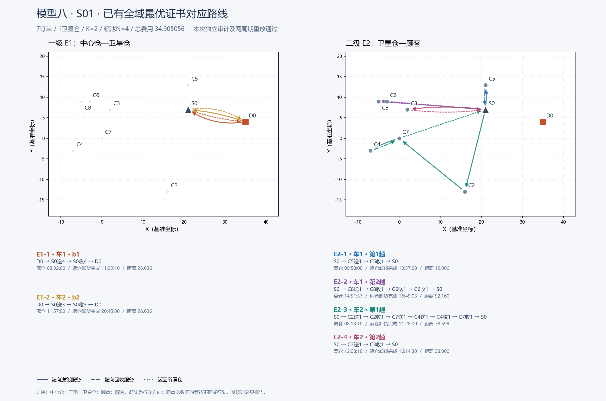

# 模型八 S01：精确解路线检查

七个订单，K=2，箱池N=4，总费用 **34.905055669**。展示此前已有全域最优证书对应的原始路线，本次重新读取原始输入并审计，未重新运行优化、未增加种子。

D0为中心仓，S0为卫星仓，C编号为顾客；“送/收”为服务开始，所有时刻均为当日HH:MM:SS。展示车辆编号从1开始，原JSON从0开始；表中返仓时刻包括卸货完成。

| 批次 | 开始装载 | 回收截点 | 批次结束 | 订单 | 用箱 |
| --- | --- | --- | --- | --- | ---: |
| b1 | 08:00:00 | 11:28:00 | 11:55:00 | C2, C4, C5, C7 | 4 |
| b2 | 11:55:00 | 20:33:00 | 21:00:00 | C3, C6, C8 | 3 |

## 逐趟路线

| 路线 | 车辆 | 离仓 | 访问顺序 | 返仓卸货完成 | 距离 |
| --- | --- | --- | --- | --- | ---: |
| E1-1 | 车1 | 08:02:00 | D0 → S0送4（08:09:10） → S0收4（11:28:00） → D0 | 11:39:10 | 28.635642 |
| E1-2 | 车2 | 11:57:00 | D0 → S0送3（12:04:10） → S0收3（20:33:50） → D0 | 20:45:00 | 28.635642 |
| E2-1 | 车1 | 09:50:00 | S0 → C5送1（09:53:00） → C5收1（10:23:00） → S0 | 10:37:00 | 12.000000 |
| E2-2 | 车1 | 14:51:57 | S0 → C8送1（15:05:00） → C8收1（15:35:00） → C6送1（15:46:00） → C6收1（16:26:00） → S0 | 16:49:03 | 52.159999 |
| E2-3 | 车2 | 08:13:10 | S0 → C2送1（08:35:00） → C2收1（09:05:00） → C7送1（09:25:19） → C4送1（09:39:08） → C4收1（10:09:08） → C7收1（11:05:55） → S0 | 11:28:00 | 78.598546 |
| E2-4 | 车2 | 12:08:10 | S0 → C3送1（15:14:00） → C3收1（15:54:00） → S0 | 16:14:30 | 38.000000 |

## 容量、时间窗与复用

| 路线 | 峰值重量 / 容量 | 峰值体积 / 容量 |
| --- | ---: | ---: |
| E1-1 | 58 / 200 | 4 / 10 |
| E1-2 | 66 / 200 | 3 / 10 |
| E2-1 | 12 / 60 | 1 / 3 |
| E2-2 | 44 / 60 | 2 / 3 |
| E2-3 | 46 / 60 | 3 / 3 |
| E2-4 | 22 / 60 | 1 / 3 |

| 顾客 | 送货开始 | 配送窗 | 回收开始 | 回收窗 | 送货服务完成至回收 / 最小使用时间（分钟） |
| --- | --- | --- | --- | --- | ---: |
| C2 | 08:35:00 | 08:35:00–09:50:00 | 09:05:00 | 09:05:00–11:00:00 | 20.00 / 20 |
| C3 | 15:14:00 | 15:14:00–16:29:00 | 15:54:00 | 15:54:00–17:39:00 | 30.00 / 30 |
| C4 | 09:39:08 | 08:35:00–09:50:00 | 10:09:08 | 09:05:00–11:00:00 | 20.00 / 20 |
| C5 | 09:53:00 | 08:38:00–09:53:00 | 10:23:00 | 09:08:00–11:03:00 | 20.00 / 20 |
| C6 | 15:46:00 | 15:15:00–16:30:00 | 16:26:00 | 15:55:00–17:40:00 | 30.00 / 30 |
| C7 | 09:25:19 | 08:41:00–09:56:00 | 11:05:55 | 09:11:00–11:06:00 | 90.60 / 20 |
| C8 | 15:05:00 | 15:05:00–16:20:00 | 15:35:00 | 15:35:00–17:30:00 | 20.00 / 20 |

箱池复用：08:00装载4箱；第一批回收4箱于11:39:10完成总仓卸货，15分钟清洗后11:54:10可用；第二批11:55装载3箱，仍余1箱。第二批3箱20:45回仓卸货完成，21:00清洗结束，全4箱回到可用状态。第一批清洗与第二批装载之间有50秒余量。

独立完整审计：**True**；两周期审计：**True**。另逐段检查24段行驶、7个订单时间窗/送收先后及6趟车的容量与同车占用，未发现违反。

## 为什么路线看起来可能不合理

一级车送达S0后可停在原地等待回收：E1-1在08:12:10完成交付，却等到11:28才开始收箱；E1-2在12:07:10交付完，20:33:50才开始收箱。原计划占用了两辆一级车，未越过车队数量或车辆时间限制。

E2-4于12:08:10离开S0，按直达行驶最早12:17:40到C3，而其配送窗从15:14才开始，存在至少2小时56分20秒的可用等待量。这里按“到达后等到服务开始”解释；原JSON没有单独保存停车位置，等待也可以分配在服务前的途中。

当前费用为 **0.1×E1距离 + 0.05×E2距离 + 5×箱池 + 0.01×使用箱数（清洗） + 0.01×使用箱数（磨损）**。工作时间、等待时间、车辆固定费用和趟次费用系数均为0。因此长等待和多用一辆已配置车辆不会增加目标值；满足现有模型的最优路线可以包含这些行为。若业务要求送货后立即返仓、限制等待，或按占用时间收费，需要明确加入相应规则。

“同一顾客连续送、收”表示送货服务后等待客户使用完再回收，并非零时间完成。地图没有为同地点等待绘制虚假行驶弧。距离采用基准坐标单位，不代表真实道路公里。

## 费用与最优性记录

E1距离 57.271284253，E2距离 180.758544867；箱池20 + E1运费5.727128425 + E2运费9.037927243 + 清洗0.07 + 磨损0.07 = **34.905055669**。费用单位为合成单位。

原始路线文件 `info.status=TIME_LIMIT`、`info.proven_optimal=false` 保留了早期固定K求解的原生记录，其原生MIP GAP约54.89%。后续全域证书保存在 `external_global_optimality_certificate`，全K=1…7的下界为 34.905055669，与当前重新审计的可行费用相等，才构成全局最优性证明。这两套状态代表不同阶段，不能把早期原生状态当作后续证书状态。本次核对证据文件SHA256及费用一致性，没有重新求解下界，也没有改写任何旧记录。

此前2.615秒是使用历史可行方案后重建下界的证明时间，不是冷启动产生这条路线的耗时。

原始方案副本：[original_certified_solution.json](original_certified_solution.json)；本次完整审计：[audit.json](audit.json)；逐段与容量检查：[review.json](review.json)。
