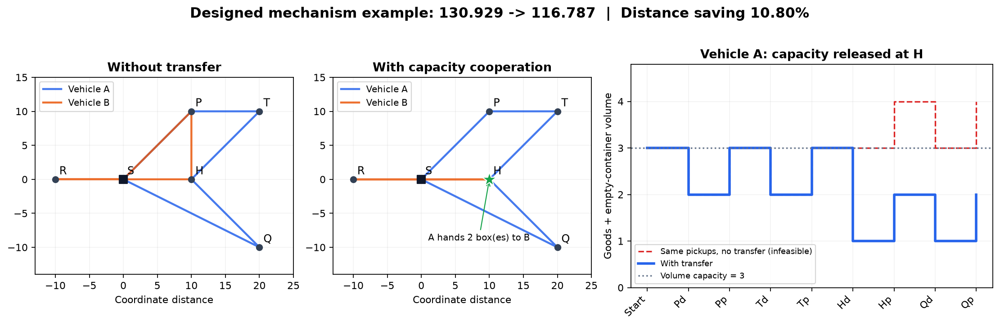

# M8 v2 实验结论

## Material Passport

- 状态：实际运行结果；2026-09-22。
- 完整实验表与证明状态：[report.md](report.md)；原始结果：[summary.json](summary.json)。
- 四个案例：两个容量机制构造情景、两个未经修改的 Zhou 标准当日回收实例。
- 每个启发式分支 20 秒，种子 42、7、19；原始 100/200 实例复用旧 M8 的同一基础解。
- 目标单位为坐标距离，不应直接称为真实公里。

## 结论

容量释放的机制已得到小规模精确验证：无交接最优 130.929222，允许交接最优 116.787087，净节省 14.142136（10.8014%）。两种条件问题均已证明最优，基础 M3 也已证明最优；三次启发式均达到相同距离。

体积容量从 3 放宽至 4 后，无交接与交接的条件最优值均为 116.787087；交接增量收益为 0.000000。这个对照表明构造例的收益依赖容量瓶颈，不能将其 10.8% 推广到原始数据。

| 原始实例 | 基础距离 | 禁止交接最好距离（3种子） | 允许交接最好距离（3种子） | 最好解交接数 |
|---|---:|---:|---:|---:|
| Set2_100-10-1 | 1449.239074 | 1449.239074 | 1449.239074 | 0 |
| Set2_200-10-1 | 2157.073012 | 2156.422731 | 2157.073012 | 0 |

这轮两个原始大规模实例均未发现优于基础解的传递解。200 客户禁止交接的一个种子通过普通回收调整节省 0.650282（约 0.0301%），不能归因于空箱传递。100 客户基础解已证明最优，200 客户基础解仅为最好已知可行解。

大实例允许交接分支在每次 20 秒内完成 2,573–5,977 次搜索，进程峰值内存约 30.4–33.1 MiB。旧 M8 的 200 客户修复仅建模就约 30 秒，因此本次解决了该建模开销问题；算法、预算和实现不同，不据此声称同算法的严格加速比。

## 可行性与验证

- 重新读取并独立复核了 28 个保存的第二阶段解，全部通过任务覆盖、配送承诺、重量/体积、O/R 流、一次交接、时间窗与两级同步检查，见 [verification.json](verification.json)。
- 相关测试 33 项通过，覆盖新版 M8、旧版 M8 复现及 M6 精确/ALNS 回归。
- 新版精确与 ALNS 的统一 CLI 均已在 7 客户标准实例跑通；精确距离 337.617968，无改善。
- 禁用 Gurobi 导入时，新版第二阶段仍可找到构造例的 116.787087 解。

## 机制图

左图：原 B 为取 P 的空箱绕行；中图：A 顺路代取后在 H 交给 B；右图：同样的任务重分配若不交接，A 会超过体积容量。图中交接数量来自保存的精确解；该例转移 1 箱或 2 箱可得到相同最短距离，启发式优先使用最少可行数量。

## 适用范围

新版仍限制 E1 和配送骨架。启发式单次移动至多 3 个回收任务、只新增一次两车交接，插入顺序和交接点均经过候选截断。零改善只说明这些预算和邻域内没有找到更好的最终解，不构成大实例无交接价值的最优性证明。未通过放宽容量、时间窗或新增费用制造原始实例收益。

## 附加时序诊断（单独 5 秒，不合并主实验）

- Set2_100-10-1：种子42，1532次迭代；1213个含交接的候选因时间窗/两级衔接被拒绝。详见 [diagnostic.json](diagnostic.json)。
- Set2_200-10-1：种子42，740次迭代；1159个含交接的候选因时间窗/两级衔接被拒绝。详见 [diagnostic.json](diagnostic.json)。

这些计数只描述此次已被生成并审计的候选，不代表所有潜在方案；说明后续应关注容量释放与时间窗口是否同时匹配，不能只依据空间靠近或剩余容量判断。
