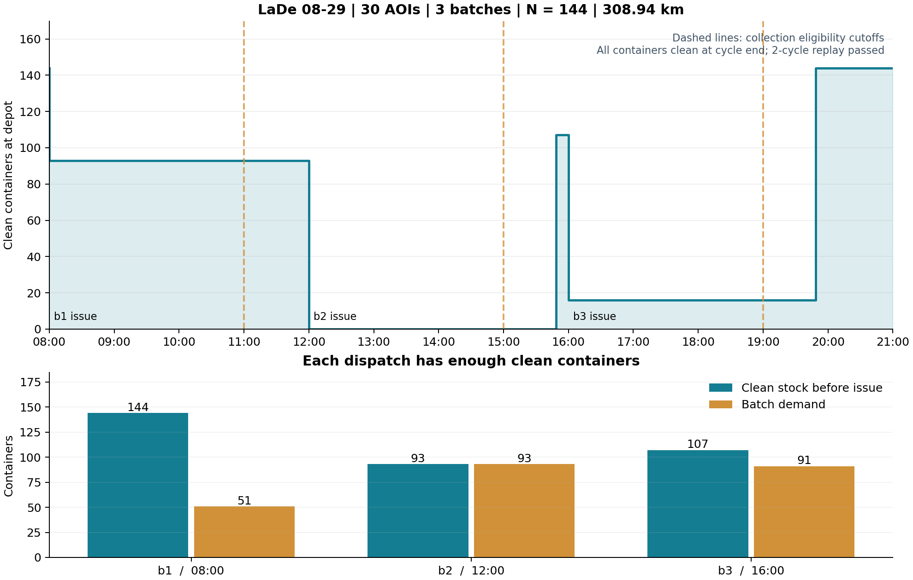
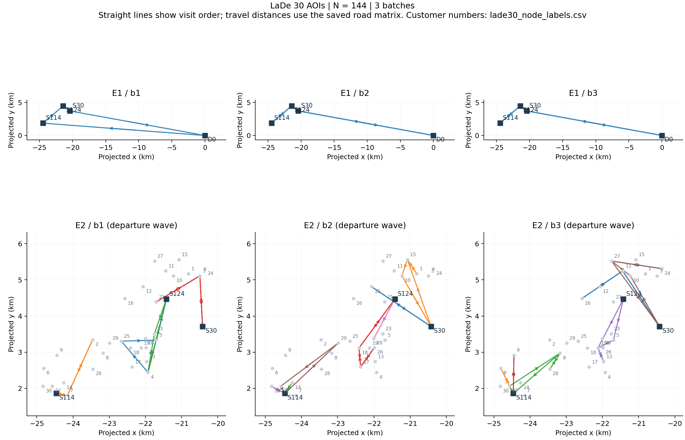

新数据集代表算例：求解试跑结果

Material Passport：Origin Skill = academic-research-suite / experiment-agent；Origin Mode = run；Verification Status = VERIFIED（本次已保存结果逐一重审通过；研究结论范围为短预算代表样本）。

2026-09-29。先校验 static_suite_v1 的 870 个文件哈希和 69 组配对，再选 6 组代表数据；不是对 207 个配置做全量评测。
每组比较 B=1 与 B=3，ALNS 单次 5 秒、最多 5000 次迭代、种子 42；7 顾客小例另用 MILP 单次 30 秒参考。
初轮使用数据集建议池网格，随后根据初轮必要池下界及有效时间表另声明 7 个 N 值；两份计划及每次源码/输入快照均保留。
共 33 次运行，27 个有效解全部再次通过独立审计与连续两周期重放。状态：{"FEASIBLE": 25, "INFEASIBLE": 6, "OPTIMAL": 2}。

容器池结果（“已测最小”是本次试跑找到的最小可行测试 N）：

| 数据 | 单批池 N=Q | 三批已测最小 N | 必要下界 | 最小池已证明 | 池减少 | 三批该方案距离 |
| --- | ---: | ---: | ---: | --- | ---: | ---: |
| Zhou 小型 · 7 顾客 | 7 | 3 | 3 | 是 | 57.1% | 693.593 坐标单位 |
| Zhou 中型 · 50 顾客 | 50 | 23 | 23 | 是 | 54.0% | 3142.159 坐标单位 |
| Zhou 大型 · 200 顾客 | 200 | 90 | 90 | 是 | 55.0% | 6649.790 坐标单位 |
| LaDe 小型 · 10 AOI | 116 | 87 | 87 | 是 | 25.0% | 232.142 km |
| LaDe 中型 · 20 AOI | 178 | 135 | 135 | 是 | 24.2% | 273.516 km |
| LaDe 大型 · 30 AOI | 235 | 144 | 144 | 是 | 38.7% | 308.939 km |

这里的“池减少”比较资源数量，不等于费用下降。最小池证明仅在实际有效解与必要下界闭合时成立，范围包含本版固定日程、时间精度及趟次上限。

相同 N=Q 下的单批/三批距离（ALNS，同一个种子和求解预算）：

| 数据 | B=1 距离 | B=3 距离 | 单位 |
| --- | ---: | ---: | --- |
| Zhou 小型 · 7 顾客 | 299.143 | 635.452 | 坐标单位 |
| Zhou 中型 · 50 顾客 | 1751.376 | 3086.247 | 坐标单位 |
| Zhou 大型 · 200 顾客 | 4302.445 | 6542.663 | 坐标单位 |
| LaDe 小型 · 10 AOI | 102.373 | 233.360 | km |
| LaDe 中型 · 20 AOI | 128.892 | 268.624 | km |
| LaDe 大型 · 30 AOI | 174.680 | 347.066 | km |

本轮部分 ALNS 方案在较大 N 下距离反而更长，这是短预算启发式搜索所得解的差异，不能解释为扩大容器池会提高数学最优成本。

7 顾客精确参考（N=7）：

| 批次 | MILP 状态 | 距离 | 已证距离最优 |
| --- | --- | ---: | --- |
| 1 | OPTIMAL | 299.143031 | True |
| 3 | OPTIMAL | 635.452399 | True |

LaDe 30 AOI 三批方案详情：

使用 N=144，全周期需求 Q=235 箱次，总距离 308.939 km；一级 2 辆/3 趟，二级 14 辆/17 趟。
[完整结果 JSON](refine_lade_0829_30aoi/000_lade_0829_30aoi_b3_N144_alns_seed42/result.json) · [逐趟路线 CSV](lade30_routes.csv) · [逐批库存 CSV](lade30_clean_stock.csv)

| 批次 | 领箱时刻 | 清洁库存 | 本批需求 | 领用后剩余 |
| --- | --- | ---: | ---: | ---: |
| b1 | 08:00 | 144 | 51 | 93 |
| b2 | 12:00 | 93 | 93 | 0 |
| b3 | 16:00 | 107 | 91 | 16 |

路线图用地点间直线表达访问顺序；距离按保存的道路矩阵计算，图中折线不是实际道路轨迹。

[全部运行与失败记录](all_runs.csv) · [六组汇总](summary.csv) · [初轮计划](trial_plan.json) · [补充池测试计划](refinement_plan.json)

范围：Zhou 是重设窗口的派生场景，距离为坐标单位；LaDe 是真实配送基础上的情景，容器回收、清洗和车队不是现场实测。本轮只用一个随机种子和短预算，未开展正式算法评测或费用比较。
