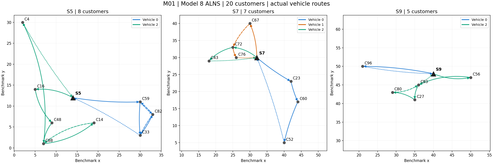
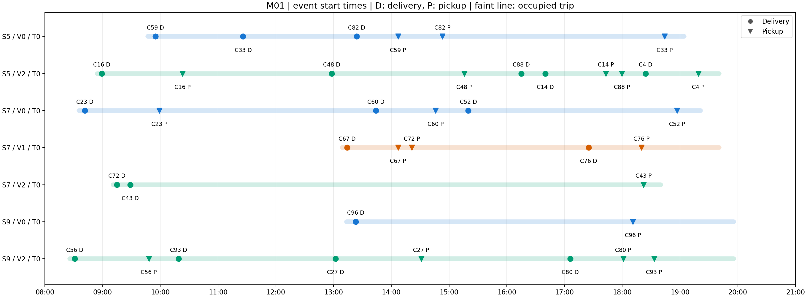

# M01：模型8 ALNS 实际路线

20位顾客，最新中规模车辆配置。仅运行ALNS，预算30秒，seed=42，候选K=1～20。使用项目ALNS-only入口，未完成Gurobi许可证验证，未运行本模型的精确求解。
状态：FEASIBLE；成本：134.2028（合成算例单位）；耗时：30.011秒；K=1，N=20。
总距离：519.7186（算例坐标单位）。实际一级车1辆/1趟；二级车7辆/7趟。
独立重放检查时间窗、最低使用时间、车辆衔接、载重、体积、箱量守恒、清洗和连续两个周期，均通过。
这是一个种子的一次可行解，不声明最优。所有任务时间均为服务开始时间。

## 一级路线

- 车1：总仓(08:02:00) → S9送5箱(08:18:31) → S7送7箱(08:31:22) → S5送8箱(08:47:06) → S5取8箱(19:55:53) → S7取7箱(20:11:37) → S9取5箱(20:24:28) → 总仓卸完(20:44:59)。

## 二级路线

每条路线均从所属站出发并返回；车辆编号在每个站内单独计数。

| 配送站 | 车辆/趟次 | 出发 | 返回卸完 | 送取顺序 | 最大载重/100 | 最大体积/5 |
| --- | --- | --- | --- | --- | ---: | ---: |
| S5 | 0/0 | 09:46:59 | 19:04:11 | C59送 → C33送 → C82送 → C59取 → C82取 → C33取 | 45.0 | 3.0 |
| S5 | 2/0 | 08:54:23 | 19:40:49 | C16送 → C16取 → C48送 → C48取 → C88送 → C14送 → C14取 → C88取 → C4送 → C4取 | 96.0 | 5.0 |
| S7 | 0/0 | 08:35:22 | 19:21:08 | C23送 → C23取 → C60送 → C60取 → C52送 → C52取 | 56.0 | 3.0 |
| S7 | 1/0 | 13:08:54 | 19:40:49 | C67送 → C67取 → C72取 → C76送 → C76取 | 28.0 | 3.0 |
| S7 | 2/0 | 09:10:58 | 18:40:02 | C72送 → C43送 → C43取 | 33.0 | 2.0 |
| S9 | 0/0 | 13:13:26 | 19:55:53 | C96送 → C96取 | 19.0 | 1.0 |
| S9 | 2/0 | 08:25:58 | 19:55:53 | C56送 → C56取 → C93送 → C27送 → C27取 → C80送 → C80取 → C93取 | 71.0 | 4.0 |

## 跨车辆送取

- C72：S7车2配送，车1回收。

## 逐任务时间表

| 站点 | 车辆 | 趟次 | 顺序 | 顾客 | 任务 | 开始时间 |
| --- | ---: | ---: | ---: | --- | --- | --- |
| S5 | 0 | 0 | 1 | C59 | 配送 | 09:55:00 |
| S5 | 0 | 0 | 2 | C33 | 配送 | 11:26:00 |
| S5 | 0 | 0 | 3 | C82 | 配送 | 13:24:00 |
| S5 | 0 | 0 | 4 | C59 | 回收 | 14:07:00 |
| S5 | 0 | 0 | 5 | C82 | 回收 | 14:53:00 |
| S5 | 0 | 0 | 6 | C33 | 回收 | 18:44:00 |
| S5 | 2 | 0 | 1 | C16 | 配送 | 08:59:00 |
| S5 | 2 | 0 | 2 | C16 | 回收 | 10:23:00 |
| S5 | 2 | 0 | 3 | C48 | 配送 | 12:58:00 |
| S5 | 2 | 0 | 4 | C48 | 回收 | 15:16:00 |
| S5 | 2 | 0 | 5 | C88 | 配送 | 16:15:00 |
| S5 | 2 | 0 | 6 | C14 | 配送 | 16:40:00 |
| S5 | 2 | 0 | 7 | C14 | 回收 | 17:43:00 |
| S5 | 2 | 0 | 8 | C88 | 回收 | 17:59:30 |
| S5 | 2 | 0 | 9 | C4 | 配送 | 18:24:13 |
| S5 | 2 | 0 | 10 | C4 | 回收 | 19:19:00 |
| S7 | 0 | 0 | 1 | C23 | 配送 | 08:41:29 |
| S7 | 0 | 0 | 2 | C23 | 回收 | 09:59:00 |
| S7 | 0 | 0 | 3 | C60 | 配送 | 13:44:00 |
| S7 | 0 | 0 | 4 | C60 | 回收 | 14:46:00 |
| S7 | 0 | 0 | 5 | C52 | 配送 | 15:20:00 |
| S7 | 0 | 0 | 6 | C52 | 回收 | 18:57:00 |
| S7 | 1 | 0 | 1 | C67 | 配送 | 13:14:00 |
| S7 | 1 | 0 | 2 | C67 | 回收 | 14:07:00 |
| S7 | 1 | 0 | 3 | C72 | 回收 | 14:21:19 |
| S7 | 1 | 0 | 4 | C76 | 配送 | 17:25:00 |
| S7 | 1 | 0 | 5 | C76 | 回收 | 18:20:00 |
| S7 | 2 | 0 | 1 | C72 | 配送 | 09:14:47 |
| S7 | 2 | 0 | 2 | C43 | 配送 | 09:28:49 |
| S7 | 2 | 0 | 3 | C43 | 回收 | 18:22:00 |
| S9 | 0 | 0 | 1 | C96 | 配送 | 13:23:00 |
| S9 | 0 | 0 | 2 | C96 | 回收 | 18:11:00 |
| S9 | 2 | 0 | 1 | C56 | 配送 | 08:31:00 |
| S9 | 2 | 0 | 2 | C56 | 回收 | 09:48:00 |
| S9 | 2 | 0 | 3 | C93 | 配送 | 10:19:00 |
| S9 | 2 | 0 | 4 | C27 | 配送 | 13:02:00 |
| S9 | 2 | 0 | 5 | C27 | 回收 | 14:31:00 |
| S9 | 2 | 0 | 6 | C80 | 配送 | 17:06:00 |
| S9 | 2 | 0 | 7 | C80 | 回收 | 18:01:00 |
| S9 | 2 | 0 | 8 | C93 | 回收 | 18:33:00 |

车辆等待与工时费用仍为0，因此部分路线含较长等待。路线中的相邻送取任务不表示立即回收。
图中D=配送，P=回收；空间图的实线终点为配送、虚线终点为回收，路线文字顺序和时间表为准。

