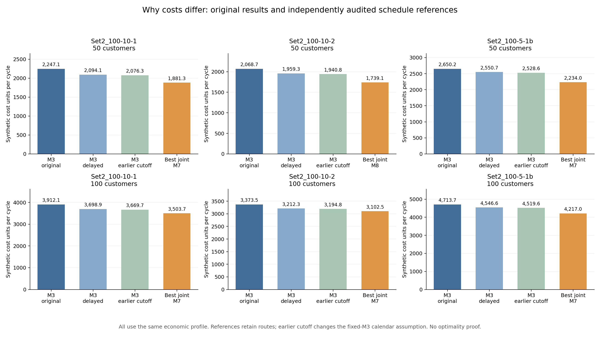

# 大规模成本差距的原因分析

基于原注册的六例、单种子42、300秒方案分析。所有完整周期为780分钟；价格参数保持原共同哈希。原始试验方案和费用没有改写。

主要观察：相对单批次模型3，六例本轮联合模型最低费用方案的优势主要来自占用工时，而非箱池；其中五例距离费用反而高于模型3。相对固定三批次模型5，距离和工时共同降低，批次合并减少了重复供货、回收线路的费用。

当前模型3、5以距离为目标，模型6–8以完整周期成本为目标；同一个批次数不等于同一套路线、车数、任务顺序、发车时刻或回收分界。一个批次也不等于车辆只跑一趟。

## 第一组50点：M3与M7的原始差距

| 项目 | M3 | M7 | M3费用减M7费用（正数为节省） |
|---|---:|---:|---:|
| 箱池 | 390.00 | 390.00 | 0.00 |
| 距离 | 839.55 | 873.32 | -33.77 |
| 占用工时 | 864.55 | 485.98 | 378.57 |
| 车辆 | 95.00 | 75.00 | 20.00 |
| 趟次 | 19.00 | 18.00 | 1.00 |
| 清洗、追踪、磨损 | 39.00 | 39.00 | 0.00 |
| 总成本 | 2247.10 | 1881.30 | 365.80 |

工时指各车各趟的占用分钟之和，包括路线内等待，不能当成完整周期长度。M3总占用8645.53车分钟，M7为4859.80车分钟；单价同为0.1。M3一级车2台、二级车15台，M7分别为1台、13台。M3一级车固定等到19:55才回收，M7在18:26:17的优化分界后回收。

## 六例相对M3的原始费用分解

| 算例 | 本轮联合最低 | 距离节省 | 工时节省 | 车辆节省 | 趟次节省 | 箱池节省 | 总节省 |
|---|---|---:|---:|---:|---:|---:|---:|
| zhou_Set2_100-10-1_subset50 | M7 | -33.77 | 378.57 | 20.00 | 1.00 | 0.00 | 365.80 |
| zhou_Set2_100-10-1 | M7 | -354.73 | 738.17 | 30.00 | -5.00 | 0.00 | 408.43 |
| zhou_Set2_100-10-2_subset50 | M8 | -50.48 | 356.09 | 25.00 | -1.00 | 0.00 | 329.61 |
| zhou_Set2_100-10-2 | M7 | -362.77 | 620.72 | 20.00 | -7.00 | 0.00 | 270.95 |
| zhou_Set2_100-5-1b_subset50 | M7 | 25.18 | 359.00 | 30.00 | 2.00 | 0.00 | 416.18 |
| zhou_Set2_100-5-1b | M7 | -103.48 | 579.22 | 25.00 | -4.00 | 0.00 | 496.74 |

## 需要统一的发车后处理

冻结源码显示，联合模型的 `JointEvaluator` 会对每个候选调用 `_delay_departures`，把到第一位客户服务前的等待移到前置仓；模型3、5的距离求解没有同样调用。相同单价并不足以消除这种方案处理差异。当前成本按占用路线时间计费，仓内等待不计入路线时间，所以只调整发车时刻也可以降低计价。它没有减少客户的使用时间，也没有改变订单时间窗。

为量化影响，对30个原方案统一执行该后处理。所有路线、客户服务时刻、回程时刻、箱池、车辆编号和分界保持原值，只有二级车出发时间推迟；30个派生方案全部独立重放两个周期通过。模型6–8费用不变，模型3六例降低99.48–213.20，模型5降低16.51–48.31。

这项处理消除了相对原M3总节省的23.90%–59.50%。相对M3的逐例降幅从原来的8.03%–16.28%变为统一发车处理后的3.42%–12.42%。因此原始降幅不能全部归因于模型结构。

| 算例 | 原M3 | M3统一发车处理 | 原M5 | M5统一发车处理 | 联合最低费用 | 相对调整后M3降低 |
|---|---:|---:|---:|---:|---:|---:|
| zhou_Set2_100-10-1_subset50 | 2247.10 | 2094.07 | 2673.00 | 2656.49 | 1881.30 | 10.16% |
| zhou_Set2_100-10-1 | 3912.09 | 3698.89 | 4314.38 | 4268.15 | 3503.66 | 5.28% |
| zhou_Set2_100-10-2_subset50 | 2068.74 | 1959.26 | 2537.01 | 2512.55 | 1739.13 | 11.24% |
| zhou_Set2_100-10-2 | 3373.49 | 3212.28 | 3718.08 | 3669.77 | 3102.54 | 3.42% |
| zhou_Set2_100-5-1b_subset50 | 2650.21 | 2550.73 | 3160.78 | 3135.08 | 2234.03 | 12.42% |
| zhou_Set2_100-5-1b | 4713.70 | 4546.64 | 5099.27 | 5069.18 | 4216.96 | 7.25% |

M5进一步按原时间表审计的最低箱池计价后，联合最低方案的逐例优势仍为14.41%–29.80%。这仍是方案比较，非全局最优或总体收益证明。

## 单独提前M3分界的诊断参考

为区分分界与线路变化，另对6个M3调整后方案把分界提前到其最后一趟二级空箱回前置仓时刻，一级回收事件及回库时刻平移相同时间，其余路线、客户事件、二级返回时刻和箱池不变。六例均独立双周期审计通过。这会改变M3原本固定分界的假设，因此只能列为诊断参考，不能替换原M3。

| 算例 | 已统一发车的M3 | 再提前分界的参考 | 分界单独节省 | 联合最低费用 |
|---|---:|---:|---:|---:|
| zhou_Set2_100-10-1_subset50 | 2094.07 | 2076.33 | 17.74 | 1881.30 |
| zhou_Set2_100-10-1 | 3698.89 | 3669.67 | 29.23 | 3503.66 |
| zhou_Set2_100-10-2_subset50 | 1959.26 | 1940.82 | 18.44 | 1739.13 |
| zhou_Set2_100-10-2 | 3212.28 | 3194.78 | 17.50 | 3102.54 |
| zhou_Set2_100-5-1b_subset50 | 2550.73 | 2528.55 | 22.18 | 2234.03 |
| zhou_Set2_100-5-1b | 4546.64 | 4519.59 | 27.05 | 4216.96 |

第一组50点原M3与M7差365.80，其中统一发车处理153.03、保持路线仅提前分界17.74、余下方案差距195.03。余下差距涉及线路、任务排序、车辆数、路线内等待及搜索结果，不能解释成箱池节省。其他案例分界参考可能与联合方案分界不同，这些诊断步骤不能当作严格的全局因果分解。

## M5与M6–8，以及M6–8之间的解释

模型5仍固定三批，不属于同一批次结构。以第一组50点M5与M7为例，791.70的总节省包括距离658.06、占用工时81.64、车辆45和趟次7；一级趟次从6降为1，一级距离费用从823.53降为225.61。箱池费用均390，箱池并未贡献这次差距。

M6–8真正K=1时日历可行域的区别消失，成本差主要反映启发式路线和调度搜索结果，不能用本轮排名证明M7独立分界或M8不等长批次的机制收益。M8有一例K=2仅一批配送，仍保留空段导致的供货起点变化，不能完全等同于K=1。

## 结论的范围

当前没有发现成本公式使用错误箱池的证据，但发现了需要对齐的发车后处理。原结果可作为各实现输出的方案记录；要作为模型结构优势比较，应同时报告统一后处理的基准结果。原始固定分界模型与可优化分界模型应继续区别标注。

本分析不是新的ALNS试验，没有重跑或重新优化路线。派生方案均沿用原共同费用参数且通过独立双周期重放。费用为合成单位，工时收益依赖当前按占用路线时间计价的规则，并非全天固定工资的节省。只有一个随机种子，没有最优性证明。

数据：analysis.json；派生方案、审计和费用：references/；生成脚本位于上级目录。

