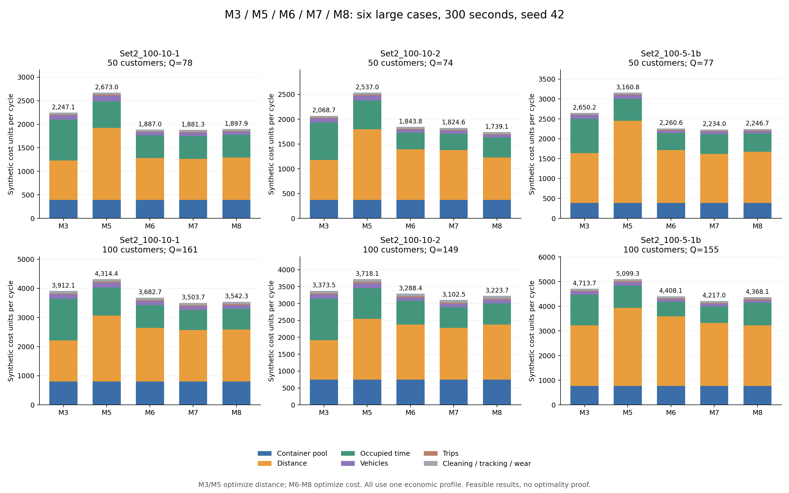

# 五分钟大规模模型 3、5、6、7、8 成本对比

三张预先选定的 Zhou 底图，各使用 50 点子集和完整 100 点，共六个 spread_medium 算例。每模型每例 ALNS 300 秒，seed=42，最多 1000000 次迭代，四个并发进程。模型 6–8 的总预算在 K=1/2/3 间共享。

运行日期：2026-10-06；共 30/30 次，独立审计通过 30 次。成本参数与前两轮完全相同，哈希 `a931fc2c3f0793d8fc7c0505866471c64335a681ba5b5133d17a8384cfae2ead`。

追加费用分析发现：模型6–8会统一推迟二级车发车以消除第一位客户服务前的路线内等待，模型3、5没有同样的后处理。对30个方案统一该处理、保持路线及客户服务时刻不变后，派生方案均通过双周期核验；相对模型3的逐例费用优势由原始8.03%–16.28%变为3.42%–12.42%。下表仍保留原注册方案，原始差距不能全部归因于模型结构。详见 [成本原因与统一处理后的参考](cost_analysis/report.md)。

## 本轮观察

模型7在六例中的五例取得本轮最低周期成本，模型8在 `zhou_Set2_100-10-2_subset50` 取得最低成本。逐例最低成本相对模型3降低 8.03%–16.28%，相对模型5降低 16.56%–31.45%。这是本轮可行方案的比较，不能据此判定全局最优或模型的普遍排名。

与上一轮相同算例、相同种子的60秒结果配对，八组中六组成本下降（0.22%–8.10%）、两组上升（M5的50点例上升2.30%，M6的100点例上升3.56%）。M5优化距离，距离改善也未必降低周期成本。不同预算会改变搜索轨迹，且本轮四进程与上一轮两进程的机器负载不同；这些配对结果不构成严格的收敛或速度证明。

本轮模型6、7全部选 K=1，模型8五例选 K=1，另一例选 K=2 但只有一批实际配送。各例模型6–8的箱池均等于需求箱次。因此，尚未观察到通过多批配送复用降低箱池的效果，也不能把模型7、8的成本优势归因于独立分界或不等长批次机制。

## 箱池相同是否意味着没有优化

需要区分固定箱池和最终选中的箱池。模型3、5本轮优化距离，箱池固定为输入需求箱次；模型6–8的输入范围均为 `pool_min=1`、`pool_max=Q`，没有把箱池上下界锁成同一个数。ALNS对每个解码后的方案计算库存审计所需的最小箱池，并把每箱每周期5的费用纳入总成本。箱池通过订单分批、日历分界、回收和清洗时间间接优化，而不是只修改一个箱数参数。

六例、三个联合模型、K=1/2/3共保存54个分批候选结果，求解器均标记可行，其中13个的箱池小于需求箱次Q；这些少箱方案的总成本都高于各自最终选中的方案。54个候选的可行性是求解器审计记录，另行独立审计的是30个最终方案。详见 `pool_diagnostics.json` 和原始 `result.json` 的 `count_search`。

以 `zhou_Set2_100-10-1_subset50` 的模型6为例：

| 保存的候选 | 箱池 | 箱池成本 | 周期总成本 |
|---|---:|---:|---:|
| K=1，最终选择 | 78 | 390 | 1,887.00 |
| K=3，未被选择 | 72 | 360 | 2,384.67 |

三批方案少了6个箱子、节省30箱池费用，但其他费用更高，最终总成本反而高497.67。模型优化的是周期总成本，并非单独最小化箱数。单批方案在周期开始需备齐全部配送箱，当前库存规则下最低箱池就是Q；只有早批箱子经回收、回库、清洗后，赶得上后续批次开始，才可减少箱池。

模型5在五例中也存在按原路线和时间表缩减箱池的空间，但本轮主对比使用的是固定配置箱池。下表只是该方案的最低可行箱池参考，不是重新优化路线的结果；对应成本已列于后文。

| 算例 | M5配置箱池 | 原方案最低需箱 |
|---|---:|---:|
| zhou_Set2_100-10-1_subset50 | 78 | 71 |
| zhou_Set2_100-10-1 | 161 | 148 |
| zhou_Set2_100-10-2_subset50 | 74 | 67 |
| zhou_Set2_100-10-2 | 149 | 140 |
| zhou_Set2_100-5-1b_subset50 | 77 | 77 |
| zhou_Set2_100-5-1b | 155 | 148 |

因此，本轮已经启用了模型6–8的箱池优化，但最低总成本方案没有减少箱池。这个单种子、有限预算的结果不证明少箱方案永远不经济，也不证明已经找到最少箱数或最低总成本。

## 当前实现核查与搜索质量

针对箱池计价的追加检查，没有发现读取固定基准箱池给模型6–8计价的错误。18个联合模型最终方案全部满足：保存的优化箱池数等于独立审计的原时间表最低需箱量，箱池费用等于该箱数乘以5，求解目标等于独立重计的周期总成本。模型3、5的固定配置箱数应与联合模型优化输出区别标注。

相关回归检查6项通过（费用接口及ALNS清洗边界等），7项精确求解检查因当前Python环境没有 `gurobipy` 而跳过，不能作为本次的最优性验证。ALNS清洗边界检查能在路线不变时，通过调整分界把需求箱池从2变为1。

另外进行两个订单的微型诊断，只在该诊断中将箱池系数从5改为30；六个大规模算例的共同参数和原始方案没有修改。在高箱费微型例中，模型7短预算搜索存在遗漏更好可行方案的情况：

| 微型例的求解方式 | 箱池 | 周期总成本 | 独立双周期重放 |
|---|---:|---:|---|
| 2秒从头搜索的一次记录 | 2 | 94.20 | 通过 |
| 固定分批构造，转换为M7契约重放 | 1 | 84.40 | 通过 |
| 8秒从头搜索 | 1 | 80.00 | 通过 |
| 给定经核验的可行初解后再搜索2秒 | 1 | 80.00 | 通过 |

这表明箱池优化能够生效，同时也表明短预算搜索未必充分；不能将大规模最终箱池相同解释为已证明最优。微型例不证明本轮五分钟结果一定漏解，也不代表总体性能。适当的后续检验是保留各K候选，并用经审计的可行初解及多个种子检查搜索质量。当前未发现需要因箱池计价错误而作废主对比的证据。

追加诊断记录保存在 `pool_smoke_check.json` 和 `pool_quality_probe.json`。这些是诊断记录，不属于原注册的30次大规模比较，也未修改求解器源码。

## 完整周期、单批次分界与终末回收

30个方案的完整周期一致，均为480–1260分钟（08:00–21:00），长度780分钟。模型6–8改变的是这个固定周期内的分段与回收分界，不改变完整周期长度；提前完成回收也不会缩短计价周期。

需要区分两类时间点：批次边界划分各批的开始/结束；批内分界c控制一级回收轮次。K=1没有批次之间的内部边界，但当前实现仍有一个批内分界c。客户使用后的二级回收在c之前发生，空箱须先运回前置仓；一级车在c之后回收这些已到仓空箱并运回总仓。c不是客户从此时才开始归还的时间点，也不是容器可直接再次使用的时间点。

当前单批次约束要求：所有配送完成以及所有空箱经二级车运回前置仓不晚于c；一级车回收不早于c，回库卸载完成不晚于周期结束；回库卸载完成加清洗时间也不得超过周期结束。终末账本必须满足全部N个箱子处于总仓清洁库存，客户、前置仓、运输途中和待清洗库存均为零。周期末回库清洗是单独核验的硬约束，不能只靠设置c来假定成立。

模型3本轮采用固定c=1195分钟（19:55）；模型5保留三批固定分界。模型6在K=1时继续优化一个共享相对分界，模型7继续优化唯一分界，模型8的唯一批次长度被完整周期固定、但仍优化唯一分界。共享/独立分界以及批次长短在K=1时不再造成日历可行域的区别，仍可有不同的启发式路线搜索结果。

以第一组50点例说明，完整周期结束始终为21:00：

| 模型 | 分界c | 最后回总仓卸载完成 | 最后清洗完成 |
|---|---|---|---|
| M3 | 19:55:00 | 20:43:49 | 20:58:49 |
| M6 | 18:26:17 | 19:35:43 | 19:50:43 |

单批次在开始时只发出一次全部需求箱，后续没有第二次供箱，即使部分箱子提前回库清洗，也只用于后续周期，不会降低本周期的首次需箱量Q。因此存在回收分界与没有周期内容器复用并不矛盾。统一分界是当前模型的调度假设；单批次和周期末完整回收本身并不在理论上强制要求统一分界，也可用各仓回收时刻及终末约束建立另一种自由回收规则，当前实现没有采用那种规则。

例外需要保留原参数解释：`zhou_Set2_100-5-1b` 的M8有K=2但仅一批实际配送，第一段无配送，第二段从约08:18:07开始供箱。它仍有两段日历和各自分界，不能直接当作K=1方案；它也没有两次供箱复用。

已逐一确认30个方案相同的周期起止、回库清洗截止、终末清洁库存和连续两周期重放，记录保存在 `cycle_diagnostics.json`。

## 共同成本参数

所有数值均为合成单位，计价周期为780分钟。距离采用原数据单位，未进行实际公里标定。

| 成本项 | 共同系数 |
|---|---:|
| 箱池占用 / 箱 / 周期 | 5 |
| 一级、二级距离 / 数据距离单位 | 1、1 |
| 一级、二级车辆占用工时 / 分钟 | 0.1、0.1 |
| 一级、二级车辆 / 周期 | 10、5 |
| 一级、二级趟次 | 1、1 |
| 清洗 / 回收箱 | 0.2 |
| 追踪 / 使用箱次 | 0.1 |
| 箱体价格 / 寿命使用次数 | 10 / 50（磨损0.2 / 箱次） |

## 模型3基准的定义

模型3为固定分仓、单批次容器循环，保持距离目标。把共同订单的批次标签统一为 b1，整个原周期合并为一批，分界固定在原日历最后一批的回收分界（1195分钟），周期仍为 480–1260分钟。原始订单数量、需求、绝对配送/回收窗、释放时间、服务/使用时长、道路、分仓、车队、清洗及箱池均保留。只改变日历分组和批次标签。

模型5保持原三批次日历和距离目标；模型6–8直接优化成本。模型3、5的方案通过独立重放后，使用同一个 JointCostProfile 计价。因此同价不代表同一优化目标，模型3也不等于模型6固定 K=1（后者仍优化分界与成本）。

## 代表方案周期成本

| 算例 | 点数 | 前置仓数 | 需求箱次 | M3 | M5 | M6 | M7 | M8 |
|---|---:|---:|---:|---:|---:|---:|---:|---:|
| zhou_Set2_100-10-1_subset50 | 50 | 4 | 78 | 2,247.10 | 2,673.00 | 1,887.00 | 1,881.30 | 1,897.87 |
| zhou_Set2_100-10-1 | 100 | 5 | 161 | 3,912.09 | 4,314.38 | 3,682.68 | 3,503.66 | 3,542.27 |
| zhou_Set2_100-10-2_subset50 | 50 | 4 | 74 | 2,068.74 | 2,537.01 | 1,843.80 | 1,824.56 | 1,739.13 |
| zhou_Set2_100-10-2 | 100 | 5 | 149 | 3,373.49 | 3,718.08 | 3,288.39 | 3,102.54 | 3,223.67 |
| zhou_Set2_100-5-1b_subset50 | 50 | 4 | 77 | 2,650.21 | 3,160.78 | 2,260.56 | 2,234.03 | 2,246.73 |
| zhou_Set2_100-5-1b | 100 | 5 | 155 | 4,713.70 | 5,099.27 | 4,408.14 | 4,216.96 | 4,368.12 |

以上为 seed=42 的单次方案，均为合成成本单位 synthetic_units，不是人民币实测费用；未找到可行解时成本留空，不能记为零。

## 相同种子：60秒与300秒

只对上一轮已运行的相同两例、相同模型和 seed=42 配对。四进程与原两进程的机器竞争不同，不据此宣称速度或严格因果提升。

| 算例 | 模型 | 60秒成本 | 300秒成本 | 降低比例 |
|---|---|---:|---:|---:|
| zhou_Set2_100-10-1 | M7 | 3,625.65 | 3,503.66 | 3.36% |
| zhou_Set2_100-10-1_subset50 | M8 | 2,065.11 | 1,897.87 | 8.10% |
| zhou_Set2_100-10-1_subset50 | M7 | 1,970.24 | 1,881.30 | 4.51% |
| zhou_Set2_100-10-1_subset50 | M5 | 2,613.01 | 2,673.00 | -2.30% |
| zhou_Set2_100-10-1 | M6 | 3,556.06 | 3,682.68 | -3.56% |
| zhou_Set2_100-10-1 | M5 | 4,323.80 | 4,314.38 | 0.22% |
| zhou_Set2_100-10-1 | M8 | 3,556.06 | 3,542.27 | 0.39% |
| zhou_Set2_100-10-1_subset50 | M6 | 1,978.89 | 1,887.00 | 4.64% |

## 箱池、批次和实际用时

| 算例 | 模型 | 箱池 | 时间表最低需箱 | 周期K/配送批次 | 一级/二级趟数 | 实际求解秒数 | 状态 |
|---|---|---:|---:|---|---|---:|---|
| zhou_Set2_100-5-1b | M7 | 155 | 155 | 1/1 | 2/36 | 294.39 | FEASIBLE |
| zhou_Set2_100-10-1 | M7 | 161 | 161 | 1/1 | 2/37 | 295.61 | FEASIBLE |
| zhou_Set2_100-10-2_subset50 | M3 | 74 | 74 | 1/1 | 2/14 | 300.41 | FEASIBLE |
| zhou_Set2_100-10-2_subset50 | M8 | 74 | 74 | 1/1 | 1/16 | 300.28 | FEASIBLE |
| zhou_Set2_100-10-2_subset50 | M6 | 74 | 74 | 1/1 | 2/16 | 290.05 | FEASIBLE |
| zhou_Set2_100-5-1b | M3 | 155 | 155 | 1/1 | 4/30 | 300.88 | FEASIBLE |
| zhou_Set2_100-5-1b | M8 | 155 | 155 | 2/1 | 2/36 | 301.26 | FEASIBLE |
| zhou_Set2_100-10-1 | M3 | 161 | 161 | 1/1 | 3/31 | 300.22 | FEASIBLE |
| zhou_Set2_100-5-1b_subset50 | M7 | 77 | 77 | 1/1 | 1/15 | 291.71 | FEASIBLE |
| zhou_Set2_100-5-1b | M6 | 155 | 155 | 1/1 | 2/40 | 291.23 | FEASIBLE |
| zhou_Set2_100-10-1_subset50 | M8 | 78 | 78 | 1/1 | 1/18 | 300.89 | FEASIBLE |
| zhou_Set2_100-10-2_subset50 | M5 | 74 | 67 | 3/3 | 5/20 | 300.15 | FEASIBLE |
| zhou_Set2_100-10-2_subset50 | M7 | 74 | 74 | 1/1 | 2/14 | 292.05 | FEASIBLE |
| zhou_Set2_100-10-2 | M7 | 149 | 149 | 1/1 | 1/37 | 295.88 | FEASIBLE |
| zhou_Set2_100-10-1_subset50 | M3 | 78 | 78 | 1/1 | 2/17 | 300.31 | FEASIBLE |
| zhou_Set2_100-10-2 | M8 | 149 | 149 | 1/1 | 2/34 | 301.26 | FEASIBLE |
| zhou_Set2_100-10-1_subset50 | M7 | 78 | 78 | 1/1 | 1/17 | 291.86 | FEASIBLE |
| zhou_Set2_100-10-1_subset50 | M5 | 78 | 71 | 3/3 | 6/19 | 301.20 | FEASIBLE |
| zhou_Set2_100-5-1b_subset50 | M6 | 77 | 77 | 1/1 | 1/17 | 289.36 | FEASIBLE |
| zhou_Set2_100-5-1b_subset50 | M3 | 77 | 77 | 1/1 | 3/15 | 300.30 | FEASIBLE |
| zhou_Set2_100-5-1b_subset50 | M8 | 77 | 77 | 1/1 | 1/15 | 300.87 | FEASIBLE |
| zhou_Set2_100-10-2 | M6 | 149 | 149 | 1/1 | 2/34 | 289.78 | FEASIBLE |
| zhou_Set2_100-10-1 | M6 | 161 | 161 | 1/1 | 3/37 | 293.75 | FEASIBLE |
| zhou_Set2_100-10-1 | M5 | 161 | 148 | 3/3 | 7/35 | 300.27 | FEASIBLE |
| zhou_Set2_100-10-2 | M5 | 149 | 140 | 3/3 | 6/36 | 300.11 | FEASIBLE |
| zhou_Set2_100-5-1b | M5 | 155 | 148 | 3/3 | 8/35 | 300.45 | FEASIBLE |
| zhou_Set2_100-10-1 | M8 | 161 | 161 | 1/1 | 2/36 | 300.55 | FEASIBLE |
| zhou_Set2_100-5-1b_subset50 | M5 | 77 | 77 | 3/3 | 6/20 | 300.30 | FEASIBLE |
| zhou_Set2_100-10-1_subset50 | M6 | 78 | 78 | 1/1 | 1/15 | 290.47 | FEASIBLE |
| zhou_Set2_100-10-2 | M3 | 149 | 149 | 1/1 | 2/29 | 300.59 | FEASIBLE |

## 距离目标方案的最低箱池参考

仅按原方案经审计的最低需箱量重新计价，路线与时间表保持原值；不是重新优化成本或箱数。

| 算例 | M3原配置 | M3最低池参考 | M5原配置 | M5最低池参考 |
|---|---:|---:|---:|---:|
| zhou_Set2_100-10-1_subset50 | 2,247.10 | 2,247.10 | 2,673.00 | 2,638.00 |
| zhou_Set2_100-10-1 | 3,912.09 | 3,912.09 | 4,314.38 | 4,249.38 |
| zhou_Set2_100-10-2_subset50 | 2,068.74 | 2,068.74 | 2,537.01 | 2,502.01 |
| zhou_Set2_100-10-2 | 3,373.49 | 3,373.49 | 3,718.08 | 3,673.08 |
| zhou_Set2_100-5-1b_subset50 | 2,650.21 | 2,650.21 | 3,160.78 | 3,160.78 |
| zhou_Set2_100-5-1b | 4,713.70 | 4,713.70 | 5,099.27 | 5,064.27 |

## 成本分项

| 算例 | 模型 | 箱池 | 距离 | 占用工时 | 车辆 | 趟次 | 清洗/追踪/磨损 |
|---|---|---:|---:|---:|---:|---:|---:|
| zhou_Set2_100-10-1_subset50 | M3 | 390.00 | 839.55 | 864.55 | 95.00 | 19.00 | 39.00 |
| zhou_Set2_100-10-1_subset50 | M5 | 390.00 | 1,531.38 | 567.62 | 120.00 | 25.00 | 39.00 |
| zhou_Set2_100-10-1_subset50 | M6 | 390.00 | 893.44 | 483.56 | 65.00 | 16.00 | 39.00 |
| zhou_Set2_100-10-1_subset50 | M7 | 390.00 | 873.32 | 485.98 | 75.00 | 18.00 | 39.00 |
| zhou_Set2_100-10-1_subset50 | M8 | 390.00 | 900.72 | 484.15 | 65.00 | 19.00 | 39.00 |
| zhou_Set2_100-10-1 | M3 | 805.00 | 1,408.12 | 1,429.48 | 155.00 | 34.00 | 80.50 |
| zhou_Set2_100-10-1 | M5 | 805.00 | 2,266.33 | 955.55 | 165.00 | 42.00 | 80.50 |
| zhou_Set2_100-10-1 | M6 | 805.00 | 1,838.88 | 783.30 | 135.00 | 40.00 | 80.50 |
| zhou_Set2_100-10-1 | M7 | 805.00 | 1,762.85 | 691.31 | 125.00 | 39.00 | 80.50 |
| zhou_Set2_100-10-1 | M8 | 805.00 | 1,782.73 | 711.04 | 125.00 | 38.00 | 80.50 |
| zhou_Set2_100-10-2_subset50 | M3 | 370.00 | 805.58 | 760.17 | 80.00 | 16.00 | 37.00 |
| zhou_Set2_100-10-2_subset50 | M5 | 370.00 | 1,424.61 | 580.40 | 100.00 | 25.00 | 37.00 |
| zhou_Set2_100-10-2_subset50 | M6 | 370.00 | 1,021.48 | 337.32 | 60.00 | 18.00 | 37.00 |
| zhou_Set2_100-10-2_subset50 | M7 | 370.00 | 1,007.13 | 329.43 | 65.00 | 16.00 | 37.00 |
| zhou_Set2_100-10-2_subset50 | M8 | 370.00 | 856.06 | 404.08 | 55.00 | 17.00 | 37.00 |
| zhou_Set2_100-10-2 | M3 | 745.00 | 1,168.71 | 1,229.28 | 125.00 | 31.00 | 74.50 |
| zhou_Set2_100-10-2 | M5 | 745.00 | 1,804.42 | 902.16 | 150.00 | 42.00 | 74.50 |
| zhou_Set2_100-10-2 | M6 | 745.00 | 1,635.19 | 697.70 | 100.00 | 36.00 | 74.50 |
| zhou_Set2_100-10-2 | M7 | 745.00 | 1,531.47 | 608.56 | 105.00 | 38.00 | 74.50 |
| zhou_Set2_100-10-2 | M8 | 745.00 | 1,633.84 | 624.34 | 110.00 | 36.00 | 74.50 |
| zhou_Set2_100-5-1b_subset50 | M3 | 385.00 | 1,256.38 | 857.33 | 95.00 | 18.00 | 38.50 |
| zhou_Set2_100-5-1b_subset50 | M5 | 385.00 | 2,064.03 | 552.26 | 95.00 | 26.00 | 38.50 |
| zhou_Set2_100-5-1b_subset50 | M6 | 385.00 | 1,330.51 | 428.55 | 60.00 | 18.00 | 38.50 |
| zhou_Set2_100-5-1b_subset50 | M7 | 385.00 | 1,231.21 | 498.32 | 65.00 | 16.00 | 38.50 |
| zhou_Set2_100-5-1b_subset50 | M8 | 385.00 | 1,290.41 | 456.82 | 60.00 | 16.00 | 38.50 |
| zhou_Set2_100-5-1b | M3 | 775.00 | 2,450.10 | 1,242.11 | 135.00 | 34.00 | 77.50 |
| zhou_Set2_100-5-1b | M5 | 775.00 | 3,158.27 | 905.50 | 140.00 | 43.00 | 77.50 |
| zhou_Set2_100-5-1b | M6 | 775.00 | 2,816.08 | 592.56 | 105.00 | 42.00 | 77.50 |
| zhou_Set2_100-5-1b | M7 | 775.00 | 2,553.58 | 662.88 | 110.00 | 38.00 | 77.50 |
| zhou_Set2_100-5-1b | M8 | 775.00 | 2,453.10 | 914.52 | 110.00 | 38.00 | 77.50 |

## 实际使用的日历决策

- zhou_Set2_100-10-1_subset50：M6: K=1, M7: K=1, M8: K=1。
  三个代表方案均为单批次，尚未体现独立分界或不等长批次的机制收益。
- zhou_Set2_100-10-1：M6: K=1, M7: K=1, M8: K=1。
  三个代表方案均为单批次，尚未体现独立分界或不等长批次的机制收益。
- zhou_Set2_100-10-2_subset50：M6: K=1, M7: K=1, M8: K=1。
  三个代表方案均为单批次，尚未体现独立分界或不等长批次的机制收益。
- zhou_Set2_100-10-2：M6: K=1, M7: K=1, M8: K=1。
  三个代表方案均为单批次，尚未体现独立分界或不等长批次的机制收益。
- zhou_Set2_100-5-1b_subset50：M6: K=1, M7: K=1, M8: K=1。
  三个代表方案均为单批次，尚未体现独立分界或不等长批次的机制收益。
- zhou_Set2_100-5-1b：M6: K=1, M7: K=1, M8: K=2。
  M8的两段日历只有一段有实际配送，配送批次为1，箱池仍为155；不是两批配送复用的证据。

## 范围和验证

- 所有有效方案通过原始输入允许域、成本、库存、车辆、清洗和连续两个周期的独立验证。
- ALNS 可行解没有全局最优证明；更长预算也不保证每个模型返回更低成本。
- 本轮单种子是用户选定的覆盖运行，不能据此声称随机稳定性。
- 50/100 点来自同底图的嵌套子集，三张底图也不能代表整个数据总体；逐例报告，不外推为总体收益。
- 300秒是软截止，解码和审计可能略超时；全部失败及硬超时保留在 rows.json 和 logs/。
- 箱体初始投入在 comparison_cost.json 单列，不并入周期运营成本。
- 统一费用计价接口新增 M3 支持，12 项相关回归检查在 UTF-8 环境通过；本轮不修改求解算法。

输入在 inputs/ 和 cases/，源码在 source_snapshot/，原始方案/独立审计/费用分项在 results/，全部尝试在 runs.csv，预算配对在 budget_comparison.csv。

## 六例费用组成

