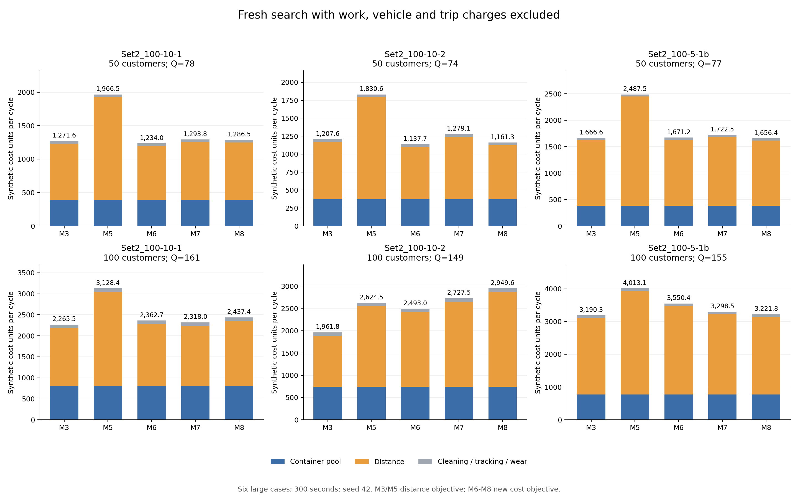

# 新成本口径：模型 3、5、6、7、8 大规模重新优化

本轮使用之前的六个大规模算例，重新运行全部五个模型。一级和二级运输的占用时间费、每辆车固定费、每趟固定费均为零；其余成本和物理条件保持原值。

共 30/30 次运行，30 次通过独立连续双周期审计。每次 ALNS 300 秒、seed=42、最多 1000000 次迭代、四进程；模型 6–8 在 K=1/2/3 之间共享 300 秒。

本轮返回方案中，各例最低成本模型为：50点 zhou_Set2_100-10-1_subset50: M6；100点 zhou_Set2_100-10-1: M3；50点 zhou_Set2_100-10-2_subset50: M6；100点 zhou_Set2_100-10-2: M3；50点 zhou_Set2_100-5-1b_subset50: M8；100点 zhou_Set2_100-5-1b: M3。

最终联合模型方案中，18/18 个只有一次实际配送，18/18 个箱池等于周期总需求。费用差额由运输距离和箱池数量决定，不包含取消费用本身的收益。

成本参数哈希：`59282332a4cdd43d37bc75da08952597a1d0fc27fa7f4d2edd06584d38a1e2c6`。所有有效方案都在新价格下重新求解；模型 3、5保留原距离目标，再统一计价，模型 6–8直接优化新周期成本。

## 保留的成本和约束

距离单价为 1，箱池费为每箱每周期 5，清洗费为每次实际回总仓的箱次 0.2，追踪费为每次发出的箱次 0.1，磨损费为每箱次 10/50=0.2。因所有需求箱次均完整回库，当前每周期总费用为：

`C = 一级距离 + 二级距离 + 5 × 箱池数量 N + 0.5 × 需求箱次 Q`。

未使用的干净箱子不收清洗费；同一个物理箱子再次使用、回库，需要再次清洗并计费；最后一轮回库的清洗也计入本周期。清洗费由实际一级回库数量累计核验，不能用独立箱子数 N 代替，也不能用 K×N。

配送/回收时间窗、使用时长、车队和装载容量、分界约束、清洗时长均仍生效。周期保持 08:00–21:00（780分钟）；周期末所有箱子已回总仓且洗净，车辆可继续下一周期。箱体初始投入在成本文件单列，不并入运营成本。

## 六例周期总成本

| 算例 | 点数 | Q | M3 | M5 | M6 | M7 | M8 |
|---|---:|---:|---:|---:|---:|---:|---:|
| zhou_Set2_100-10-1_subset50 | 50 | 78 | 1,271.57 | 1,966.51 | 1,234.00 | 1,293.81 | 1,286.45 |
| zhou_Set2_100-10-1 | 100 | 161 | 2,265.46 | 3,128.35 | 2,362.74 | 2,318.05 | 2,437.42 |
| zhou_Set2_100-10-2_subset50 | 50 | 74 | 1,207.61 | 1,830.62 | 1,137.69 | 1,279.06 | 1,161.30 |
| zhou_Set2_100-10-2 | 100 | 149 | 1,961.77 | 2,624.52 | 2,493.01 | 2,727.53 | 2,949.63 |
| zhou_Set2_100-5-1b_subset50 | 50 | 77 | 1,666.62 | 2,487.53 | 1,671.22 | 1,722.54 | 1,656.43 |
| zhou_Set2_100-5-1b | 100 | 155 | 3,190.29 | 4,013.07 | 3,550.39 | 3,298.45 | 3,221.80 |

## 相对单批次基准的费用差额

费用差额采用本轮 M3 与本轮最低成本联合模型配对。正数表示联合模型节省，负数表示本次搜索的联合模型成本更高。清洗、追踪和磨损总费用相同，差额只来自运输距离和箱池数量。

| 算例 | 最低联合模型 | 相对 M3 降低比例 | 距离费用节省 | 箱池费用节省 | 总费用节省 |
|---|---|---:|---:|---:|---:|
| zhou_Set2_100-10-1_subset50 | M6 | 2.95% | 37.57 | 0.00 | 37.57 |
| zhou_Set2_100-10-1 | M7 | -2.32% | -52.59 | 0.00 | -52.59 |
| zhou_Set2_100-10-2_subset50 | M6 | 5.79% | 69.92 | 0.00 | 69.92 |
| zhou_Set2_100-10-2 | M6 | -27.08% | -531.24 | 0.00 | -531.24 |
| zhou_Set2_100-5-1b_subset50 | M8 | 0.61% | 10.19 | 0.00 | 10.19 |
| zhou_Set2_100-5-1b | M8 | -0.99% | -31.51 | 0.00 | -31.51 |

最终联合模型方案中，0/18 个箱池小于周期需求箱次 Q；搜索候选摘要中有 23 个求解器审计有效的候选箱池小于 Q。是否选择多批次取决于箱池节省能否抵消新增运输距离。

有 1 个最终联合方案含空日历段；实际配送批次见下表，不能仅凭 K 判断循环利用。

## 箱池数量、批次和回收

模型 3、5的箱池仍为输入配置值；另列原时间表最低需箱量供参考。模型 6–8的费用采用优化输出箱池，独立审计核对其等于该时间表最低需箱量。K 是日历段数，实际配送批次只计有需求的段；空段不表示容器循环利用。

| 算例 | 模型 | 使用箱池 N | 时间表最低需箱 | 日历 K / 实际配送批次 | 分批回总仓箱次 | 清洗费 | 求解秒数 |
|---|---|---:|---:|---|---|---:|---:|
| zhou_Set2_100-10-1_subset50 | M3 | 78 | 78 | 1/1 | b1:78 | 15.60 | 300.42 |
| zhou_Set2_100-10-1_subset50 | M5 | 78 | 71 | 3/3 | b1:0, b2:25, b3:53 | 15.60 | 300.84 |
| zhou_Set2_100-10-1_subset50 | M6 | 78 | 78 | 1/1 | b1:78 | 15.60 | 288.87 |
| zhou_Set2_100-10-1_subset50 | M7 | 78 | 78 | 1/1 | b1:78 | 15.60 | 289.00 |
| zhou_Set2_100-10-1_subset50 | M8 | 78 | 78 | 1/1 | b1:78 | 15.60 | 301.00 |
| zhou_Set2_100-10-1 | M3 | 161 | 161 | 1/1 | b1:161 | 32.20 | 300.82 |
| zhou_Set2_100-10-1 | M5 | 161 | 148 | 3/3 | b1:0, b2:43, b3:118 | 32.20 | 300.35 |
| zhou_Set2_100-10-1 | M6 | 161 | 161 | 1/1 | b1:161 | 32.20 | 290.26 |
| zhou_Set2_100-10-1 | M7 | 161 | 161 | 1/1 | b1:161 | 32.20 | 292.66 |
| zhou_Set2_100-10-1 | M8 | 161 | 161 | 1/1 | b1:161 | 32.20 | 300.73 |
| zhou_Set2_100-10-2_subset50 | M3 | 74 | 74 | 1/1 | b1:74 | 14.80 | 300.29 |
| zhou_Set2_100-10-2_subset50 | M5 | 74 | 67 | 3/3 | b1:0, b2:9, b3:65 | 14.80 | 300.12 |
| zhou_Set2_100-10-2_subset50 | M6 | 74 | 74 | 1/1 | b1:74 | 14.80 | 289.07 |
| zhou_Set2_100-10-2_subset50 | M7 | 74 | 74 | 1/1 | b1:74 | 14.80 | 289.47 |
| zhou_Set2_100-10-2_subset50 | M8 | 74 | 74 | 1/1 | b1:74 | 14.80 | 300.17 |
| zhou_Set2_100-10-2 | M3 | 149 | 149 | 1/1 | b1:149 | 29.80 | 300.09 |
| zhou_Set2_100-10-2 | M5 | 149 | 140 | 3/3 | b1:0, b2:46, b3:103 | 29.80 | 300.20 |
| zhou_Set2_100-10-2 | M6 | 149 | 149 | 1/1 | b1:149 | 29.80 | 290.70 |
| zhou_Set2_100-10-2 | M7 | 149 | 149 | 1/1 | b1:149 | 29.80 | 291.66 |
| zhou_Set2_100-10-2 | M8 | 149 | 149 | 1/1 | b1:149 | 29.80 | 302.02 |
| zhou_Set2_100-5-1b_subset50 | M3 | 77 | 77 | 1/1 | b1:77 | 15.40 | 300.12 |
| zhou_Set2_100-5-1b_subset50 | M5 | 77 | 77 | 3/3 | b1:0, b2:34, b3:43 | 15.40 | 300.10 |
| zhou_Set2_100-5-1b_subset50 | M6 | 77 | 77 | 1/1 | b1:77 | 15.40 | 288.98 |
| zhou_Set2_100-5-1b_subset50 | M7 | 77 | 77 | 1/1 | b1:77 | 15.40 | 289.29 |
| zhou_Set2_100-5-1b_subset50 | M8 | 77 | 77 | 1/1 | b1:77 | 15.40 | 300.69 |
| zhou_Set2_100-5-1b | M3 | 155 | 155 | 1/1 | b1:155 | 31.00 | 301.67 |
| zhou_Set2_100-5-1b | M5 | 155 | 148 | 3/3 | b1:0, b2:59, b3:96 | 31.00 | 300.14 |
| zhou_Set2_100-5-1b | M6 | 155 | 155 | 1/1 | b1:155 | 31.00 | 292.21 |
| zhou_Set2_100-5-1b | M7 | 155 | 155 | 1/1 | b1:155 | 31.00 | 290.94 |
| zhou_Set2_100-5-1b | M8 | 155 | 155 | 3/1 | b1:0, b2:155, b3:0 | 31.00 | 300.42 |

## 同一新价格：旧方案重新计价与本轮重新搜索

此表两列都使用当前新价格，因此差额仅表示搜索得到的方案变化，不把取消费用本身当作优化收益。有限预算和并发机器负载会改变搜索轨迹，同种子也不保证本轮每次都更好。

| 算例 | 模型 | 旧方案按新价格 | 本轮重新搜索 | 成本降低比例 | 旧池→新池 |
|---|---|---:|---:|---:|---|
| zhou_Set2_100-10-1_subset50 | M3 | 1,268.55 | 1,271.57 | -0.24% | 78→78 |
| zhou_Set2_100-10-1_subset50 | M5 | 1,960.38 | 1,966.51 | -0.31% | 78→78 |
| zhou_Set2_100-10-1_subset50 | M6 | 1,322.44 | 1,234.00 | 6.69% | 78→78 |
| zhou_Set2_100-10-1_subset50 | M7 | 1,302.32 | 1,293.81 | 0.65% | 78→78 |
| zhou_Set2_100-10-1_subset50 | M8 | 1,329.72 | 1,286.45 | 3.25% | 78→78 |
| zhou_Set2_100-10-1 | M3 | 2,293.62 | 2,265.46 | 1.23% | 161→161 |
| zhou_Set2_100-10-1 | M5 | 3,151.83 | 3,128.35 | 0.75% | 161→161 |
| zhou_Set2_100-10-1 | M6 | 2,724.38 | 2,362.74 | 13.27% | 161→161 |
| zhou_Set2_100-10-1 | M7 | 2,648.35 | 2,318.05 | 12.47% | 161→161 |
| zhou_Set2_100-10-1 | M8 | 2,668.23 | 2,437.42 | 8.65% | 161→161 |
| zhou_Set2_100-10-2_subset50 | M3 | 1,212.58 | 1,207.61 | 0.41% | 74→74 |
| zhou_Set2_100-10-2_subset50 | M5 | 1,831.61 | 1,830.62 | 0.05% | 74→74 |
| zhou_Set2_100-10-2_subset50 | M6 | 1,428.48 | 1,137.69 | 20.36% | 74→74 |
| zhou_Set2_100-10-2_subset50 | M7 | 1,414.13 | 1,279.06 | 9.55% | 74→74 |
| zhou_Set2_100-10-2_subset50 | M8 | 1,263.06 | 1,161.30 | 8.06% | 74→74 |
| zhou_Set2_100-10-2 | M3 | 1,988.21 | 1,961.77 | 1.33% | 149→149 |
| zhou_Set2_100-10-2 | M5 | 2,623.92 | 2,624.52 | -0.02% | 149→149 |
| zhou_Set2_100-10-2 | M6 | 2,454.69 | 2,493.01 | -1.56% | 149→149 |
| zhou_Set2_100-10-2 | M7 | 2,350.97 | 2,727.53 | -16.02% | 149→149 |
| zhou_Set2_100-10-2 | M8 | 2,453.34 | 2,949.63 | -20.23% | 149→149 |
| zhou_Set2_100-5-1b_subset50 | M3 | 1,679.88 | 1,666.62 | 0.79% | 77→77 |
| zhou_Set2_100-5-1b_subset50 | M5 | 2,487.53 | 2,487.53 | 0.00% | 77→77 |
| zhou_Set2_100-5-1b_subset50 | M6 | 1,754.01 | 1,671.22 | 4.72% | 77→77 |
| zhou_Set2_100-5-1b_subset50 | M7 | 1,654.71 | 1,722.54 | -4.10% | 77→77 |
| zhou_Set2_100-5-1b_subset50 | M8 | 1,713.91 | 1,656.43 | 3.35% | 77→77 |
| zhou_Set2_100-5-1b | M3 | 3,302.60 | 3,190.29 | 3.40% | 155→155 |
| zhou_Set2_100-5-1b | M5 | 4,010.77 | 4,013.07 | -0.06% | 155→155 |
| zhou_Set2_100-5-1b | M6 | 3,668.58 | 3,550.39 | 3.22% | 155→155 |
| zhou_Set2_100-5-1b | M7 | 3,406.08 | 3,298.45 | 3.16% | 155→155 |
| zhou_Set2_100-5-1b | M8 | 3,305.60 | 3,221.80 | 2.53% | 155→155 |

## M3、M5原时间表的最低箱池参考

下表仅将原配置池替换为审计给出的该方案最低需箱数，路线、时刻和批次不变。这是重新计价参考，不是模型 3、5箱池优化输出。

| 算例 | M3当前 | M3最低池参考 | M5当前 | M5最低池参考 |
|---|---:|---:|---:|---:|
| zhou_Set2_100-10-1_subset50 | 1,271.57 | 1,271.57 | 1,966.51 | 1,931.51 |
| zhou_Set2_100-10-1 | 2,265.46 | 2,265.46 | 3,128.35 | 3,063.35 |
| zhou_Set2_100-10-2_subset50 | 1,207.61 | 1,207.61 | 1,830.62 | 1,795.62 |
| zhou_Set2_100-10-2 | 1,961.77 | 1,961.77 | 2,624.52 | 2,579.52 |
| zhou_Set2_100-5-1b_subset50 | 1,666.62 | 1,666.62 | 2,487.53 | 2,487.53 |
| zhou_Set2_100-5-1b | 3,190.29 | 3,190.29 | 4,013.07 | 3,978.07 |

## 搜索中各 K 的候选记录

这里保留求解器报告的每个 K 的最佳候选（count_search）；独立双周期审计针对最终返回的 30 个方案，不把候选摘要的 valid 字段当成额外独立审计。

| 算例 | 模型 | K | 候选箱池 | 候选成本 | 求解器审计 | 最终 K |
|---|---|---:|---:|---:|---|---:|
| zhou_Set2_100-10-1_subset50 | M6 | 1 | 78 | 1,234.00 | True | 1 |
| zhou_Set2_100-10-1_subset50 | M6 | 2 | 78 | 1,689.14 | True | 1 |
| zhou_Set2_100-10-1_subset50 | M6 | 3 | 74 | 1,996.37 | True | 1 |
| zhou_Set2_100-10-1_subset50 | M7 | 1 | 78 | 1,293.81 | True | 1 |
| zhou_Set2_100-10-1_subset50 | M7 | 2 | 78 | 1,898.31 | True | 1 |
| zhou_Set2_100-10-1_subset50 | M7 | 3 | 75 | 1,903.47 | True | 1 |
| zhou_Set2_100-10-1_subset50 | M8 | 1 | 78 | 1,286.45 | True | 1 |
| zhou_Set2_100-10-1_subset50 | M8 | 2 | 78 | 1,334.79 | True | 1 |
| zhou_Set2_100-10-1_subset50 | M8 | 3 | 78 | 1,962.70 | True | 1 |
| zhou_Set2_100-10-1 | M6 | 1 | 161 | 2,362.74 | True | 1 |
| zhou_Set2_100-10-1 | M6 | 2 | 107 | 3,744.67 | True | 1 |
| zhou_Set2_100-10-1 | M6 | 3 | 146 | 4,619.72 | True | 1 |
| zhou_Set2_100-10-1 | M7 | 1 | 161 | 2,318.05 | True | 1 |
| zhou_Set2_100-10-1 | M7 | 2 | 105 | 3,683.74 | True | 1 |
| zhou_Set2_100-10-1 | M7 | 3 | 146 | 4,251.05 | True | 1 |
| zhou_Set2_100-10-1 | M8 | 1 | 161 | 2,437.42 | True | 1 |
| zhou_Set2_100-10-1 | M8 | 2 | 119 | 3,539.46 | True | 1 |
| zhou_Set2_100-10-1 | M8 | 3 | 161 | 3,350.99 | True | 1 |
| zhou_Set2_100-10-2_subset50 | M6 | 1 | 74 | 1,137.69 | True | 1 |
| zhou_Set2_100-10-2_subset50 | M6 | 2 | 70 | 1,354.52 | True | 1 |
| zhou_Set2_100-10-2_subset50 | M6 | 3 | 71 | 2,034.58 | True | 1 |
| zhou_Set2_100-10-2_subset50 | M7 | 1 | 74 | 1,279.06 | True | 1 |
| zhou_Set2_100-10-2_subset50 | M7 | 2 | 74 | 1,618.94 | True | 1 |
| zhou_Set2_100-10-2_subset50 | M7 | 3 | 63 | 2,482.10 | True | 1 |
| zhou_Set2_100-10-2_subset50 | M8 | 1 | 74 | 1,161.30 | True | 1 |
| zhou_Set2_100-10-2_subset50 | M8 | 2 | 74 | 1,442.61 | True | 1 |
| zhou_Set2_100-10-2_subset50 | M8 | 3 | 74 | 1,278.33 | True | 1 |
| zhou_Set2_100-10-2 | M6 | 1 | 149 | 2,493.01 | True | 1 |
| zhou_Set2_100-10-2 | M6 | 2 | 99 | 3,529.55 | True | 1 |
| zhou_Set2_100-10-2 | M6 | 3 | 139 | 4,040.07 | True | 1 |
| zhou_Set2_100-10-2 | M7 | 1 | 149 | 2,727.53 | True | 1 |
| zhou_Set2_100-10-2 | M7 | 2 | 112 | 3,480.61 | True | 1 |
| zhou_Set2_100-10-2 | M7 | 3 | 142 | 4,011.64 | True | 1 |
| zhou_Set2_100-10-2 | M8 | 1 | 149 | 2,949.63 | True | 1 |
| zhou_Set2_100-10-2 | M8 | 2 | 108 | 3,483.12 | True | 1 |
| zhou_Set2_100-10-2 | M8 | 3 | 141 | 4,168.15 | True | 1 |
| zhou_Set2_100-5-1b_subset50 | M6 | 1 | 77 | 1,671.22 | True | 1 |
| zhou_Set2_100-5-1b_subset50 | M6 | 2 | 77 | 2,150.77 | True | 1 |
| zhou_Set2_100-5-1b_subset50 | M6 | 3 | 72 | 2,545.55 | True | 1 |
| zhou_Set2_100-5-1b_subset50 | M7 | 1 | 77 | 1,722.54 | True | 1 |
| zhou_Set2_100-5-1b_subset50 | M7 | 2 | 74 | 1,940.99 | True | 1 |
| zhou_Set2_100-5-1b_subset50 | M7 | 3 | 75 | 3,275.64 | True | 1 |
| zhou_Set2_100-5-1b_subset50 | M8 | 1 | 77 | 1,656.43 | True | 1 |
| zhou_Set2_100-5-1b_subset50 | M8 | 2 | 77 | 2,270.69 | True | 1 |
| zhou_Set2_100-5-1b_subset50 | M8 | 3 | 77 | 1,718.21 | True | 1 |
| zhou_Set2_100-5-1b | M6 | 1 | 155 | 3,550.39 | True | 1 |
| zhou_Set2_100-5-1b | M6 | 2 | 109 | 5,327.65 | True | 1 |
| zhou_Set2_100-5-1b | M6 | 3 | 150 | 5,444.35 | True | 1 |
| zhou_Set2_100-5-1b | M7 | 1 | 155 | 3,298.45 | True | 1 |
| zhou_Set2_100-5-1b | M7 | 2 | 110 | 5,423.92 | True | 1 |
| zhou_Set2_100-5-1b | M7 | 3 | 155 | 5,968.93 | True | 1 |
| zhou_Set2_100-5-1b | M8 | 1 | 155 | 3,429.80 | True | 3 |
| zhou_Set2_100-5-1b | M8 | 2 | 153 | 5,467.31 | True | 3 |
| zhou_Set2_100-5-1b | M8 | 3 | 155 | 3,221.80 | True | 3 |

## 范围和复现

- 本轮为单种子、有限预算可行解，没有全局最优或随机稳定性证明。五个模型的可行域和优化目标仍有区别，不能把全部成本差额归因于多批次机制。
- 工时费为零后，移动等待时间本身不再直接降低成本；分界仍会影响可行性、路线及箱子复用。
- 若联合模型成本高于 M3，这说明本次搜索返回较差方案，不能据此推断其理论最优值更差。K=1 时模型 6–8的日历可行域相同，启发式返回值仍可能不同。
- 模型 3把全部 300 秒用于单批次路线搜索；联合模型把总预算分给三个 K，每个 K 的实际预算及迭代量保存在 count_candidates.json。即使最终都选择单批次，搜索路线、算子和分配到 K=1 的时间仍有差异。
- 三张底图各包含 50 点子集和 100 点完整版，样本不是六个独立总体样本。
- 成本为 synthetic_units 合成单位，未标定为人民币；300 秒为软截止，四进程共享机器。
- 输入和代码均冻结并校验原始字节哈希；每个最终方案再次重放并核对新目标、零费用项、优化箱池、实际清洗箱次和连续两周期可复用性。

复核已有结果：`python output/model35678_comparison/20261006_distance_pool_5min_v1/verify_and_report.py`。脚本支持仓库路径变化，临时重定位案例路径，不改写归档输入。

重新执行搜索：把 run_study.py、monitor_study.py、verify_and_report.py 复制到 output/model35678_comparison/ 下一个新的空目录，先运行该目录的 run_study.py，再运行 verify_and_report.py。已注册或已完成的目录拒绝覆盖。

文件：experiment.json 为预注册计划；runs.csv 为全部运行；results/ 为方案、独立审计、成本；verification.json 为复核；pool_cycle_cleaning_diagnostics.json 为箱池/日历/清洗明细；count_candidates.json 为按 K 搜索摘要；same_price_search_comparison.csv 为同价旧方案与新搜索配对。
