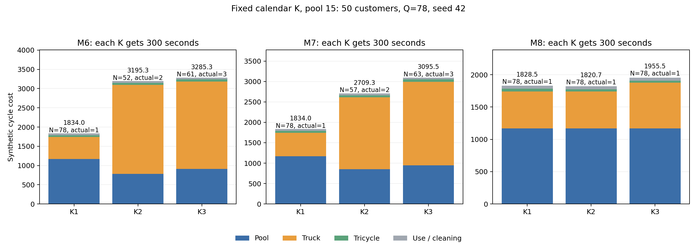

# 箱价15：固定K与相同搜索预算诊断

## Material Passport

- Origin Skill: academic-research-suite / experiment-agent
- Origin Mode: run (continuous)
- Origin Date: 2026-10-06
- Verification Status: VERIFIED
- Version Label: pool15_fixedK_diagnostic_v1

算例100-10-1的50点子集，Q=78；M6/M7/M8分别固定K=1/2/3。每次300秒、seed42、迭代上限1000000，3个进程并行。全部使用箱池15、一级2.535、二级0.056470588、清洗0.2、追踪0.1、磨损0.3的同一费用目标。

完成9/9；独立双周期审计通过9/9。物理输入、费用和308份算法源码与上一轮一致。

本轮有4条真实多批路线，其中4条减少箱池；相对同模型K1的真实多批费用胜出为0条。搜索预算相等后，当前找到的真实多批方案仍未获得净成本优势。

K是日历段数，现有模型允许空段；实际配送次数、减箱与净收益分别报告。

| 模型 | 固定K | 实际配送批次 | 箱池N | D1 | D2 | 运输费 | 箱池费 | 总费用 | 相对同模型K1增量 |
|---|---:|---:|---:|---:|---:|---:|---:|---:|---:|
| M6 | 1 | 1 | 78 | 225.61 | 801.37 | 617.18 | 1,170.00 | 1,833.98 | 0.00 |
| M6 | 2 | 2 | 52 | 913.86 | 919.15 | 2,368.54 | 780.00 | 3,195.34 | 1,361.36 |
| M6 | 3 | 3 | 61 | 893.61 | 1,031.00 | 2,323.53 | 915.00 | 3,285.33 | 1,451.35 |
| M7 | 1 | 1 | 78 | 225.61 | 801.37 | 617.18 | 1,170.00 | 1,833.98 | 0.00 |
| M7 | 2 | 2 | 57 | 693.62 | 870.73 | 1,807.49 | 855.00 | 2,709.29 | 875.31 |
| M7 | 3 | 3 | 63 | 807.11 | 1,021.68 | 2,103.71 | 945.00 | 3,095.51 | 1,261.54 |
| M8 | 1 | 1 | 78 | 225.61 | 703.49 | 611.65 | 1,170.00 | 1,828.45 | 0.00 |
| M8 | 2 | 1 | 78 | 225.61 | 565.57 | 603.86 | 1,170.00 | 1,820.66 | -7.79 |
| M8 | 3 | 1 | 78 | 278.52 | 577.20 | 738.66 | 1,170.00 | 1,955.46 | 127.01 |

## 减箱与运输权衡

| 模型 | K | 省箱数 | 箱池费节省 | 新增运输费 | 总费用增量 | 当前两路线的盈亏平衡箱价 |
|---|---:|---:|---:|---:|---:|---:|
| M6 | 2 | 26 | 390.00 | 1,751.36 | 1,361.36 | 67.36 |
| M6 | 3 | 17 | 255.00 | 1,706.35 | 1,451.35 | 100.37 |
| M7 | 2 | 21 | 315.00 | 1,190.31 | 875.31 | 56.68 |
| M7 | 3 | 15 | 225.00 | 1,486.54 | 1,261.54 | 99.10 |
| M8 | 2 | 0 | 0.00 | -7.79 | -7.79 | — |
| M8 | 3 | 0 | 0.00 | 127.01 | 127.01 | — |

M7的K1→K2：箱池78→57；一级距离225.61→693.62，一级趟次1→5；省箱费用315.00，额外运输1190.31，总费用增加875.31。

阈值仅针对这两条固定路线；不能解释为全局最优或保证多批胜出的单价。箱次固定费用0.6Q相同，成本差完全等于运输增量减去箱池节省。

## 与上一轮同K候选对照

| 模型 | K | 旧分配秒数 | 本轮分配秒数 | 旧同K费用 | 本轮费用 | 降低费用 |
|---|---:|---:|---:|---:|---:|---:|
| M6 | 1 | 100.00 | 299.99 | 1,976.29 | 1,833.98 | 142.31 |
| M6 | 2 | 104.94 | 299.99 | 3,202.14 | 3,195.34 | 6.80 |
| M6 | 3 | 115.19 | 299.93 | 4,056.83 | 3,285.33 | 771.50 |
| M7 | 1 | 100.00 | 299.99 | 1,968.22 | 1,833.98 | 134.24 |
| M7 | 2 | 104.95 | 299.99 | 3,205.48 | 2,709.29 | 496.20 |
| M7 | 3 | 104.34 | 299.99 | 4,322.63 | 3,095.51 | 1,227.11 |
| M8 | 1 | 100.00 | 299.98 | 1,965.50 | 1,828.45 | 137.05 |
| M8 | 2 | 104.78 | 299.99 | 1,956.92 | 1,820.66 | 136.26 |
| M8 | 3 | 104.19 | 299.98 | 2,564.06 | 1,955.46 | 608.60 |

旧候选只有求解器内部审计摘要，缺少逐一保存的路线。本轮九条路线均独立重放；不把旧候选称为独立审计方案。预算、迭代上限分配和并行负载有变化；单种子对照不能证明搜索时间是唯一原因。

## 每批发箱和回库

| 模型 | K | 发箱 | 回库 | 清洗费 | 追踪费 | 磨损费 |
|---|---:|---|---|---:|---:|---:|
| M6 | 1 | b1:78 | b1:78 | 15.60 | 7.80 | 23.40 |
| M6 | 2 | b1:52, b2:26 | b1:27, b2:51 | 15.60 | 7.80 | 23.40 |
| M6 | 3 | b1:60, b2:15, b3:3 | b1:14, b2:29, b3:35 | 15.60 | 7.80 | 23.40 |
| M7 | 1 | b1:78 | b1:78 | 15.60 | 7.80 | 23.40 |
| M7 | 2 | b1:52, b2:26 | b1:21, b2:57 | 15.60 | 7.80 | 23.40 |
| M7 | 3 | b1:59, b2:16, b3:3 | b1:12, b2:8, b3:58 | 15.60 | 7.80 | 23.40 |
| M8 | 1 | b1:78 | b1:78 | 15.60 | 7.80 | 23.40 |
| M8 | 2 | b1:0, b2:78 | b1:0, b2:78 | 15.60 | 7.80 | 23.40 |
| M8 | 3 | b1:0, b2:0, b3:78 | b1:0, b2:0, b3:78 | 15.60 | 7.80 | 23.40 |

## 范围

- K不强制每段非空；实际配送一次的K2/K3方案不能作为真实多批收益。
- 无热启动；求解器源码未改。各K分别使用相同300秒，原一百万迭代上限也完整分配给各K。
- 一个算例、一个种子、有限搜索；不能推广至其他算例或证明全局最优。
- 原速度2单位/分钟保持不变；本轮仍是成本比例测试。
- results/保存路线、独立审计和成本；diagnostics.json记录逐批量；tradeoffs.json记录成本差。

复核：`python output/model35678_comparison/20261006_pool15_fixedK_diagnostic_v1/verify_and_report.py`。
