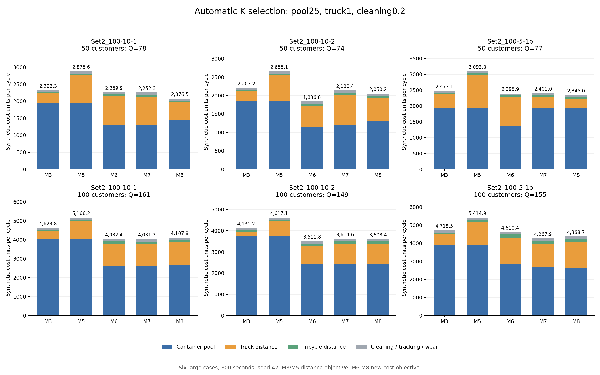

# 箱价25、一级里程1：六例自动选择批次的正式实验

## Material Passport

- Origin Skill: academic-research-suite / experiment-agent
- Origin Mode: run (continuous)
- Origin Date: 2026-10-06
- Verification Status: VERIFIED
- Version Label: pool25_truck1_autoK_5min_v1

完成30/30次，独立路线与双周期复核通过30次。基准提交`b95c13f5ccd332d04aa1de5b110545b96c9e6def`。

## 恢复原实验流程

六个原算例（50/100客户）、模型3/5/6/7/8、seed42、每模型每例总预算300秒、迭代上限1000000、4个worker。没有提前指定M6–M8最终批次。

M6–M8一次调用传入候选K=[1,2,3]，程序将总时间和迭代预算分配给各K，联合优化路线、时间表、订单批次和箱池，再自动返回有效候选中费用最低者。K的允许范围沿用原实验，不是无上限搜索。M3/M5保留原距离目标，M3固定单批、M5固定输入日历，作为原有基准。

这不同于此前固定K诊断：此前每个K独享300秒并分开运行，最后横向比较；本轮每模型每例只有一个300秒总预算，最终K由求解器返回。固定K诊断结果不混入本轮正式实验结果。

## 参数

`C = D1 + 0.056470588D2 + 25N + 0.6U + 0.2R`。磨损25/50=0.5，追踪0.1，清洗按每次实际回库0.2；完整回收U=R=Q，常量费用为0.8Q。工时、车辆固定和趟次费为0。

主价格与最近固定K诊断完全一致：箱25、一级1、二级0.056470588。与之前六例自动K箱价15实验相比，仅改箱池15→25、磨损0.3→0.5、一级2.535→1；全部物理输入、时间窗、车队、清洗时长和308份算法源码保持。原距离与速度仍是基准单位，费用为synthetic_units。

## 最终返回方案的成本

| 算例 | 点数 | Q | M3 | M5 | M6 | M7 | M8 | 最低费用模型 |
|---|---:|---:|---:|---:|---:|---:|---:|---|
| zhou_Set2_100-10-1_subset50 | 50 | 78 | 2,322.31 | 2,875.62 | 2,259.86 | 2,252.31 | 2,076.54 | M8 |
| zhou_Set2_100-10-1 | 100 | 161 | 4,623.83 | 5,166.24 | 4,032.40 | 4,031.34 | 4,107.77 | M7 |
| zhou_Set2_100-10-2_subset50 | 50 | 74 | 2,203.21 | 2,655.07 | 1,836.82 | 2,138.42 | 2,050.25 | M6 |
| zhou_Set2_100-10-2 | 100 | 149 | 4,131.23 | 4,617.12 | 3,511.78 | 3,614.61 | 3,608.40 | M6 |
| zhou_Set2_100-5-1b_subset50 | 50 | 77 | 2,477.06 | 3,093.26 | 2,395.93 | 2,400.98 | 2,345.00 | M8 |
| zhou_Set2_100-5-1b | 100 | 155 | 4,718.46 | 5,414.85 | 4,610.40 | 4,267.94 | 4,368.67 | M7 |

## 自动选择的K、实际配送批次和箱池

M6–M8最终18个方案中，实际单批2个、多批16个、箱池小于Q的16个；有空日历段2个。日历K不能替代实际配送批次。

| 算例 | 模型 | 日历K | 实际配送批次 | N | Q | 每批发箱 | 每批回库 |
|---|---|---:|---:|---:|---:|---|---|
| zhou_Set2_100-10-1_subset50 | M3 | 1 | 1 | 78 | 78 | b1:78 | b1:78 |
| zhou_Set2_100-10-1_subset50 | M5 | 3 | 3 | 78 | 78 | b1:29, b2:42, b3:7 | b1:0, b2:23, b3:55 |
| zhou_Set2_100-10-1_subset50 | M6 | 2 | 2 | 52 | 78 | b1:52, b2:26 | b1:26, b2:52 |
| zhou_Set2_100-10-1_subset50 | M7 | 2 | 2 | 52 | 78 | b1:52, b2:26 | b1:26, b2:52 |
| zhou_Set2_100-10-1_subset50 | M8 | 3 | 2 | 58 | 78 | b1:0, b2:58, b3:20 | b1:0, b2:20, b3:58 |
| zhou_Set2_100-10-1 | M3 | 1 | 1 | 161 | 161 | b1:161 | b1:161 |
| zhou_Set2_100-10-1 | M5 | 3 | 3 | 161 | 161 | b1:59, b2:89, b3:13 | b1:0, b2:41, b3:120 |
| zhou_Set2_100-10-1 | M6 | 2 | 2 | 104 | 161 | b1:104, b2:57 | b1:58, b2:103 |
| zhou_Set2_100-10-1 | M7 | 2 | 2 | 104 | 161 | b1:104, b2:57 | b1:62, b2:99 |
| zhou_Set2_100-10-1 | M8 | 2 | 2 | 107 | 161 | b1:105, b2:56 | b1:54, b2:107 |
| zhou_Set2_100-10-2_subset50 | M3 | 1 | 1 | 74 | 74 | b1:74 | b1:74 |
| zhou_Set2_100-10-2_subset50 | M5 | 3 | 3 | 74 | 74 | b1:25, b2:42, b3:7 | b1:0, b2:18, b3:56 |
| zhou_Set2_100-10-2_subset50 | M6 | 2 | 2 | 46 | 74 | b1:46, b2:28 | b1:28, b2:46 |
| zhou_Set2_100-10-2_subset50 | M7 | 2 | 2 | 48 | 74 | b1:48, b2:26 | b1:26, b2:48 |
| zhou_Set2_100-10-2_subset50 | M8 | 3 | 2 | 52 | 74 | b1:49, b2:25, b3:0 | b1:22, b2:52, b3:0 |
| zhou_Set2_100-10-2 | M3 | 1 | 1 | 149 | 149 | b1:149 | b1:149 |
| zhou_Set2_100-10-2 | M5 | 3 | 3 | 149 | 149 | b1:58, b2:82, b3:9 | b1:0, b2:57, b3:92 |
| zhou_Set2_100-10-2 | M6 | 2 | 2 | 97 | 149 | b1:97, b2:52 | b1:53, b2:96 |
| zhou_Set2_100-10-2 | M7 | 2 | 2 | 97 | 149 | b1:97, b2:52 | b1:53, b2:96 |
| zhou_Set2_100-10-2 | M8 | 2 | 2 | 97 | 149 | b1:97, b2:52 | b1:52, b2:97 |
| zhou_Set2_100-5-1b_subset50 | M3 | 1 | 1 | 77 | 77 | b1:77 | b1:77 |
| zhou_Set2_100-5-1b_subset50 | M5 | 3 | 3 | 77 | 77 | b1:29, b2:43, b3:5 | b1:0, b2:27, b3:50 |
| zhou_Set2_100-5-1b_subset50 | M6 | 2 | 2 | 55 | 77 | b1:55, b2:22 | b1:22, b2:55 |
| zhou_Set2_100-5-1b_subset50 | M7 | 1 | 1 | 77 | 77 | b1:77 | b1:77 |
| zhou_Set2_100-5-1b_subset50 | M8 | 1 | 1 | 77 | 77 | b1:77 | b1:77 |
| zhou_Set2_100-5-1b | M3 | 1 | 1 | 155 | 155 | b1:155 | b1:155 |
| zhou_Set2_100-5-1b | M5 | 3 | 3 | 155 | 155 | b1:64, b2:84, b3:7 | b1:0, b2:56, b3:99 |
| zhou_Set2_100-5-1b | M6 | 2 | 2 | 115 | 155 | b1:115, b2:40 | b1:41, b2:114 |
| zhou_Set2_100-5-1b | M7 | 2 | 2 | 107 | 155 | b1:106, b2:49 | b1:55, b2:100 |
| zhou_Set2_100-5-1b | M8 | 2 | 2 | 106 | 155 | b1:106, b2:49 | b1:49, b2:106 |

## 程序内部各K候选

这里记录一次300秒调用内的各K候选、分配上限和实际运行秒数。提前结束的时间可留给后续K，所以分配上限之和不等于实际消耗；以整次调用总预算300秒为准。候选valid来自求解器内部检查；独立路线和双周期审计只针对最终返回的30条路线。复核确认最终成本等于有效候选成本的最小值。

| 算例 | 模型 | 候选K | 分配上限秒 | 运行秒 | 候选N | 候选成本 | 状态 | 最终K |
|---|---|---:|---:|---:|---:|---:|---|---:|
| zhou_Set2_100-10-1_subset50 | M6 | 1 | 100.00 | 90.04 | 78 | 2,343.49 | FEASIBLE | 2 |
| zhou_Set2_100-10-1_subset50 | M6 | 2 | 104.97 | 94.59 | 52 | 2,259.86 | FEASIBLE | 2 |
| zhou_Set2_100-10-1_subset50 | M6 | 3 | 115.30 | 104.20 | 61 | 2,487.23 | FEASIBLE | 2 |
| zhou_Set2_100-10-1_subset50 | M7 | 1 | 100.00 | 90.06 | 78 | 2,343.52 | FEASIBLE | 2 |
| zhou_Set2_100-10-1_subset50 | M7 | 2 | 104.95 | 95.20 | 52 | 2,252.31 | FEASIBLE | 2 |
| zhou_Set2_100-10-1_subset50 | M7 | 3 | 113.60 | 103.55 | 60 | 2,619.89 | FEASIBLE | 2 |
| zhou_Set2_100-10-1_subset50 | M8 | 1 | 99.90 | 91.03 | 78 | 2,291.76 | FEASIBLE | 3 |
| zhou_Set2_100-10-1_subset50 | M8 | 2 | 104.30 | 104.37 | 52 | 2,185.88 | FEASIBLE | 3 |
| zhou_Set2_100-10-1_subset50 | M8 | 3 | 103.38 | 103.39 | 58 | 2,076.54 | FEASIBLE | 3 |
| zhou_Set2_100-10-1 | M6 | 1 | 99.99 | 90.17 | 161 | 4,731.12 | FEASIBLE | 2 |
| zhou_Set2_100-10-1 | M6 | 2 | 104.85 | 95.09 | 104 | 4,032.40 | FEASIBLE | 2 |
| zhou_Set2_100-10-1 | M6 | 3 | 114.48 | 104.92 | 128 | 4,955.40 | FEASIBLE | 2 |
| zhou_Set2_100-10-1 | M7 | 1 | 99.99 | 90.13 | 161 | 4,693.22 | FEASIBLE | 2 |
| zhou_Set2_100-10-1 | M7 | 2 | 104.87 | 94.90 | 104 | 4,031.34 | FEASIBLE | 2 |
| zhou_Set2_100-10-1 | M7 | 3 | 114.68 | 105.18 | 135 | 5,397.18 | FEASIBLE | 2 |
| zhou_Set2_100-10-1 | M8 | 1 | 99.98 | 90.08 | 161 | 4,707.81 | FEASIBLE | 2 |
| zhou_Set2_100-10-1 | M8 | 2 | 104.86 | 104.86 | 107 | 4,107.77 | FEASIBLE | 2 |
| zhou_Set2_100-10-1 | M8 | 3 | 104.50 | 104.52 | 107 | 4,526.77 | FEASIBLE | 2 |
| zhou_Set2_100-10-2_subset50 | M6 | 1 | 100.00 | 90.06 | 74 | 2,248.77 | FEASIBLE | 2 |
| zhou_Set2_100-10-2_subset50 | M6 | 2 | 104.95 | 94.61 | 46 | 1,836.82 | FEASIBLE | 2 |
| zhou_Set2_100-10-2_subset50 | M6 | 3 | 115.24 | 104.06 | 59 | 2,594.30 | FEASIBLE | 2 |
| zhou_Set2_100-10-2_subset50 | M7 | 1 | 100.00 | 91.10 | 74 | 2,249.52 | FEASIBLE | 2 |
| zhou_Set2_100-10-2_subset50 | M7 | 2 | 104.43 | 94.26 | 48 | 2,138.42 | FEASIBLE | 2 |
| zhou_Set2_100-10-2_subset50 | M7 | 3 | 114.52 | 104.25 | 58 | 2,490.83 | FEASIBLE | 2 |
| zhou_Set2_100-10-2_subset50 | M8 | 1 | 100.00 | 90.07 | 74 | 2,241.34 | FEASIBLE | 3 |
| zhou_Set2_100-10-2_subset50 | M8 | 2 | 104.93 | 104.95 | 51 | 2,168.66 | FEASIBLE | 3 |
| zhou_Set2_100-10-2_subset50 | M8 | 3 | 104.85 | 104.85 | 52 | 2,050.25 | FEASIBLE | 3 |
| zhou_Set2_100-10-2 | M6 | 1 | 99.99 | 90.13 | 149 | 4,219.44 | FEASIBLE | 2 |
| zhou_Set2_100-10-2 | M6 | 2 | 104.88 | 94.76 | 97 | 3,511.78 | FEASIBLE | 2 |
| zhou_Set2_100-10-2 | M6 | 3 | 114.91 | 103.80 | 126 | 4,661.76 | FEASIBLE | 2 |
| zhou_Set2_100-10-2 | M7 | 1 | 99.99 | 90.48 | 149 | 4,353.57 | FEASIBLE | 2 |
| zhou_Set2_100-10-2 | M7 | 2 | 104.67 | 94.64 | 97 | 3,614.61 | FEASIBLE | 2 |
| zhou_Set2_100-10-2 | M7 | 3 | 114.61 | 104.15 | 140 | 5,147.09 | FEASIBLE | 2 |
| zhou_Set2_100-10-2 | M8 | 1 | 99.98 | 90.12 | 149 | 4,109.75 | FEASIBLE | 2 |
| zhou_Set2_100-10-2 | M8 | 2 | 104.84 | 104.92 | 97 | 3,608.40 | FEASIBLE | 2 |
| zhou_Set2_100-10-2 | M8 | 3 | 104.55 | 104.57 | 113 | 4,522.23 | FEASIBLE | 2 |
| zhou_Set2_100-5-1b_subset50 | M6 | 1 | 100.00 | 90.07 | 77 | 2,402.00 | FEASIBLE | 2 |
| zhou_Set2_100-5-1b_subset50 | M6 | 2 | 104.95 | 94.52 | 55 | 2,395.93 | FEASIBLE | 2 |
| zhou_Set2_100-5-1b_subset50 | M6 | 3 | 115.34 | 104.27 | 71 | 2,888.69 | FEASIBLE | 2 |
| zhou_Set2_100-5-1b_subset50 | M7 | 1 | 100.00 | 90.07 | 77 | 2,400.98 | FEASIBLE | 1 |
| zhou_Set2_100-5-1b_subset50 | M7 | 2 | 104.94 | 94.86 | 53 | 2,505.96 | FEASIBLE | 1 |
| zhou_Set2_100-5-1b_subset50 | M7 | 3 | 114.96 | 103.94 | 70 | 2,852.08 | FEASIBLE | 1 |
| zhou_Set2_100-5-1b_subset50 | M8 | 1 | 99.99 | 90.06 | 77 | 2,345.00 | FEASIBLE | 1 |
| zhou_Set2_100-5-1b_subset50 | M8 | 2 | 104.94 | 104.94 | 77 | 2,382.36 | FEASIBLE | 1 |
| zhou_Set2_100-5-1b_subset50 | M8 | 3 | 104.88 | 104.89 | 77 | 2,515.23 | FEASIBLE | 1 |
| zhou_Set2_100-5-1b | M6 | 1 | 99.70 | 90.81 | 155 | 4,673.85 | FEASIBLE | 2 |
| zhou_Set2_100-5-1b | M6 | 2 | 104.10 | 94.57 | 115 | 4,610.40 | FEASIBLE | 2 |
| zhou_Set2_100-5-1b | M6 | 3 | 113.54 | 102.95 | 144 | 5,337.35 | FEASIBLE | 2 |
| zhou_Set2_100-5-1b | M7 | 1 | 99.99 | 90.15 | 155 | 4,596.40 | FEASIBLE | 2 |
| zhou_Set2_100-5-1b | M7 | 2 | 104.87 | 94.73 | 107 | 4,267.94 | FEASIBLE | 2 |
| zhou_Set2_100-5-1b | M7 | 3 | 114.90 | 104.35 | 151 | 5,936.31 | FEASIBLE | 2 |
| zhou_Set2_100-5-1b | M8 | 1 | 99.98 | 90.11 | 155 | 4,697.54 | FEASIBLE | 2 |
| zhou_Set2_100-5-1b | M8 | 2 | 104.84 | 104.85 | 106 | 4,368.67 | FEASIBLE | 2 |
| zhou_Set2_100-5-1b | M8 | 3 | 104.70 | 104.94 | 150 | 5,223.75 | FEASIBLE | 2 |

## 同次调用的省箱和运输权衡

比较本次运行的K1与其他有效K候选，正的费用增量表示更贵。共同完整发出/回收时箱次费用相同，成本差=运输增量−箱池费节省。

| 算例 | 模型 | 候选K | 单批池→候选池 | 箱池节省 | 运输增量 | 总费用增量 | 最终K |
|---|---|---:|---|---:|---:|---:|---:|
| zhou_Set2_100-10-1_subset50 | M6 | 2 | 78→52 | 650.00 | 566.37 | -83.63 | 2 |
| zhou_Set2_100-10-1_subset50 | M6 | 3 | 78→61 | 425.00 | 568.75 | 143.75 | 2 |
| zhou_Set2_100-10-1_subset50 | M7 | 2 | 78→52 | 650.00 | 558.78 | -91.22 | 2 |
| zhou_Set2_100-10-1_subset50 | M7 | 3 | 78→60 | 450.00 | 726.37 | 276.37 | 2 |
| zhou_Set2_100-10-1_subset50 | M8 | 2 | 78→52 | 650.00 | 544.12 | -105.88 | 3 |
| zhou_Set2_100-10-1_subset50 | M8 | 3 | 78→58 | 500.00 | 284.78 | -215.22 | 3 |
| zhou_Set2_100-10-1 | M6 | 2 | 161→104 | 1,425.00 | 726.28 | -698.72 | 2 |
| zhou_Set2_100-10-1 | M6 | 3 | 161→128 | 825.00 | 1,049.28 | 224.28 | 2 |
| zhou_Set2_100-10-1 | M7 | 2 | 161→104 | 1,425.00 | 763.12 | -661.88 | 2 |
| zhou_Set2_100-10-1 | M7 | 3 | 161→135 | 650.00 | 1,353.96 | 703.96 | 2 |
| zhou_Set2_100-10-1 | M8 | 2 | 161→107 | 1,350.00 | 749.96 | -600.04 | 2 |
| zhou_Set2_100-10-1 | M8 | 3 | 161→107 | 1,350.00 | 1,168.96 | -181.04 | 2 |
| zhou_Set2_100-10-2_subset50 | M6 | 2 | 74→46 | 700.00 | 288.05 | -411.95 | 2 |
| zhou_Set2_100-10-2_subset50 | M6 | 3 | 74→59 | 375.00 | 720.53 | 345.53 | 2 |
| zhou_Set2_100-10-2_subset50 | M7 | 2 | 74→48 | 650.00 | 538.90 | -111.10 | 2 |
| zhou_Set2_100-10-2_subset50 | M7 | 3 | 74→58 | 400.00 | 641.31 | 241.31 | 2 |
| zhou_Set2_100-10-2_subset50 | M8 | 2 | 74→51 | 575.00 | 502.32 | -72.68 | 3 |
| zhou_Set2_100-10-2_subset50 | M8 | 3 | 74→52 | 550.00 | 358.91 | -191.09 | 3 |
| zhou_Set2_100-10-2 | M6 | 2 | 149→97 | 1,300.00 | 592.34 | -707.66 | 2 |
| zhou_Set2_100-10-2 | M6 | 3 | 149→126 | 575.00 | 1,017.32 | 442.32 | 2 |
| zhou_Set2_100-10-2 | M7 | 2 | 149→97 | 1,300.00 | 561.04 | -738.96 | 2 |
| zhou_Set2_100-10-2 | M7 | 3 | 149→140 | 225.00 | 1,018.52 | 793.52 | 2 |
| zhou_Set2_100-10-2 | M8 | 2 | 149→97 | 1,300.00 | 798.65 | -501.35 | 2 |
| zhou_Set2_100-10-2 | M8 | 3 | 149→113 | 900.00 | 1,312.48 | 412.48 | 2 |
| zhou_Set2_100-5-1b_subset50 | M6 | 2 | 77→55 | 550.00 | 543.93 | -6.07 | 2 |
| zhou_Set2_100-5-1b_subset50 | M6 | 3 | 77→71 | 150.00 | 636.68 | 486.68 | 2 |
| zhou_Set2_100-5-1b_subset50 | M7 | 2 | 77→53 | 600.00 | 704.98 | 104.98 | 1 |
| zhou_Set2_100-5-1b_subset50 | M7 | 3 | 77→70 | 175.00 | 626.09 | 451.09 | 1 |
| zhou_Set2_100-5-1b_subset50 | M8 | 2 | 77→77 | 0.00 | 37.36 | 37.36 | 1 |
| zhou_Set2_100-5-1b_subset50 | M8 | 3 | 77→77 | 0.00 | 170.22 | 170.22 | 1 |
| zhou_Set2_100-5-1b | M6 | 2 | 155→115 | 1,000.00 | 936.55 | -63.45 | 2 |
| zhou_Set2_100-5-1b | M6 | 3 | 155→144 | 275.00 | 938.50 | 663.50 | 2 |
| zhou_Set2_100-5-1b | M7 | 2 | 155→107 | 1,200.00 | 871.54 | -328.46 | 2 |
| zhou_Set2_100-5-1b | M7 | 3 | 155→151 | 100.00 | 1,439.91 | 1,339.91 | 2 |
| zhou_Set2_100-5-1b | M8 | 2 | 155→106 | 1,225.00 | 896.13 | -328.87 | 2 |
| zhou_Set2_100-5-1b | M8 | 3 | 155→150 | 125.00 | 651.21 | 526.21 | 2 |

## 前一轮正式实验的路线按新价重计

比较对象是六例自动K箱价15正式实验的最终保存路线，按本轮一级1/箱25计价；不是固定K诊断结果。重新计价和重新搜索分别列出，有限搜索不保证新结果更好。

| 算例 | 模型 | 旧路线按新价 | 本轮新搜索 | 降低比例 | 旧N→新N |
|---|---|---:|---:|---:|---|
| zhou_Set2_100-10-1_subset50 | M3 | 2,323.26 | 2,322.31 | 0.04% | 78→78 |
| zhou_Set2_100-10-1_subset50 | M5 | 2,886.91 | 2,875.62 | 0.39% | 78→78 |
| zhou_Set2_100-10-1_subset50 | M6 | 2,344.35 | 2,259.86 | 3.60% | 78→52 |
| zhou_Set2_100-10-1_subset50 | M7 | 2,336.29 | 2,252.31 | 3.59% | 78→52 |
| zhou_Set2_100-10-1_subset50 | M8 | 2,324.99 | 2,076.54 | 10.69% | 78→58 |
| zhou_Set2_100-10-1 | M3 | 4,624.42 | 4,623.83 | 0.01% | 161→161 |
| zhou_Set2_100-10-1 | M5 | 5,276.92 | 5,166.24 | 2.10% | 161→161 |
| zhou_Set2_100-10-1 | M6 | 4,654.80 | 4,032.40 | 13.37% | 161→104 |
| zhou_Set2_100-10-1 | M7 | 4,609.27 | 4,031.34 | 12.54% | 161→104 |
| zhou_Set2_100-10-1 | M8 | 4,698.43 | 4,107.77 | 12.57% | 161→107 |
| zhou_Set2_100-10-2_subset50 | M3 | 2,203.21 | 2,203.21 | -0.00% | 74→74 |
| zhou_Set2_100-10-2_subset50 | M5 | 2,655.07 | 2,655.07 | 0.00% | 74→74 |
| zhou_Set2_100-10-2_subset50 | M6 | 2,149.45 | 1,836.82 | 14.54% | 74→46 |
| zhou_Set2_100-10-2_subset50 | M7 | 2,148.92 | 2,138.42 | 0.49% | 74→48 |
| zhou_Set2_100-10-2_subset50 | M8 | 2,149.61 | 2,050.25 | 4.62% | 74→52 |
| zhou_Set2_100-10-2 | M3 | 4,129.06 | 4,131.23 | -0.05% | 149→149 |
| zhou_Set2_100-10-2 | M5 | 4,628.63 | 4,617.12 | 0.25% | 149→149 |
| zhou_Set2_100-10-2 | M6 | 4,217.54 | 3,511.78 | 16.73% | 149→97 |
| zhou_Set2_100-10-2 | M7 | 4,213.10 | 3,614.61 | 14.21% | 149→97 |
| zhou_Set2_100-10-2 | M8 | 4,264.80 | 3,608.40 | 15.39% | 149→97 |
| zhou_Set2_100-5-1b_subset50 | M3 | 2,477.48 | 2,477.06 | 0.02% | 77→77 |
| zhou_Set2_100-5-1b_subset50 | M5 | 3,079.93 | 3,093.26 | -0.43% | 77→77 |
| zhou_Set2_100-5-1b_subset50 | M6 | 2,342.88 | 2,395.93 | -2.26% | 77→55 |
| zhou_Set2_100-5-1b_subset50 | M7 | 2,339.83 | 2,400.98 | -2.61% | 77→77 |
| zhou_Set2_100-5-1b_subset50 | M8 | 2,379.86 | 2,345.00 | 1.46% | 77→77 |
| zhou_Set2_100-5-1b | M3 | 4,723.25 | 4,718.46 | 0.10% | 155→155 |
| zhou_Set2_100-5-1b | M5 | 5,416.84 | 5,414.85 | 0.04% | 155→155 |
| zhou_Set2_100-5-1b | M6 | 4,474.59 | 4,610.40 | -3.04% | 155→115 |
| zhou_Set2_100-5-1b | M7 | 4,463.16 | 4,267.94 | 4.37% | 155→107 |
| zhou_Set2_100-5-1b | M8 | 4,469.86 | 4,368.67 | 2.26% | 155→106 |

## 最终方案的费用分项

| 算例 | 模型 | D1 | D2 | 一级费 | 二级费 | 箱池费 | 清洗 | 追踪 | 磨损 | 总费用 |
|---|---|---:|---:|---:|---:|---:|---:|---:|---:|---:|
| zhou_Set2_100-10-1_subset50 | M3 | 278.52 | 555.76 | 278.52 | 31.38 | 1,950.00 | 15.60 | 7.80 | 39.00 | 2,322.31 |
| zhou_Set2_100-10-1_subset50 | M5 | 823.53 | 702.88 | 823.53 | 39.69 | 1,950.00 | 15.60 | 7.80 | 39.00 | 2,875.62 |
| zhou_Set2_100-10-1_subset50 | M6 | 848.77 | 862.26 | 848.77 | 48.69 | 1,300.00 | 15.60 | 7.80 | 39.00 | 2,259.86 |
| zhou_Set2_100-10-1_subset50 | M7 | 828.90 | 1,080.41 | 828.90 | 61.01 | 1,300.00 | 15.60 | 7.80 | 39.00 | 2,252.31 |
| zhou_Set2_100-10-1_subset50 | M8 | 510.68 | 946.57 | 510.68 | 53.45 | 1,450.00 | 15.60 | 7.80 | 39.00 | 2,076.54 |
| zhou_Set2_100-10-1 | M3 | 416.41 | 949.59 | 416.41 | 53.62 | 4,025.00 | 32.20 | 16.10 | 80.50 | 4,623.83 |
| zhou_Set2_100-10-1 | M5 | 945.98 | 1,176.92 | 945.98 | 66.46 | 4,025.00 | 32.20 | 16.10 | 80.50 | 5,166.24 |
| zhou_Set2_100-10-1 | M6 | 1,189.63 | 2,018.31 | 1,189.63 | 113.97 | 2,600.00 | 32.20 | 16.10 | 80.50 | 4,032.40 |
| zhou_Set2_100-10-1 | M7 | 1,189.63 | 1,999.45 | 1,189.63 | 112.91 | 2,600.00 | 32.20 | 16.10 | 80.50 | 4,031.34 |
| zhou_Set2_100-10-1 | M8 | 1,189.63 | 2,024.78 | 1,189.63 | 114.34 | 2,675.00 | 32.20 | 16.10 | 80.50 | 4,107.77 |
| zhou_Set2_100-10-2_subset50 | M3 | 263.69 | 536.92 | 263.69 | 30.32 | 1,850.00 | 14.80 | 7.40 | 37.00 | 2,203.21 |
| zhou_Set2_100-10-2_subset50 | M5 | 705.30 | 718.31 | 705.30 | 40.56 | 1,850.00 | 14.80 | 7.40 | 37.00 | 2,655.07 |
| zhou_Set2_100-10-2_subset50 | M6 | 565.63 | 1,097.82 | 565.63 | 61.99 | 1,150.00 | 14.80 | 7.40 | 37.00 | 1,836.82 |
| zhou_Set2_100-10-2_subset50 | M7 | 811.36 | 1,201.78 | 811.36 | 67.87 | 1,200.00 | 14.80 | 7.40 | 37.00 | 2,138.42 |
| zhou_Set2_100-10-2_subset50 | M8 | 624.04 | 1,186.62 | 624.04 | 67.01 | 1,300.00 | 14.80 | 7.40 | 37.00 | 2,050.25 |
| zhou_Set2_100-10-2 | M3 | 233.83 | 942.20 | 233.83 | 53.21 | 3,725.00 | 29.80 | 14.90 | 74.50 | 4,131.23 |
| zhou_Set2_100-10-2 | M5 | 711.84 | 1,081.65 | 711.84 | 61.08 | 3,725.00 | 29.80 | 14.90 | 74.50 | 4,617.12 |
| zhou_Set2_100-10-2 | M6 | 850.63 | 2,070.96 | 850.63 | 116.95 | 2,425.00 | 29.80 | 14.90 | 74.50 | 3,511.78 |
| zhou_Set2_100-10-2 | M7 | 955.30 | 2,038.52 | 955.30 | 115.12 | 2,425.00 | 29.80 | 14.90 | 74.50 | 3,614.61 |
| zhou_Set2_100-10-2 | M8 | 937.20 | 2,249.08 | 937.20 | 127.01 | 2,425.00 | 29.80 | 14.90 | 74.50 | 3,608.40 |
| zhou_Set2_100-5-1b_subset50 | M3 | 445.51 | 796.02 | 445.51 | 44.95 | 1,925.00 | 15.40 | 7.70 | 38.50 | 2,477.06 |
| zhou_Set2_100-5-1b_subset50 | M5 | 1,051.20 | 982.20 | 1,051.20 | 55.47 | 1,925.00 | 15.40 | 7.70 | 38.50 | 3,093.26 |
| zhou_Set2_100-5-1b_subset50 | M6 | 891.02 | 1,209.59 | 891.02 | 68.31 | 1,375.00 | 15.40 | 7.70 | 38.50 | 2,395.93 |
| zhou_Set2_100-5-1b_subset50 | M7 | 342.20 | 1,278.28 | 342.20 | 72.19 | 1,925.00 | 15.40 | 7.70 | 38.50 | 2,400.98 |
| zhou_Set2_100-5-1b_subset50 | M8 | 280.31 | 1,382.83 | 280.31 | 78.09 | 1,925.00 | 15.40 | 7.70 | 38.50 | 2,345.00 |
| zhou_Set2_100-5-1b | M3 | 627.95 | 1,620.47 | 627.95 | 91.51 | 3,875.00 | 31.00 | 15.50 | 77.50 | 4,718.46 |
| zhou_Set2_100-5-1b | M5 | 1,314.67 | 1,791.71 | 1,314.67 | 101.18 | 3,875.00 | 31.00 | 15.50 | 77.50 | 5,414.85 |
| zhou_Set2_100-5-1b | M6 | 1,415.28 | 3,472.89 | 1,415.28 | 196.12 | 2,875.00 | 31.00 | 15.50 | 77.50 | 4,610.40 |
| zhou_Set2_100-5-1b | M7 | 1,271.56 | 3,495.17 | 1,271.56 | 197.37 | 2,675.00 | 31.00 | 15.50 | 77.50 | 4,267.94 |
| zhou_Set2_100-5-1b | M8 | 1,399.62 | 3,453.95 | 1,399.62 | 195.05 | 2,650.00 | 31.00 | 15.50 | 77.50 | 4,368.67 |

## 范围和复核

- 同价参数、同物理输入、同每次总预算；M3/M5与M6–M8的目标和预算分配结构仍不同，排名不能解释为理论最优值排序。
- 无热启动；单个种子、有限预算，没有全局最优证明。50/100点为嵌套规模，不是六个独立总体样本。
- K范围沿用1/2/3；不是让K无限增大，也没有更改批次搜索算法。
- 清洗0.8只对同一已审计路线另外计价，保存在alternate_cleaning_comparison.json，未另做搜索。
- 原速度2坐标单位/分钟、周期和所有约束保持；不证明深圳实测运营可行性。
- 审计核对冻结哈希、费用公式、终端回库洗净、连续双周期、全部候选范围和程序自动选最低费用。

复核：`python output/model35678_comparison/20261006_pool25_truck1_autoK_5min_v1/verify_and_report.py`。

results/保存最终路线、独立审计和费用；count_candidates.json保留程序候选；verification.json保留自动选择及双周期检查。
