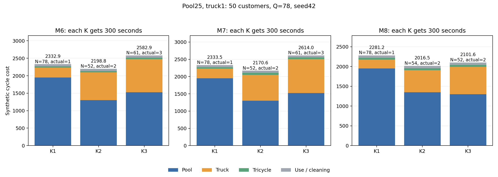

# 箱价25、一级里程1：固定K重新优化

## Material Passport

- Origin Skill: academic-research-suite / experiment-agent
- Origin Mode: run (continuous)
- Origin Date: 2026-10-06
- Verification Status: VERIFIED
- Version Label: pool25_truck1_fixedK_v1

同一100-10-1的50点算例，Q=78；M6/M7/M8各固定K=1/2/3，每个独享300秒，seed42、迭代上限1000000、3个worker，无热启动。物理输入、308份算法源码、时间预算和并行方式与上一轮箱价25、一级里程2实验相同。

本轮仅一级大卡车系数2→1；箱池25、磨损25/50=0.5保持；二级电动三轮车仍0.056470588，追踪0.1，清洗按每次回库0.2。

`C = D1 + 0.056470588D2 + 25N + 0.6U + 0.2R`。完整回收U=R=78，因此使用与清洗合计62.4，各方案相同。N是独立箱池，U/R是累计发箱/回库箱次。

独立路线与双周期审计通过9/9；真实多批方案6条、减箱6条、相对同模型K1净成本胜出4条。

| 模型 | 日历K | 实际配送批次 | 箱池N | D1 | D2 | 运输费 | 箱池费 | 总成本 | 相对同模型K1增量 |
|---|---:|---:|---:|---:|---:|---:|---:|---:|---:|
| M6 | 1 | 1 | 78 | 278.52 | 744.04 | 320.54 | 1,950.00 | 2,332.94 | 0.00 |
| M6 | 2 | 2 | 52 | 795.54 | 723.64 | 836.40 | 1,300.00 | 2,198.80 | -134.14 |
| M6 | 3 | 3 | 61 | 948.85 | 826.13 | 995.50 | 1,525.00 | 2,582.90 | 249.96 |
| M7 | 1 | 1 | 78 | 278.52 | 753.97 | 321.10 | 1,950.00 | 2,333.50 | 0.00 |
| M7 | 2 | 2 | 52 | 747.32 | 1,077.38 | 808.16 | 1,300.00 | 2,170.56 | -162.95 |
| M7 | 3 | 3 | 61 | 977.20 | 875.13 | 1,026.62 | 1,525.00 | 2,614.02 | 280.52 |
| M8 | 1 | 1 | 78 | 225.61 | 765.64 | 268.85 | 1,950.00 | 2,281.25 | 0.00 |
| M8 | 2 | 2 | 54 | 557.05 | 833.82 | 604.14 | 1,350.00 | 2,016.54 | -264.71 |
| M8 | 3 | 2 | 52 | 691.14 | 851.59 | 739.23 | 1,300.00 | 2,101.63 | -179.62 |

## 箱池节省与运输增量

| 模型 | K | 省箱 | 节省箱池费 | 额外运输费 | 总成本增量 | 固定两路线盈亏平衡箱价 |
|---|---:|---:|---:|---:|---:|---:|
| M6 | 2 | 26 | 650.00 | 515.86 | -134.14 | 19.84 |
| M6 | 3 | 17 | 425.00 | 674.96 | 249.96 | 39.70 |
| M7 | 2 | 26 | 650.00 | 487.05 | -162.95 | 18.73 |
| M7 | 3 | 17 | 425.00 | 705.52 | 280.52 | 41.50 |
| M8 | 2 | 24 | 600.00 | 335.29 | -264.71 | 13.97 |
| M8 | 3 | 26 | 650.00 | 470.38 | -179.62 | 18.09 |

## 固定路线：一级里程系数2与1的对照

保持本轮同模型单批/多批路线不变，箱池25及其他成本不变，只对同一物理路线改变一级系数。以下是重新计价，没有额外运行求解器。成本差<0代表多批更便宜。

| 模型 | K | 实际配送批次 | 一级系数2时多批成本差 | 一级系数1时多批成本差 |
|---|---:|---:|---:|---:|
| M6 | 2 | 2 | 382.88 | -134.14 |
| M6 | 3 | 3 | 920.29 | 249.96 |
| M7 | 2 | 2 | 305.84 | -162.95 |
| M7 | 3 | 3 | 979.19 | 280.52 |
| M8 | 2 | 2 | 66.73 | -264.71 |
| M8 | 3 | 2 | 285.91 | -179.62 |

成本增量=额外运输费−节省箱池费。盈亏平衡箱价仅比较表内这两条固定路线；不代表全局最优或保证重新优化能获得多批收益。

## 上一轮路线同价重算

此前箱价15/一级2.535和箱价25/一级2的18条保存路线已通过独立路线和双周期审计。本表取历史同K路线按本轮价格计价后的最低值，未将不同价格下的总成本直接相减。所有18条重计价明细见historical_routes_repriced.json。

| 模型 | K | 历史来源（一级/箱价） | 历史箱池 | 实际批次 | 原价总成本 | 历史同K新价最低 | 本轮新路线 | 新搜索降低成本 |
|---|---:|---|---:|---:|---:|---:|---:|---:|
| M6 | 1 | 2.535/15 | 78 | 1 | 1,833.98 | 2,283.26 | 2,332.94 | -49.68 |
| M6 | 2 | 2/25 | 52 | 2 | 2,876.26 | 2,143.69 | 2,198.80 | -55.11 |
| M6 | 3 | 2/25 | 62 | 3 | 3,354.54 | 2,509.97 | 2,582.90 | -72.93 |
| M7 | 1 | 2.535/15 | 78 | 1 | 1,833.98 | 2,283.26 | 2,333.50 | -50.24 |
| M7 | 2 | 2/25 | 52 | 2 | 2,767.90 | 2,085.68 | 2,170.56 | -84.88 |
| M7 | 3 | 2.535/15 | 63 | 3 | 3,095.51 | 2,502.20 | 2,614.02 | -111.82 |
| M8 | 1 | 2.535/15 | 78 | 1 | 1,828.45 | 2,277.74 | 2,281.25 | -3.51 |
| M8 | 2 | 2.535/15 | 78 | 1 | 1,820.66 | 2,269.95 | 2,016.54 | 253.41 |
| M8 | 3 | 2/25 | 59 | 2 | 2,712.06 | 2,144.35 | 2,101.63 | 42.71 |

## 三轮保存路线中的同价最好候选

| 模型 | K | 来源 | 实际配送批次 | 箱池 | 同价总成本 |
|---|---:|---|---:|---:|---:|
| M6 | 1 | 历史审计路线重计价 | 1 | 78 | 2,283.26 |
| M6 | 2 | 历史审计路线重计价 | 2 | 52 | 2,143.69 |
| M6 | 3 | 历史审计路线重计价 | 3 | 62 | 2,509.97 |
| M7 | 1 | 历史审计路线重计价 | 1 | 78 | 2,283.26 |
| M7 | 2 | 历史审计路线重计价 | 2 | 52 | 2,085.68 |
| M7 | 3 | 历史审计路线重计价 | 3 | 63 | 2,502.20 |
| M8 | 1 | 历史审计路线重计价 | 1 | 78 | 2,277.74 |
| M8 | 2 | 本轮重新搜索 | 2 | 54 | 2,016.54 |
| M8 | 3 | 本轮重新搜索 | 2 | 52 | 2,101.63 |

此表保留每个模型/K在三轮保存路线中按新价格计算更便宜的可行路线，仅是已知候选，不是全局最优。

## 所有保存路线同价比较：实际单批与多批

包含本轮9条新路线及历史18条已审计路线，全部按一级1、箱池25计价；实际一次配送的K2/K3也归入单批基准。历史重计价不等于本轮重新求解。

| 模型 | 已知单批最低 | 已知多批最低 | 多批来源 | 实际批次 | 箱池 | 多批减费 | 降幅 |
|---|---:|---:|---|---:|---:|---:|---:|
| M6 | 2,283.26 | 2,143.69 | 历史审计路线重计价 | 2 | 52 | 139.57 | 6.11% |
| M7 | 2,283.26 | 2,085.68 | 历史审计路线重计价 | 2 | 52 | 197.59 | 8.65% |
| M8 | 2,269.95 | 2,016.54 | 本轮新搜索 | 2 | 54 | 253.41 | 11.16% |

降低成本为负表示本次有限搜索比同价重算的旧保存路线更贵，应同时保留旧路线作为可行候选。时间限制搜索存在波动，不能把结果视为最优解。

## 清洗、追踪、磨损与每批数量

| 模型 | K | 发箱量 | 回库量 | 清洗 | 追踪 | 磨损 |
|---|---:|---|---|---:|---:|---:|
| M6 | 1 | b1:78 | b1:78 | 15.60 | 7.80 | 39.00 |
| M6 | 2 | b1:52, b2:26 | b1:27, b2:51 | 15.60 | 7.80 | 39.00 |
| M6 | 3 | b1:29, b2:45, b3:4 | b1:13, b2:21, b3:44 | 15.60 | 7.80 | 39.00 |
| M7 | 1 | b1:78 | b1:78 | 15.60 | 7.80 | 39.00 |
| M7 | 2 | b1:52, b2:26 | b1:26, b2:52 | 15.60 | 7.80 | 39.00 |
| M7 | 3 | b1:35, b2:39, b3:4 | b1:13, b2:18, b3:47 | 15.60 | 7.80 | 39.00 |
| M8 | 1 | b1:78 | b1:78 | 15.60 | 7.80 | 39.00 |
| M8 | 2 | b1:54, b2:24 | b1:24, b2:54 | 15.60 | 7.80 | 39.00 |
| M8 | 3 | b1:0, b2:50, b3:28 | b1:0, b2:26, b3:52 | 15.60 | 7.80 | 39.00 |

## 范围与复核

- K是日历段数，模型允许空段；实际仅配送一次的K2/K3不能算多批次复用收益。
- 单个算例、单个种子、有限搜索，不证明全局最优，也不推广至全部数据集。
- 原距离单位、速度2单位/分钟、时间窗和车队约束保持；这是成本比例测试，不是深圳实测运营成本。
- 每个worker15秒心跳、480秒硬超时；源代码和物理输入冻结，原始路线、审计及费用明细保存在results/。

复核：`python output/model35678_comparison/20261006_pool25_truck1_fixedK_v1/verify_and_report.py`。
