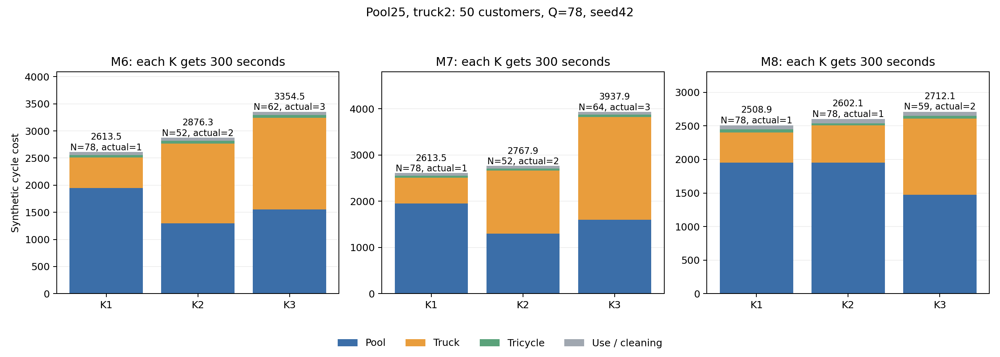

# 箱价25、一级里程2：固定K重新优化

## Material Passport

- Origin Skill: academic-research-suite / experiment-agent
- Origin Mode: run (continuous)
- Origin Date: 2026-10-06
- Verification Status: VERIFIED
- Version Label: pool25_truck2_fixedK_v1

同一100-10-1的50点算例，Q=78；M6/M7/M8各固定K=1/2/3，每个独享300秒，seed42、迭代上限1000000、3个worker，无热启动。物理输入、308份算法源码、时间预算和并行方式与此前箱价15固定K实验相同。

本轮一级大卡车系数2.535→2，箱池15→25，磨损15/50→25/50=0.5；二级电动三轮车仍0.056470588，追踪0.1，清洗按每次回库0.2。

`C = 2D1 + 0.056470588D2 + 25N + 0.6U + 0.2R`。完整回收U=R=78，因此使用与清洗合计62.4，各方案相同。N是独立箱池，U/R是累计发箱/回库箱次。

独立路线与双周期审计通过9/9；真实多批方案5条、减箱5条、相对同模型K1净成本胜出0条。

| 模型 | 日历K | 实际配送批次 | 箱池N | D1 | D2 | 运输费 | 箱池费 | 总成本 | 相对同模型K1增量 |
|---|---:|---:|---:|---:|---:|---:|---:|---:|---:|
| M6 | 1 | 1 | 78 | 278.52 | 779.73 | 601.08 | 1,950.00 | 2,613.48 | 0.00 |
| M6 | 2 | 2 | 52 | 732.57 | 862.86 | 1,513.86 | 1,300.00 | 2,876.26 | 262.78 |
| M6 | 3 | 3 | 62 | 844.57 | 938.60 | 1,742.14 | 1,550.00 | 3,354.54 | 741.06 |
| M7 | 1 | 1 | 78 | 278.52 | 779.73 | 601.08 | 1,950.00 | 2,613.48 | 0.00 |
| M7 | 2 | 2 | 52 | 682.23 | 727.00 | 1,405.50 | 1,300.00 | 2,767.90 | 154.42 |
| M7 | 3 | 3 | 64 | 1,111.92 | 915.50 | 2,275.53 | 1,600.00 | 3,937.93 | 1,324.45 |
| M8 | 1 | 1 | 78 | 225.61 | 801.22 | 496.47 | 1,950.00 | 2,508.87 | 0.00 |
| M8 | 2 | 1 | 78 | 278.52 | 577.67 | 589.67 | 1,950.00 | 2,602.07 | 93.20 |
| M8 | 3 | 2 | 59 | 567.71 | 694.75 | 1,174.66 | 1,475.00 | 2,712.06 | 203.19 |

## 箱池节省与运输增量

| 模型 | K | 省箱 | 节省箱池费 | 额外运输费 | 总成本增量 | 固定两路线盈亏平衡箱价 |
|---|---:|---:|---:|---:|---:|---:|
| M6 | 2 | 26 | 650.00 | 912.78 | 262.78 | 35.11 |
| M6 | 3 | 16 | 400.00 | 1,141.06 | 741.06 | 71.32 |
| M7 | 2 | 26 | 650.00 | 804.42 | 154.42 | 30.94 |
| M7 | 3 | 14 | 350.00 | 1,674.45 | 1,324.45 | 119.60 |
| M8 | 2 | 0 | 0.00 | 93.20 | 93.20 | — |
| M8 | 3 | 19 | 475.00 | 678.19 | 203.19 | 35.69 |

成本增量=额外运输费−节省箱池费。盈亏平衡箱价仅比较表内这两条固定路线；不代表全局最优或保证重新优化能获得多批收益。

## 上一轮路线同价重算

上一轮箱价15/一级2.535的9条保存路线已通过独立路线和双周期审计。本表利用保存的物理指标重新计算本轮价格，未将不同价格下的总成本直接相减。

| 模型 | K | 旧路线箱池 | 旧路线实际批次 | 旧价格总成本 | 旧路线按新价格 | 本轮新路线 | 新搜索降低成本 |
|---|---:|---:|---:|---:|---:|---:|---:|
| M6 | 1 | 78 | 1 | 1,833.98 | 2,508.88 | 2,613.48 | -104.61 |
| M6 | 2 | 52 | 2 | 3,195.34 | 3,242.03 | 2,876.26 | 365.77 |
| M6 | 3 | 61 | 3 | 3,285.33 | 3,432.84 | 3,354.54 | 78.30 |
| M7 | 1 | 78 | 1 | 1,833.98 | 2,508.88 | 2,613.48 | -104.61 |
| M7 | 2 | 57 | 2 | 2,709.29 | 2,923.80 | 2,767.90 | 155.90 |
| M7 | 3 | 63 | 3 | 3,095.51 | 3,309.31 | 3,937.93 | -628.62 |
| M8 | 1 | 78 | 1 | 1,828.45 | 2,503.35 | 2,508.87 | -5.52 |
| M8 | 2 | 78 | 1 | 1,820.66 | 2,495.56 | 2,602.07 | -106.51 |
| M8 | 3 | 78 | 1 | 1,955.46 | 2,602.04 | 2,712.06 | -110.01 |

## 两轮保存路线中的同价最好候选

| 模型 | K | 来源 | 实际配送批次 | 箱池 | 同价总成本 |
|---|---:|---|---:|---:|---:|
| M6 | 1 | 旧审计路线重计价 | 1 | 78 | 2,508.88 |
| M6 | 2 | 本轮重新搜索 | 2 | 52 | 2,876.26 |
| M6 | 3 | 本轮重新搜索 | 3 | 62 | 3,354.54 |
| M7 | 1 | 旧审计路线重计价 | 1 | 78 | 2,508.88 |
| M7 | 2 | 本轮重新搜索 | 2 | 52 | 2,767.90 |
| M7 | 3 | 旧审计路线重计价 | 3 | 63 | 3,309.31 |
| M8 | 1 | 旧审计路线重计价 | 1 | 78 | 2,503.35 |
| M8 | 2 | 旧审计路线重计价 | 1 | 78 | 2,495.56 |
| M8 | 3 | 旧审计路线重计价 | 1 | 78 | 2,602.04 |

此表保留每个模型/K在两轮保存路线中按新价格计算更便宜的可行路线，仅是已知候选，不是全局最优。

降低成本为负表示本次有限搜索比同价重算的旧保存路线更贵，应同时保留旧路线作为可行候选。时间限制搜索存在波动，不能把结果视为最优解。

## 清洗、追踪、磨损与每批数量

| 模型 | K | 发箱量 | 回库量 | 清洗 | 追踪 | 磨损 |
|---|---:|---|---|---:|---:|---:|
| M6 | 1 | b1:78 | b1:78 | 15.60 | 7.80 | 39.00 |
| M6 | 2 | b1:52, b2:26 | b1:26, b2:52 | 15.60 | 7.80 | 39.00 |
| M6 | 3 | b1:57, b2:18, b3:3 | b1:13, b2:23, b3:42 | 15.60 | 7.80 | 39.00 |
| M7 | 1 | b1:78 | b1:78 | 15.60 | 7.80 | 39.00 |
| M7 | 2 | b1:52, b2:26 | b1:26, b2:52 | 15.60 | 7.80 | 39.00 |
| M7 | 3 | b1:55, b2:20, b3:3 | b1:11, b2:26, b3:41 | 15.60 | 7.80 | 39.00 |
| M8 | 1 | b1:78 | b1:78 | 15.60 | 7.80 | 39.00 |
| M8 | 2 | b1:0, b2:78 | b1:0, b2:78 | 15.60 | 7.80 | 39.00 |
| M8 | 3 | b1:0, b2:59, b3:19 | b1:0, b2:19, b3:59 | 15.60 | 7.80 | 39.00 |

## 范围与复核

- K是日历段数，模型允许空段；实际仅配送一次的K2/K3不能算多批次复用收益。
- 单个算例、单个种子、有限搜索，不证明全局最优，也不推广至全部数据集。
- 原距离单位、速度2单位/分钟、时间窗和车队约束保持；这是成本比例测试，不是深圳实测运营成本。
- 每个worker15秒心跳、480秒硬超时；源代码和物理输入冻结，原始路线、审计及费用明细保存在results/。

复核：`python output/model35678_comparison/20261006_pool25_truck2_fixedK_v1/verify_and_report.py`。
