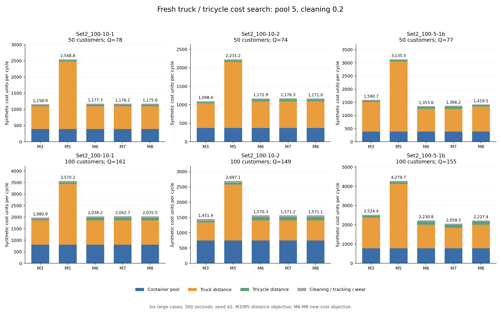

# 大卡车/电动三轮新成本：六例五分钟重新优化

远程基准提交：`6f95443447e1898ca131fca2e903bc8973da3f84`。本轮按用户选定清洗费0.2重新搜索，共 30/30 次，独立双周期审计通过 30 次。

在最终模型6–8方案中，18/18 个只有一次实际配送，0/18 个有多次实际配送，0/18 个箱池小于总需求箱次 Q。日历有空段的方案为 1 个，不能仅凭日历 K 判断循环利用。

六个原大规模算例、模型3/5/6/7/8，每次 ALNS 300 秒、seed=42、最多1000000次迭代、四进程。模型6–8在K=1/2/3之间共享总预算。订单、分仓、道路、时间窗、车队、容量、清洗时长和周期边界均与上一轮相同。

## 本轮参数

一级距离系数2.535，二级0.05647058823529412，箱池系数5。一级/二级占用时间、车辆固定和趟次固定费均为0。清洗0.2/实际回总仓箱次；追踪0.1/实际发箱次；磨损按箱价参考5、寿命50次，为0.1/发箱次。

`C = 2.535D1 + 0.056470588D2 + 5N + 0.2U + 0.2R`；完整发出、回收时 U=R=Q，得到 `C = 2.535D1 + 0.056470588D2 + 5N + 0.4Q`。

两级运输不能再直接将原始距离相加计费。价格和距离仍是合成比例测试，未校准为实际人民币运营支出。初始购箱参考5N在成本文件单列，不再次加入周期总费用。

主参数语义哈希：`caa09fff5272924767c6cb3ca10576ff2016cd9150d9d4c1d5d214ba134f7382`；源文件 `C:\Users\猫的秋刀鱼\Desktop\毕业设计\config\cost\cases\truck_tricycle_pool5_clean02_v2.json` 已复制到 inputs/common_economic.json。

模型3/5保留原始距离目标和配置箱池，再统一加权计价；模型6–8直接优化本轮费用并使用优化箱池。原始距离目标与加权费用目标不同，不能把全部收益解释为分批机制。

## 最终方案成本

| 算例 | 点数 | Q | M3 | M5 | M6 | M7 | M8 | 最低成本模型 |
|---|---:|---:|---:|---:|---:|---:|---:|---|
| zhou_Set2_100-10-1_subset50 | 50 | 78 | 1,158.92 | 2,548.81 | 1,177.33 | 1,176.24 | 1,175.64 | M3 |
| zhou_Set2_100-10-1 | 100 | 161 | 1,980.91 | 3,570.24 | 2,038.22 | 2,042.67 | 2,035.52 | M3 |
| zhou_Set2_100-10-2_subset50 | 50 | 74 | 1,098.43 | 2,231.23 | 1,172.91 | 1,176.31 | 1,170.96 | M3 |
| zhou_Set2_100-10-2 | 100 | 149 | 1,451.40 | 2,697.10 | 1,570.25 | 1,571.17 | 1,571.15 | M3 |
| zhou_Set2_100-5-1b_subset50 | 50 | 77 | 1,590.67 | 3,135.48 | 1,353.61 | 1,366.18 | 1,419.51 | M6 |
| zhou_Set2_100-5-1b | 100 | 155 | 2,524.44 | 4,279.69 | 2,230.84 | 2,058.49 | 2,227.41 | M7 |

本轮有限搜索结果：M3在4例最低、M6在1例最低、M7在1例最低。模型3/5和联合模型的搜索目标、预算分配不同，这一排名不能作为各模型理论最优成本的排序。

## 实际配送批次、箱池和清洗

N 是独立物理箱池，Q 是本周期需求箱次。模型3/5的N来自输入配置；模型6–8的N来自优化输出，并经独立库存重放核对。实际配送批次只计有需求的日历段，空段不代表箱子再次使用。

| 算例 | 模型 | N | 原时间表最低需箱 | Q | 日历K / 实际配送批次 | 各批发箱 | 各批回总仓 | 清洗费 |
|---|---|---:|---:|---:|---|---|---|---:|
| zhou_Set2_100-10-1_subset50 | M3 | 78 | 78 | 78 | 1/1 | b1:78 | b1:78 | 15.60 |
| zhou_Set2_100-10-1_subset50 | M5 | 78 | 71 | 78 | 3/3 | b1:29, b2:42, b3:7 | b1:0, b2:22, b3:56 | 15.60 |
| zhou_Set2_100-10-1_subset50 | M6 | 78 | 78 | 78 | 1/1 | b1:78 | b1:78 | 15.60 |
| zhou_Set2_100-10-1_subset50 | M7 | 78 | 78 | 78 | 1/1 | b1:78 | b1:78 | 15.60 |
| zhou_Set2_100-10-1_subset50 | M8 | 78 | 78 | 78 | 1/1 | b1:78 | b1:78 | 15.60 |
| zhou_Set2_100-10-1 | M3 | 161 | 161 | 161 | 1/1 | b1:161 | b1:161 | 32.20 |
| zhou_Set2_100-10-1 | M5 | 161 | 148 | 161 | 3/3 | b1:59, b2:89, b3:13 | b1:0, b2:38, b3:123 | 32.20 |
| zhou_Set2_100-10-1 | M6 | 161 | 161 | 161 | 1/1 | b1:161 | b1:161 | 32.20 |
| zhou_Set2_100-10-1 | M7 | 161 | 161 | 161 | 1/1 | b1:161 | b1:161 | 32.20 |
| zhou_Set2_100-10-1 | M8 | 161 | 161 | 161 | 1/1 | b1:161 | b1:161 | 32.20 |
| zhou_Set2_100-10-2_subset50 | M3 | 74 | 74 | 74 | 1/1 | b1:74 | b1:74 | 14.80 |
| zhou_Set2_100-10-2_subset50 | M5 | 74 | 67 | 74 | 3/3 | b1:25, b2:42, b3:7 | b1:0, b2:19, b3:55 | 14.80 |
| zhou_Set2_100-10-2_subset50 | M6 | 74 | 74 | 74 | 1/1 | b1:74 | b1:74 | 14.80 |
| zhou_Set2_100-10-2_subset50 | M7 | 74 | 74 | 74 | 1/1 | b1:74 | b1:74 | 14.80 |
| zhou_Set2_100-10-2_subset50 | M8 | 74 | 74 | 74 | 1/1 | b1:74 | b1:74 | 14.80 |
| zhou_Set2_100-10-2 | M3 | 149 | 149 | 149 | 1/1 | b1:149 | b1:149 | 29.80 |
| zhou_Set2_100-10-2 | M5 | 149 | 140 | 149 | 3/3 | b1:58, b2:82, b3:9 | b1:0, b2:48, b3:101 | 29.80 |
| zhou_Set2_100-10-2 | M6 | 149 | 149 | 149 | 1/1 | b1:149 | b1:149 | 29.80 |
| zhou_Set2_100-10-2 | M7 | 149 | 149 | 149 | 1/1 | b1:149 | b1:149 | 29.80 |
| zhou_Set2_100-10-2 | M8 | 149 | 149 | 149 | 1/1 | b1:149 | b1:149 | 29.80 |
| zhou_Set2_100-5-1b_subset50 | M3 | 77 | 77 | 77 | 1/1 | b1:77 | b1:77 | 15.40 |
| zhou_Set2_100-5-1b_subset50 | M5 | 77 | 77 | 77 | 3/3 | b1:29, b2:43, b3:5 | b1:0, b2:22, b3:55 | 15.40 |
| zhou_Set2_100-5-1b_subset50 | M6 | 77 | 77 | 77 | 1/1 | b1:77 | b1:77 | 15.40 |
| zhou_Set2_100-5-1b_subset50 | M7 | 77 | 77 | 77 | 1/1 | b1:77 | b1:77 | 15.40 |
| zhou_Set2_100-5-1b_subset50 | M8 | 77 | 77 | 77 | 3/1 | b1:0, b2:0, b3:77 | b1:0, b2:0, b3:77 | 15.40 |
| zhou_Set2_100-5-1b | M3 | 155 | 155 | 155 | 1/1 | b1:155 | b1:155 | 31.00 |
| zhou_Set2_100-5-1b | M5 | 155 | 148 | 155 | 3/3 | b1:64, b2:84, b3:7 | b1:0, b2:71, b3:84 | 31.00 |
| zhou_Set2_100-5-1b | M6 | 155 | 155 | 155 | 1/1 | b1:155 | b1:155 | 31.00 |
| zhou_Set2_100-5-1b | M7 | 155 | 155 | 155 | 1/1 | b1:155 | b1:155 | 31.00 |
| zhou_Set2_100-5-1b | M8 | 155 | 155 | 155 | 1/1 | b1:155 | b1:155 | 31.00 |

所有箱子在08:00–21:00的同一780分钟周期末回到总仓并洗净。清洗按每次实际回库箱次累计，包含最后一轮；同一箱子复用后再次回库再次收费。连续两个周期均已验证。

## 各K候选与箱池节省

求解器候选摘要中，有 24 个有效候选的箱池小于Q。候选 valid 来自求解器内部审计；独立双周期复核仅针对30个最终返回方案。

| 算例 | 模型 | 候选K | 候选N | 候选成本 | 状态 | 最终K |
|---|---|---:|---:|---:|---|---:|
| zhou_Set2_100-10-1_subset50 | M6 | 1 | 78 | 1,177.33 | FEASIBLE | 1 |
| zhou_Set2_100-10-1_subset50 | M6 | 2 | 52 | 2,670.74 | FEASIBLE | 1 |
| zhou_Set2_100-10-1_subset50 | M6 | 3 | 78 | 2,173.02 | FEASIBLE | 1 |
| zhou_Set2_100-10-1_subset50 | M7 | 1 | 78 | 1,176.24 | FEASIBLE | 1 |
| zhou_Set2_100-10-1_subset50 | M7 | 2 | 52 | 2,670.85 | FEASIBLE | 1 |
| zhou_Set2_100-10-1_subset50 | M7 | 3 | 78 | 2,626.14 | FEASIBLE | 1 |
| zhou_Set2_100-10-1_subset50 | M8 | 1 | 78 | 1,175.64 | FEASIBLE | 1 |
| zhou_Set2_100-10-1_subset50 | M8 | 2 | 78 | 1,448.60 | FEASIBLE | 1 |
| zhou_Set2_100-10-1_subset50 | M8 | 3 | 78 | 2,020.47 | FEASIBLE | 1 |
| zhou_Set2_100-10-1 | M6 | 1 | 161 | 2,038.22 | FEASIBLE | 1 |
| zhou_Set2_100-10-1 | M6 | 2 | 104 | 3,714.45 | FEASIBLE | 1 |
| zhou_Set2_100-10-1 | M6 | 3 | 137 | 4,863.06 | FEASIBLE | 1 |
| zhou_Set2_100-10-1 | M7 | 1 | 161 | 2,042.67 | FEASIBLE | 1 |
| zhou_Set2_100-10-1 | M7 | 2 | 159 | 2,526.19 | FEASIBLE | 1 |
| zhou_Set2_100-10-1 | M7 | 3 | 119 | 5,297.30 | FEASIBLE | 1 |
| zhou_Set2_100-10-1 | M8 | 1 | 161 | 2,035.52 | FEASIBLE | 1 |
| zhou_Set2_100-10-1 | M8 | 2 | 109 | 3,738.43 | FEASIBLE | 1 |
| zhou_Set2_100-10-1 | M8 | 3 | 134 | 3,651.48 | FEASIBLE | 1 |
| zhou_Set2_100-10-2_subset50 | M6 | 1 | 74 | 1,172.91 | FEASIBLE | 1 |
| zhou_Set2_100-10-2_subset50 | M6 | 2 | 69 | 1,456.51 | FEASIBLE | 1 |
| zhou_Set2_100-10-2_subset50 | M6 | 3 | 70 | 1,661.34 | FEASIBLE | 1 |
| zhou_Set2_100-10-2_subset50 | M7 | 1 | 74 | 1,176.31 | FEASIBLE | 1 |
| zhou_Set2_100-10-2_subset50 | M7 | 2 | 74 | 2,506.37 | FEASIBLE | 1 |
| zhou_Set2_100-10-2_subset50 | M7 | 3 | 71 | 2,175.51 | FEASIBLE | 1 |
| zhou_Set2_100-10-2_subset50 | M8 | 1 | 74 | 1,170.96 | FEASIBLE | 1 |
| zhou_Set2_100-10-2_subset50 | M8 | 2 | 74 | 1,549.94 | FEASIBLE | 1 |
| zhou_Set2_100-10-2_subset50 | M8 | 3 | 74 | 1,574.09 | FEASIBLE | 1 |
| zhou_Set2_100-10-2 | M6 | 1 | 149 | 1,570.25 | FEASIBLE | 1 |
| zhou_Set2_100-10-2 | M6 | 2 | 126 | 3,212.33 | FEASIBLE | 1 |
| zhou_Set2_100-10-2 | M6 | 3 | 124 | 3,907.96 | FEASIBLE | 1 |
| zhou_Set2_100-10-2 | M7 | 1 | 149 | 1,571.17 | FEASIBLE | 1 |
| zhou_Set2_100-10-2 | M7 | 2 | 148 | 2,577.13 | FEASIBLE | 1 |
| zhou_Set2_100-10-2 | M7 | 3 | 137 | 4,091.77 | FEASIBLE | 1 |
| zhou_Set2_100-10-2 | M8 | 1 | 149 | 1,571.15 | FEASIBLE | 1 |
| zhou_Set2_100-10-2 | M8 | 2 | 107 | 3,073.99 | FEASIBLE | 1 |
| zhou_Set2_100-10-2 | M8 | 3 | 148 | 2,924.91 | FEASIBLE | 1 |
| zhou_Set2_100-5-1b_subset50 | M6 | 1 | 77 | 1,353.61 | FEASIBLE | 1 |
| zhou_Set2_100-5-1b_subset50 | M6 | 2 | 71 | 2,126.62 | FEASIBLE | 1 |
| zhou_Set2_100-5-1b_subset50 | M6 | 3 | 74 | 3,239.91 | FEASIBLE | 1 |
| zhou_Set2_100-5-1b_subset50 | M7 | 1 | 77 | 1,366.18 | FEASIBLE | 1 |
| zhou_Set2_100-5-1b_subset50 | M7 | 2 | 77 | 1,546.94 | FEASIBLE | 1 |
| zhou_Set2_100-5-1b_subset50 | M7 | 3 | 70 | 3,706.35 | FEASIBLE | 1 |
| zhou_Set2_100-5-1b_subset50 | M8 | 1 | 77 | 1,458.37 | FEASIBLE | 3 |
| zhou_Set2_100-5-1b_subset50 | M8 | 2 | 77 | 1,784.78 | FEASIBLE | 3 |
| zhou_Set2_100-5-1b_subset50 | M8 | 3 | 77 | 1,419.51 | FEASIBLE | 3 |
| zhou_Set2_100-5-1b | M6 | 1 | 155 | 2,230.84 | FEASIBLE | 1 |
| zhou_Set2_100-5-1b | M6 | 2 | 141 | 3,237.79 | FEASIBLE | 1 |
| zhou_Set2_100-5-1b | M6 | 3 | 149 | 4,076.10 | FEASIBLE | 1 |
| zhou_Set2_100-5-1b | M7 | 1 | 155 | 2,058.49 | FEASIBLE | 1 |
| zhou_Set2_100-5-1b | M7 | 2 | 148 | 3,141.46 | FEASIBLE | 1 |
| zhou_Set2_100-5-1b | M7 | 3 | 155 | 4,179.99 | FEASIBLE | 1 |
| zhou_Set2_100-5-1b | M8 | 1 | 155 | 2,227.41 | FEASIBLE | 1 |
| zhou_Set2_100-5-1b | M8 | 2 | 155 | 2,238.08 | FEASIBLE | 1 |
| zhou_Set2_100-5-1b | M8 | 3 | 148 | 5,161.04 | FEASIBLE | 1 |

固定两条完整回收方案之间，多批次要降低本轮周期成本，必须满足 `2.535ΔD1 + 0.056470588ΔD2 < 5×节省箱数`。清洗、追踪和按使用磨损在Q相同时相同。候选摘要不保存原始路线，不能从一个加权总成本反推分别的一级、二级距离。

下表对每个模型运行，取成本最低的减箱候选，与该运行的K=1候选比较。运输增量由加权总目标减去箱池费和固定箱次费得到；正的总增量表示减箱后仍更贵。两者均为有限搜索找到的候选，不能据此证明多批次的理论最优成本。

| 算例 | 模型 | 减箱候选K | 单批池→候选池 | 箱池费节省 | 加权运输增量 | 总成本增量 |
|---|---|---:|---|---:|---:|---:|
| zhou_Set2_100-10-1_subset50 | M6 | 2 | 78→52 | 130.00 | 1,623.41 | 1,493.41 |
| zhou_Set2_100-10-1_subset50 | M7 | 2 | 78→52 | 130.00 | 1,624.61 | 1,494.61 |
| zhou_Set2_100-10-1 | M6 | 2 | 161→104 | 285.00 | 1,961.23 | 1,676.23 |
| zhou_Set2_100-10-1 | M7 | 2 | 161→159 | 10.00 | 493.52 | 483.52 |
| zhou_Set2_100-10-1 | M8 | 3 | 161→134 | 135.00 | 1,750.96 | 1,615.96 |
| zhou_Set2_100-10-2_subset50 | M6 | 2 | 74→69 | 25.00 | 308.59 | 283.59 |
| zhou_Set2_100-10-2_subset50 | M7 | 3 | 74→71 | 15.00 | 1,014.20 | 999.20 |
| zhou_Set2_100-10-2 | M6 | 2 | 149→126 | 115.00 | 1,757.08 | 1,642.08 |
| zhou_Set2_100-10-2 | M7 | 2 | 149→148 | 5.00 | 1,010.96 | 1,005.96 |
| zhou_Set2_100-10-2 | M8 | 3 | 149→148 | 5.00 | 1,358.76 | 1,353.76 |
| zhou_Set2_100-5-1b_subset50 | M6 | 2 | 77→71 | 30.00 | 803.01 | 773.01 |
| zhou_Set2_100-5-1b_subset50 | M7 | 3 | 77→70 | 35.00 | 2,375.17 | 2,340.17 |
| zhou_Set2_100-5-1b | M6 | 2 | 155→141 | 70.00 | 1,076.95 | 1,006.95 |
| zhou_Set2_100-5-1b | M7 | 2 | 155→148 | 35.00 | 1,117.97 | 1,082.97 |
| zhou_Set2_100-5-1b | M8 | 3 | 155→148 | 35.00 | 2,968.63 | 2,933.63 |

## 本轮最低联合方案与M3的差额

| 算例 | 最低联合模型 | 相对M3降低比例 | 加权运输节省 | 箱池节省 | 总节省 |
|---|---|---:|---:|---:|---:|
| zhou_Set2_100-10-1_subset50 | M8 | -1.44% | -16.72 | 0.00 | -16.72 |
| zhou_Set2_100-10-1 | M8 | -2.76% | -54.61 | 0.00 | -54.61 |
| zhou_Set2_100-10-2_subset50 | M8 | -6.60% | -72.53 | 0.00 | -72.53 |
| zhou_Set2_100-10-2 | M6 | -8.19% | -118.85 | 0.00 | -118.85 |
| zhou_Set2_100-5-1b_subset50 | M6 | 14.90% | 237.06 | 0.00 | 237.06 |
| zhou_Set2_100-5-1b | M7 | 18.46% | 465.95 | 0.00 | 465.95 |

## 同价旧方案与新搜索

两列均按本轮清洗0.2的新参数计价；左列是上一轮保存方案重新计价，右列是本轮重新搜索，不把参数调整本身当作优化收益。旧方案的审计文件哈希和新价格重算均已核对。

同价比较中，新搜索10次更低、20次更高、0次相同。有限时间、单种子的新搜索没有保证优于已保存旧方案；两轮结果均完整保留。

| 算例 | 模型 | 旧方案按新价 | 新搜索 | 降低比例 | 旧池→新池 |
|---|---|---:|---:|---:|---|
| zhou_Set2_100-10-1_subset50 | M3 | 1,159.11 | 1,158.92 | 0.02% | 78→78 |
| zhou_Set2_100-10-1_subset50 | M5 | 2,576.66 | 2,548.81 | 1.08% | 78→78 |
| zhou_Set2_100-10-1_subset50 | M6 | 1,025.84 | 1,177.33 | -14.77% | 78→78 |
| zhou_Set2_100-10-1_subset50 | M7 | 1,160.37 | 1,176.24 | -1.37% | 78→78 |
| zhou_Set2_100-10-1_subset50 | M8 | 1,159.95 | 1,175.64 | -1.35% | 78→78 |
| zhou_Set2_100-10-1 | M3 | 1,979.41 | 1,980.91 | -0.08% | 161→161 |
| zhou_Set2_100-10-1 | M5 | 3,596.57 | 3,570.24 | 0.73% | 161→161 |
| zhou_Set2_100-10-1 | M6 | 1,874.85 | 2,038.22 | -8.71% | 161→161 |
| zhou_Set2_100-10-1 | M7 | 1,848.45 | 2,042.67 | -10.51% | 161→161 |
| zhou_Set2_100-10-1 | M8 | 2,015.51 | 2,035.52 | -0.99% | 161→161 |
| zhou_Set2_100-10-2_subset50 | M3 | 1,098.39 | 1,098.43 | -0.00% | 74→74 |
| zhou_Set2_100-10-2_subset50 | M5 | 2,228.11 | 2,231.23 | -0.14% | 74→74 |
| zhou_Set2_100-10-2_subset50 | M6 | 921.13 | 1,172.91 | -27.33% | 74→74 |
| zhou_Set2_100-10-2_subset50 | M7 | 1,102.42 | 1,176.31 | -6.70% | 74→74 |
| zhou_Set2_100-10-2_subset50 | M8 | 922.46 | 1,170.96 | -26.94% | 74→74 |
| zhou_Set2_100-10-2 | M3 | 1,448.65 | 1,451.40 | -0.19% | 149→149 |
| zhou_Set2_100-10-2 | M5 | 2,698.02 | 2,697.10 | 0.03% | 149→149 |
| zhou_Set2_100-10-2 | M6 | 1,485.04 | 1,570.25 | -5.74% | 149→149 |
| zhou_Set2_100-10-2 | M7 | 1,625.44 | 1,571.17 | 3.34% | 149→149 |
| zhou_Set2_100-10-2 | M8 | 1,606.87 | 1,571.15 | 2.22% | 149→149 |
| zhou_Set2_100-5-1b_subset50 | M3 | 1,590.22 | 1,590.67 | -0.03% | 77→77 |
| zhou_Set2_100-5-1b_subset50 | M5 | 3,137.78 | 3,135.48 | 0.07% | 77→77 |
| zhou_Set2_100-5-1b_subset50 | M6 | 1,334.40 | 1,353.61 | -1.44% | 77→77 |
| zhou_Set2_100-5-1b_subset50 | M7 | 1,460.48 | 1,366.18 | 6.46% | 77→77 |
| zhou_Set2_100-5-1b_subset50 | M8 | 1,363.89 | 1,419.51 | -4.08% | 77→77 |
| zhou_Set2_100-5-1b | M3 | 2,525.41 | 2,524.44 | 0.04% | 155→155 |
| zhou_Set2_100-5-1b | M5 | 4,273.93 | 4,279.69 | -0.13% | 155→155 |
| zhou_Set2_100-5-1b | M6 | 2,131.96 | 2,230.84 | -4.64% | 155→155 |
| zhou_Set2_100-5-1b | M7 | 2,096.48 | 2,058.49 | 1.81% | 155→155 |
| zhou_Set2_100-5-1b | M8 | 2,178.78 | 2,227.41 | -2.23% | 155→155 |

## 清洗0.8的同方案计价对照

主实验使用0.2；另将同一已审计方案按0.8计价，没有另做0.8搜索。在完整回收时，每个方案增加0.6Q，运输/箱池的理论权衡和同例方案排名不变。有限预算启发式搜索轨迹仍可能受总目标常量和机器负载影响，不能把这个计价对照称为独立的0.8优化。

| 算例 | 模型 | 清洗0.2总成本 | 清洗0.8同方案总成本 | 增量 |
|---|---|---:|---:|---:|
| zhou_Set2_100-10-1_subset50 | M3 | 1,158.92 | 1,205.72 | 46.80 |
| zhou_Set2_100-10-1_subset50 | M5 | 2,548.81 | 2,595.61 | 46.80 |
| zhou_Set2_100-10-1_subset50 | M6 | 1,177.33 | 1,224.13 | 46.80 |
| zhou_Set2_100-10-1_subset50 | M7 | 1,176.24 | 1,223.04 | 46.80 |
| zhou_Set2_100-10-1_subset50 | M8 | 1,175.64 | 1,222.44 | 46.80 |
| zhou_Set2_100-10-1 | M3 | 1,980.91 | 2,077.51 | 96.60 |
| zhou_Set2_100-10-1 | M5 | 3,570.24 | 3,666.84 | 96.60 |
| zhou_Set2_100-10-1 | M6 | 2,038.22 | 2,134.82 | 96.60 |
| zhou_Set2_100-10-1 | M7 | 2,042.67 | 2,139.27 | 96.60 |
| zhou_Set2_100-10-1 | M8 | 2,035.52 | 2,132.12 | 96.60 |
| zhou_Set2_100-10-2_subset50 | M3 | 1,098.43 | 1,142.83 | 44.40 |
| zhou_Set2_100-10-2_subset50 | M5 | 2,231.23 | 2,275.63 | 44.40 |
| zhou_Set2_100-10-2_subset50 | M6 | 1,172.91 | 1,217.31 | 44.40 |
| zhou_Set2_100-10-2_subset50 | M7 | 1,176.31 | 1,220.71 | 44.40 |
| zhou_Set2_100-10-2_subset50 | M8 | 1,170.96 | 1,215.36 | 44.40 |
| zhou_Set2_100-10-2 | M3 | 1,451.40 | 1,540.80 | 89.40 |
| zhou_Set2_100-10-2 | M5 | 2,697.10 | 2,786.50 | 89.40 |
| zhou_Set2_100-10-2 | M6 | 1,570.25 | 1,659.65 | 89.40 |
| zhou_Set2_100-10-2 | M7 | 1,571.17 | 1,660.57 | 89.40 |
| zhou_Set2_100-10-2 | M8 | 1,571.15 | 1,660.55 | 89.40 |
| zhou_Set2_100-5-1b_subset50 | M3 | 1,590.67 | 1,636.87 | 46.20 |
| zhou_Set2_100-5-1b_subset50 | M5 | 3,135.48 | 3,181.68 | 46.20 |
| zhou_Set2_100-5-1b_subset50 | M6 | 1,353.61 | 1,399.81 | 46.20 |
| zhou_Set2_100-5-1b_subset50 | M7 | 1,366.18 | 1,412.38 | 46.20 |
| zhou_Set2_100-5-1b_subset50 | M8 | 1,419.51 | 1,465.71 | 46.20 |
| zhou_Set2_100-5-1b | M3 | 2,524.44 | 2,617.44 | 93.00 |
| zhou_Set2_100-5-1b | M5 | 4,279.69 | 4,372.69 | 93.00 |
| zhou_Set2_100-5-1b | M6 | 2,230.84 | 2,323.84 | 93.00 |
| zhou_Set2_100-5-1b | M7 | 2,058.49 | 2,151.49 | 93.00 |
| zhou_Set2_100-5-1b | M8 | 2,227.41 | 2,320.41 | 93.00 |

## 边界与复现

- 单种子、有限预算可行解，不是全局最优或稳定性证明。四进程共享机器，300秒为软截止。
- 模型3将300秒用于单批次距离搜索；模型6–8将总预算分给三个K，各K预算、迭代和候选池在count_candidates.json中。若联合模型更差，不能据此推断其理论最优值更差。
- 模型3/5仍优化两级原始距离和；模型6–8优化本轮加权费用。除日历机制外，目标和搜索过程也有差异。
- 三张底图的50/100点为嵌套规模，不是六个独立总体样本；保留全部失败，不把无解费用记为零。
- 原时间表最低需箱参考只重算模型3/5箱池费，不改变路线，也不是箱池优化输出；见comparison_cost.json。

复核：`python output/model35678_comparison/20261006_truck_tricycle_5min_v2/verify_and_report.py`。复核支持仓库路径变化，检查冻结字节、重新审计30个方案、重算新目标、优化箱池、清洗箱次和双周期可复用性。

重新运行应把run_study.py、monitor_study.py、verify_and_report.py、report_content.py复制到output/model35678_comparison/下一个新的空目录，然后运行run_study.py与verify_and_report.py；已有注册目录拒绝覆盖。

主要文件：experiment.json、runs.csv、results/、verification.json、pool_cycle_cleaning_diagnostics.json、count_candidates.json、findings.json、same_price_search_comparison.csv、alternate_cleaning_comparison.json，以及冻结inputs/、cases/、source_snapshot/。
