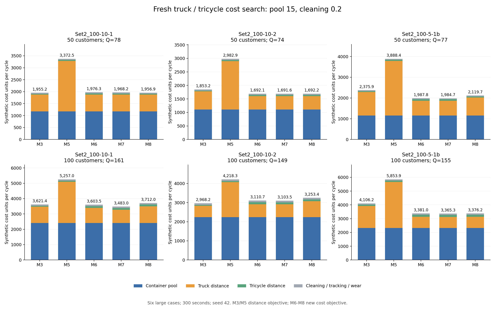

# 箱池成本15：六例五分钟重新优化

## Material Passport

- Origin Skill: academic-research-suite / experiment-agent
- Origin Mode: run (continuous)
- Origin Date: 2026-10-06
- Verification Status: VERIFIED
- Version Label: truck_tricycle_pool15_5min_v1

远程基准提交：`b95c13f5ccd332d04aa1de5b110545b96c9e6def`。本轮按用户要求将箱池系数调为15、磨损调为15/50=0.3，清洗沿用0.2，重新搜索，共 30/30 次，独立双周期审计通过 30 次。

在最终模型6–8方案中，18/18 个只有一次实际配送，0/18 个有多次实际配送，0/18 个箱池小于总需求箱次 Q。日历有空段的方案为 2 个，不能仅凭日历 K 判断循环利用。

六个原大规模算例、模型3/5/6/7/8，每次 ALNS 300 秒、seed=42、最多1000000次迭代、四进程。模型6–8在K=1/2/3之间共享总预算。订单、分仓、道路、时间窗、车队、容量、清洗时长和周期边界均与上一轮相同。

## 本轮参数

相对上一轮，仅改变箱池单价5→15和磨损参考箱价5→15（寿命仍50次）。清洗0.2、追踪0.1、两级距离系数、原始距离与速度均沿用。

一级距离系数2.535，二级0.05647058823529412，箱池系数15。一级/二级占用时间、车辆固定和趟次固定费均为0。清洗0.2/实际回总仓箱次；追踪0.1/实际发箱次；磨损按箱价参考15、寿命50次，为0.3/发箱次。

`C = 2.535D1 + 0.056470588D2 + 15N + 0.4U + 0.2R`；完整发出、回收时 U=R=Q，得到 `C = 2.535D1 + 0.056470588D2 + 15N + 0.6Q`。

两级运输不能再直接将原始距离相加计费。价格和距离仍是合成比例测试，未校准为实际人民币运营支出。初始购箱参考15N在成本文件单列，不再次加入周期总费用。

主参数语义哈希：`12c4601ab40020af0b3f8ce40942acc600ec69ca49c2fc7ad6473562bb3d80ad`；源文件 `/Users/chenzeheng/Desktop/2E-VRPTW-PDD/config/cost/cases/truck_tricycle_pool15_clean02_v1.json` 已复制到 inputs/common_economic.json。

模型3/5保留原始距离目标和配置箱池，再统一加权计价；模型6–8直接优化本轮费用并使用优化箱池。原始距离目标与加权费用目标不同，不能把全部收益解释为分批机制。

## 最终方案成本

| 算例 | 点数 | Q | M3 | M5 | M6 | M7 | M8 | 最低成本模型 |
|---|---:|---:|---:|---:|---:|---:|---:|---|
| zhou_Set2_100-10-1_subset50 | 50 | 78 | 1,955.20 | 3,372.45 | 1,976.29 | 1,968.22 | 1,956.92 | M3 |
| zhou_Set2_100-10-1 | 100 | 161 | 3,621.41 | 5,257.02 | 3,603.45 | 3,483.00 | 3,711.98 | M7 |
| zhou_Set2_100-10-2_subset50 | 50 | 74 | 1,853.18 | 2,982.91 | 1,692.09 | 1,691.56 | 1,692.25 | M7 |
| zhou_Set2_100-10-2 | 100 | 149 | 2,968.18 | 4,218.33 | 3,110.66 | 3,103.50 | 3,253.38 | M3 |
| zhou_Set2_100-5-1b_subset50 | 50 | 77 | 2,375.94 | 3,888.35 | 1,987.76 | 1,984.71 | 2,119.73 | M7 |
| zhou_Set2_100-5-1b | 100 | 155 | 4,106.15 | 5,853.86 | 3,380.95 | 3,365.32 | 3,376.22 | M7 |

本轮有限搜索结果：M3在2例最低、M7在4例最低。模型3/5和联合模型的搜索目标、预算分配不同，这一排名不能作为各模型理论最优成本的排序。

## 实际配送批次、箱池和清洗

N 是独立物理箱池，Q 是本周期需求箱次。模型3/5的N来自输入配置；模型6–8的N来自优化输出，并经独立库存重放核对。实际配送批次只计有需求的日历段，空段不代表箱子再次使用。

| 算例 | 模型 | N | 原时间表最低需箱 | Q | 日历K / 实际配送批次 | 各批发箱 | 各批回总仓 | 清洗费 |
|---|---|---:|---:|---:|---|---|---|---:|
| zhou_Set2_100-10-1_subset50 | M3 | 78 | 78 | 78 | 1/1 | b1:78 | b1:78 | 15.60 |
| zhou_Set2_100-10-1_subset50 | M5 | 78 | 71 | 78 | 3/3 | b1:29, b2:42, b3:7 | b1:0, b2:33, b3:45 | 15.60 |
| zhou_Set2_100-10-1_subset50 | M6 | 78 | 78 | 78 | 1/1 | b1:78 | b1:78 | 15.60 |
| zhou_Set2_100-10-1_subset50 | M7 | 78 | 78 | 78 | 1/1 | b1:78 | b1:78 | 15.60 |
| zhou_Set2_100-10-1_subset50 | M8 | 78 | 78 | 78 | 2/1 | b1:0, b2:78 | b1:0, b2:78 | 15.60 |
| zhou_Set2_100-10-1 | M3 | 161 | 161 | 161 | 1/1 | b1:161 | b1:161 | 32.20 |
| zhou_Set2_100-10-1 | M5 | 161 | 148 | 161 | 3/3 | b1:59, b2:89, b3:13 | b1:0, b2:46, b3:115 | 32.20 |
| zhou_Set2_100-10-1 | M6 | 161 | 161 | 161 | 1/1 | b1:161 | b1:161 | 32.20 |
| zhou_Set2_100-10-1 | M7 | 161 | 161 | 161 | 1/1 | b1:161 | b1:161 | 32.20 |
| zhou_Set2_100-10-1 | M8 | 161 | 161 | 161 | 1/1 | b1:161 | b1:161 | 32.20 |
| zhou_Set2_100-10-2_subset50 | M3 | 74 | 74 | 74 | 1/1 | b1:74 | b1:74 | 14.80 |
| zhou_Set2_100-10-2_subset50 | M5 | 74 | 67 | 74 | 3/3 | b1:25, b2:42, b3:7 | b1:0, b2:18, b3:56 | 14.80 |
| zhou_Set2_100-10-2_subset50 | M6 | 74 | 74 | 74 | 1/1 | b1:74 | b1:74 | 14.80 |
| zhou_Set2_100-10-2_subset50 | M7 | 74 | 74 | 74 | 1/1 | b1:74 | b1:74 | 14.80 |
| zhou_Set2_100-10-2_subset50 | M8 | 74 | 74 | 74 | 1/1 | b1:74 | b1:74 | 14.80 |
| zhou_Set2_100-10-2 | M3 | 149 | 149 | 149 | 1/1 | b1:149 | b1:149 | 29.80 |
| zhou_Set2_100-10-2 | M5 | 149 | 140 | 149 | 3/3 | b1:58, b2:82, b3:9 | b1:0, b2:60, b3:89 | 29.80 |
| zhou_Set2_100-10-2 | M6 | 149 | 149 | 149 | 1/1 | b1:149 | b1:149 | 29.80 |
| zhou_Set2_100-10-2 | M7 | 149 | 149 | 149 | 1/1 | b1:149 | b1:149 | 29.80 |
| zhou_Set2_100-10-2 | M8 | 149 | 149 | 149 | 1/1 | b1:149 | b1:149 | 29.80 |
| zhou_Set2_100-5-1b_subset50 | M3 | 77 | 77 | 77 | 1/1 | b1:77 | b1:77 | 15.40 |
| zhou_Set2_100-5-1b_subset50 | M5 | 77 | 71 | 77 | 3/3 | b1:29, b2:43, b3:5 | b1:2, b2:15, b3:60 | 15.40 |
| zhou_Set2_100-5-1b_subset50 | M6 | 77 | 77 | 77 | 1/1 | b1:77 | b1:77 | 15.40 |
| zhou_Set2_100-5-1b_subset50 | M7 | 77 | 77 | 77 | 1/1 | b1:77 | b1:77 | 15.40 |
| zhou_Set2_100-5-1b_subset50 | M8 | 77 | 77 | 77 | 2/1 | b1:0, b2:77 | b1:0, b2:77 | 15.40 |
| zhou_Set2_100-5-1b | M3 | 155 | 155 | 155 | 1/1 | b1:155 | b1:155 | 31.00 |
| zhou_Set2_100-5-1b | M5 | 155 | 148 | 155 | 3/3 | b1:64, b2:84, b3:7 | b1:0, b2:55, b3:100 | 31.00 |
| zhou_Set2_100-5-1b | M6 | 155 | 155 | 155 | 1/1 | b1:155 | b1:155 | 31.00 |
| zhou_Set2_100-5-1b | M7 | 155 | 155 | 155 | 1/1 | b1:155 | b1:155 | 31.00 |
| zhou_Set2_100-5-1b | M8 | 155 | 155 | 155 | 1/1 | b1:155 | b1:155 | 31.00 |

所有箱子在08:00–21:00的同一780分钟周期末回到总仓并洗净。清洗按每次实际回库箱次累计，包含最后一轮；同一箱子复用后再次回库再次收费。连续两个周期均已验证。

## 各K候选与箱池节省

求解器候选摘要中，有 27 个有效候选的箱池小于Q。候选 valid 来自求解器内部审计；独立双周期复核仅针对30个最终返回方案。

| 算例 | 模型 | 候选K | 候选N | 候选成本 | 状态 | 最终K |
|---|---|---:|---:|---:|---|---:|
| zhou_Set2_100-10-1_subset50 | M6 | 1 | 78 | 1,976.29 | FEASIBLE | 1 |
| zhou_Set2_100-10-1_subset50 | M6 | 2 | 52 | 3,202.14 | FEASIBLE | 1 |
| zhou_Set2_100-10-1_subset50 | M6 | 3 | 66 | 4,056.83 | FEASIBLE | 1 |
| zhou_Set2_100-10-1_subset50 | M7 | 1 | 78 | 1,968.22 | FEASIBLE | 1 |
| zhou_Set2_100-10-1_subset50 | M7 | 2 | 52 | 3,205.48 | FEASIBLE | 1 |
| zhou_Set2_100-10-1_subset50 | M7 | 3 | 67 | 4,322.63 | FEASIBLE | 1 |
| zhou_Set2_100-10-1_subset50 | M8 | 1 | 78 | 1,965.50 | FEASIBLE | 2 |
| zhou_Set2_100-10-1_subset50 | M8 | 2 | 78 | 1,956.92 | FEASIBLE | 2 |
| zhou_Set2_100-10-1_subset50 | M8 | 3 | 78 | 2,564.06 | FEASIBLE | 2 |
| zhou_Set2_100-10-1 | M6 | 1 | 161 | 3,603.45 | FEASIBLE | 1 |
| zhou_Set2_100-10-1 | M6 | 2 | 113 | 4,922.90 | FEASIBLE | 1 |
| zhou_Set2_100-10-1 | M6 | 3 | 137 | 6,261.00 | FEASIBLE | 1 |
| zhou_Set2_100-10-1 | M7 | 1 | 161 | 3,483.00 | FEASIBLE | 1 |
| zhou_Set2_100-10-1 | M7 | 2 | 104 | 4,782.03 | FEASIBLE | 1 |
| zhou_Set2_100-10-1 | M7 | 3 | 143 | 6,244.08 | FEASIBLE | 1 |
| zhou_Set2_100-10-1 | M8 | 1 | 161 | 3,711.98 | FEASIBLE | 1 |
| zhou_Set2_100-10-1 | M8 | 2 | 115 | 4,857.32 | FEASIBLE | 1 |
| zhou_Set2_100-10-1 | M8 | 3 | 140 | 4,705.75 | FEASIBLE | 1 |
| zhou_Set2_100-10-2_subset50 | M6 | 1 | 74 | 1,692.09 | FEASIBLE | 1 |
| zhou_Set2_100-10-2_subset50 | M6 | 2 | 48 | 2,402.63 | FEASIBLE | 1 |
| zhou_Set2_100-10-2_subset50 | M6 | 3 | 74 | 2,752.15 | FEASIBLE | 1 |
| zhou_Set2_100-10-2_subset50 | M7 | 1 | 74 | 1,691.56 | FEASIBLE | 1 |
| zhou_Set2_100-10-2_subset50 | M7 | 2 | 74 | 2,294.84 | FEASIBLE | 1 |
| zhou_Set2_100-10-2_subset50 | M7 | 3 | 66 | 2,950.27 | FEASIBLE | 1 |
| zhou_Set2_100-10-2_subset50 | M8 | 1 | 74 | 1,692.25 | FEASIBLE | 1 |
| zhou_Set2_100-10-2_subset50 | M8 | 2 | 74 | 1,886.28 | FEASIBLE | 1 |
| zhou_Set2_100-10-2_subset50 | M8 | 3 | 74 | 2,263.27 | FEASIBLE | 1 |
| zhou_Set2_100-10-2 | M6 | 1 | 149 | 3,110.66 | FEASIBLE | 1 |
| zhou_Set2_100-10-2 | M6 | 2 | 99 | 4,245.26 | FEASIBLE | 1 |
| zhou_Set2_100-10-2 | M6 | 3 | 123 | 5,642.98 | FEASIBLE | 1 |
| zhou_Set2_100-10-2 | M7 | 1 | 149 | 3,103.50 | FEASIBLE | 1 |
| zhou_Set2_100-10-2 | M7 | 2 | 96 | 4,084.10 | FEASIBLE | 1 |
| zhou_Set2_100-10-2 | M7 | 3 | 126 | 5,510.09 | FEASIBLE | 1 |
| zhou_Set2_100-10-2 | M8 | 1 | 149 | 3,253.38 | FEASIBLE | 1 |
| zhou_Set2_100-10-2 | M8 | 2 | 97 | 4,228.11 | FEASIBLE | 1 |
| zhou_Set2_100-10-2 | M8 | 3 | 124 | 5,186.46 | FEASIBLE | 1 |
| zhou_Set2_100-5-1b_subset50 | M6 | 1 | 77 | 1,987.76 | FEASIBLE | 1 |
| zhou_Set2_100-5-1b_subset50 | M6 | 2 | 55 | 3,603.98 | FEASIBLE | 1 |
| zhou_Set2_100-5-1b_subset50 | M6 | 3 | 73 | 3,644.56 | FEASIBLE | 1 |
| zhou_Set2_100-5-1b_subset50 | M7 | 1 | 77 | 1,984.71 | FEASIBLE | 1 |
| zhou_Set2_100-5-1b_subset50 | M7 | 2 | 71 | 2,519.08 | FEASIBLE | 1 |
| zhou_Set2_100-5-1b_subset50 | M7 | 3 | 75 | 3,095.96 | FEASIBLE | 1 |
| zhou_Set2_100-5-1b_subset50 | M8 | 1 | 77 | 2,156.23 | FEASIBLE | 2 |
| zhou_Set2_100-5-1b_subset50 | M8 | 2 | 77 | 2,119.73 | FEASIBLE | 2 |
| zhou_Set2_100-5-1b_subset50 | M8 | 3 | 72 | 3,185.20 | FEASIBLE | 2 |
| zhou_Set2_100-5-1b | M6 | 1 | 155 | 3,380.95 | FEASIBLE | 1 |
| zhou_Set2_100-5-1b | M6 | 2 | 131 | 5,247.73 | FEASIBLE | 1 |
| zhou_Set2_100-5-1b | M6 | 3 | 149 | 5,169.85 | FEASIBLE | 1 |
| zhou_Set2_100-5-1b | M7 | 1 | 155 | 3,365.32 | FEASIBLE | 1 |
| zhou_Set2_100-5-1b | M7 | 2 | 130 | 5,520.19 | FEASIBLE | 1 |
| zhou_Set2_100-5-1b | M7 | 3 | 153 | 5,337.59 | FEASIBLE | 1 |
| zhou_Set2_100-5-1b | M8 | 1 | 155 | 3,376.22 | FEASIBLE | 1 |
| zhou_Set2_100-5-1b | M8 | 2 | 155 | 3,527.17 | FEASIBLE | 1 |
| zhou_Set2_100-5-1b | M8 | 3 | 155 | 3,545.92 | FEASIBLE | 1 |

固定两条完整回收方案之间，多批次要降低本轮周期成本，必须满足 `2.535ΔD1 + 0.056470588ΔD2 < 15×节省箱数`。清洗、追踪和按使用磨损在Q相同时相同。候选摘要不保存原始路线，不能从一个加权总成本反推分别的一级、二级距离。

下表对每个模型运行，取成本最低的减箱候选，与该运行的K=1候选比较。运输增量由加权总目标减去箱池费和固定箱次费得到；正的总增量表示减箱后仍更贵。两者均为有限搜索找到的候选，不能据此证明多批次的理论最优成本。

| 算例 | 模型 | 减箱候选K | 单批池→候选池 | 箱池费节省 | 加权运输增量 | 总成本增量 |
|---|---|---:|---|---:|---:|---:|
| zhou_Set2_100-10-1_subset50 | M6 | 2 | 78→52 | 390.00 | 1,615.86 | 1,225.86 |
| zhou_Set2_100-10-1_subset50 | M7 | 2 | 78→52 | 390.00 | 1,627.26 | 1,237.26 |
| zhou_Set2_100-10-1 | M6 | 2 | 161→113 | 720.00 | 2,039.44 | 1,319.44 |
| zhou_Set2_100-10-1 | M7 | 2 | 161→104 | 855.00 | 2,154.03 | 1,299.03 |
| zhou_Set2_100-10-1 | M8 | 3 | 161→140 | 315.00 | 1,308.76 | 993.76 |
| zhou_Set2_100-10-2_subset50 | M6 | 2 | 74→48 | 390.00 | 1,100.54 | 710.54 |
| zhou_Set2_100-10-2_subset50 | M7 | 3 | 74→66 | 120.00 | 1,378.72 | 1,258.72 |
| zhou_Set2_100-10-2 | M6 | 2 | 149→99 | 750.00 | 1,884.60 | 1,134.60 |
| zhou_Set2_100-10-2 | M7 | 2 | 149→96 | 795.00 | 1,775.61 | 980.61 |
| zhou_Set2_100-10-2 | M8 | 2 | 149→97 | 780.00 | 1,754.73 | 974.73 |
| zhou_Set2_100-5-1b_subset50 | M6 | 2 | 77→55 | 330.00 | 1,946.23 | 1,616.23 |
| zhou_Set2_100-5-1b_subset50 | M7 | 2 | 77→71 | 90.00 | 624.36 | 534.36 |
| zhou_Set2_100-5-1b_subset50 | M8 | 3 | 77→72 | 75.00 | 1,103.97 | 1,028.97 |
| zhou_Set2_100-5-1b | M6 | 3 | 155→149 | 90.00 | 1,878.90 | 1,788.90 |
| zhou_Set2_100-5-1b | M7 | 3 | 155→153 | 30.00 | 2,002.28 | 1,972.28 |

## 本轮最低联合方案与M3的差额

| 算例 | 最低联合模型 | 相对M3降低比例 | 加权运输节省 | 箱池节省 | 总节省 |
|---|---|---:|---:|---:|---:|
| zhou_Set2_100-10-1_subset50 | M8 | -0.09% | -1.72 | 0.00 | -1.72 |
| zhou_Set2_100-10-1 | M7 | 3.82% | 138.41 | 0.00 | 138.41 |
| zhou_Set2_100-10-2_subset50 | M7 | 8.72% | 161.62 | 0.00 | 161.62 |
| zhou_Set2_100-10-2 | M7 | -4.56% | -135.32 | 0.00 | -135.32 |
| zhou_Set2_100-5-1b_subset50 | M7 | 16.47% | 391.23 | 0.00 | 391.23 |
| zhou_Set2_100-5-1b | M7 | 18.04% | 740.83 | 0.00 | 740.83 |

## 同价旧方案与新搜索

两列均按本轮清洗0.2的新参数计价；左列是上一轮箱池5重新搜索的保存方案按箱池15重新计价，右列是本轮重新搜索，不把参数调整本身当作优化收益。旧方案的审计文件哈希和新价格重算均已核对。

同价比较中，新搜索20次更低、10次更高、0次相同。有限时间、单种子的新搜索没有保证优于已保存旧方案；两轮结果均完整保留。

| 算例 | 模型 | 旧方案按新价 | 新搜索 | 降低比例 | 旧池→新池 |
|---|---|---:|---:|---:|---|
| zhou_Set2_100-10-1_subset50 | M3 | 1,954.52 | 1,955.20 | -0.03% | 78→78 |
| zhou_Set2_100-10-1_subset50 | M5 | 3,344.41 | 3,372.45 | -0.84% | 78→78 |
| zhou_Set2_100-10-1_subset50 | M6 | 1,972.93 | 1,976.29 | -0.17% | 78→78 |
| zhou_Set2_100-10-1_subset50 | M7 | 1,971.84 | 1,968.22 | 0.18% | 78→78 |
| zhou_Set2_100-10-1_subset50 | M8 | 1,971.24 | 1,956.92 | 0.73% | 78→78 |
| zhou_Set2_100-10-1 | M3 | 3,623.11 | 3,621.41 | 0.05% | 161→161 |
| zhou_Set2_100-10-1 | M5 | 5,212.44 | 5,257.02 | -0.86% | 161→161 |
| zhou_Set2_100-10-1 | M6 | 3,680.42 | 3,603.45 | 2.09% | 161→161 |
| zhou_Set2_100-10-1 | M7 | 3,684.87 | 3,483.00 | 5.48% | 161→161 |
| zhou_Set2_100-10-1 | M8 | 3,677.72 | 3,711.98 | -0.93% | 161→161 |
| zhou_Set2_100-10-2_subset50 | M3 | 1,853.23 | 1,853.18 | 0.00% | 74→74 |
| zhou_Set2_100-10-2_subset50 | M5 | 2,986.03 | 2,982.91 | 0.10% | 74→74 |
| zhou_Set2_100-10-2_subset50 | M6 | 1,927.71 | 1,692.09 | 12.22% | 74→74 |
| zhou_Set2_100-10-2_subset50 | M7 | 1,931.11 | 1,691.56 | 12.41% | 74→74 |
| zhou_Set2_100-10-2_subset50 | M8 | 1,925.76 | 1,692.25 | 12.13% | 74→74 |
| zhou_Set2_100-10-2 | M3 | 2,971.20 | 2,968.18 | 0.10% | 149→149 |
| zhou_Set2_100-10-2 | M5 | 4,216.90 | 4,218.33 | -0.03% | 149→149 |
| zhou_Set2_100-10-2 | M6 | 3,090.05 | 3,110.66 | -0.67% | 149→149 |
| zhou_Set2_100-10-2 | M7 | 3,090.97 | 3,103.50 | -0.41% | 149→149 |
| zhou_Set2_100-10-2 | M8 | 3,090.95 | 3,253.38 | -5.26% | 149→149 |
| zhou_Set2_100-5-1b_subset50 | M3 | 2,376.07 | 2,375.94 | 0.01% | 77→77 |
| zhou_Set2_100-5-1b_subset50 | M5 | 3,920.88 | 3,888.35 | 0.83% | 77→77 |
| zhou_Set2_100-5-1b_subset50 | M6 | 2,139.01 | 1,987.76 | 7.07% | 77→77 |
| zhou_Set2_100-5-1b_subset50 | M7 | 2,151.58 | 1,984.71 | 7.76% | 77→77 |
| zhou_Set2_100-5-1b_subset50 | M8 | 2,204.91 | 2,119.73 | 3.86% | 77→77 |
| zhou_Set2_100-5-1b | M3 | 4,105.44 | 4,106.15 | -0.02% | 155→155 |
| zhou_Set2_100-5-1b | M5 | 5,860.69 | 5,853.86 | 0.12% | 155→155 |
| zhou_Set2_100-5-1b | M6 | 3,811.84 | 3,380.95 | 11.30% | 155→155 |
| zhou_Set2_100-5-1b | M7 | 3,639.49 | 3,365.32 | 7.53% | 155→155 |
| zhou_Set2_100-5-1b | M8 | 3,808.41 | 3,376.22 | 11.35% | 155→155 |

## 清洗0.8的同方案计价对照

主实验使用0.2；另将同一已审计方案按0.8计价，没有另做0.8搜索。在完整回收时，每个方案增加0.6Q，运输/箱池的理论权衡和同例方案排名不变。有限预算启发式搜索轨迹仍可能受总目标常量和机器负载影响，不能把这个计价对照称为独立的0.8优化。

| 算例 | 模型 | 清洗0.2总成本 | 清洗0.8同方案总成本 | 增量 |
|---|---|---:|---:|---:|
| zhou_Set2_100-10-1_subset50 | M3 | 1,955.20 | 2,002.00 | 46.80 |
| zhou_Set2_100-10-1_subset50 | M5 | 3,372.45 | 3,419.25 | 46.80 |
| zhou_Set2_100-10-1_subset50 | M6 | 1,976.29 | 2,023.09 | 46.80 |
| zhou_Set2_100-10-1_subset50 | M7 | 1,968.22 | 2,015.02 | 46.80 |
| zhou_Set2_100-10-1_subset50 | M8 | 1,956.92 | 2,003.72 | 46.80 |
| zhou_Set2_100-10-1 | M3 | 3,621.41 | 3,718.01 | 96.60 |
| zhou_Set2_100-10-1 | M5 | 5,257.02 | 5,353.62 | 96.60 |
| zhou_Set2_100-10-1 | M6 | 3,603.45 | 3,700.05 | 96.60 |
| zhou_Set2_100-10-1 | M7 | 3,483.00 | 3,579.60 | 96.60 |
| zhou_Set2_100-10-1 | M8 | 3,711.98 | 3,808.58 | 96.60 |
| zhou_Set2_100-10-2_subset50 | M3 | 1,853.18 | 1,897.58 | 44.40 |
| zhou_Set2_100-10-2_subset50 | M5 | 2,982.91 | 3,027.31 | 44.40 |
| zhou_Set2_100-10-2_subset50 | M6 | 1,692.09 | 1,736.49 | 44.40 |
| zhou_Set2_100-10-2_subset50 | M7 | 1,691.56 | 1,735.96 | 44.40 |
| zhou_Set2_100-10-2_subset50 | M8 | 1,692.25 | 1,736.65 | 44.40 |
| zhou_Set2_100-10-2 | M3 | 2,968.18 | 3,057.58 | 89.40 |
| zhou_Set2_100-10-2 | M5 | 4,218.33 | 4,307.73 | 89.40 |
| zhou_Set2_100-10-2 | M6 | 3,110.66 | 3,200.06 | 89.40 |
| zhou_Set2_100-10-2 | M7 | 3,103.50 | 3,192.90 | 89.40 |
| zhou_Set2_100-10-2 | M8 | 3,253.38 | 3,342.78 | 89.40 |
| zhou_Set2_100-5-1b_subset50 | M3 | 2,375.94 | 2,422.14 | 46.20 |
| zhou_Set2_100-5-1b_subset50 | M5 | 3,888.35 | 3,934.55 | 46.20 |
| zhou_Set2_100-5-1b_subset50 | M6 | 1,987.76 | 2,033.96 | 46.20 |
| zhou_Set2_100-5-1b_subset50 | M7 | 1,984.71 | 2,030.91 | 46.20 |
| zhou_Set2_100-5-1b_subset50 | M8 | 2,119.73 | 2,165.93 | 46.20 |
| zhou_Set2_100-5-1b | M3 | 4,106.15 | 4,199.15 | 93.00 |
| zhou_Set2_100-5-1b | M5 | 5,853.86 | 5,946.86 | 93.00 |
| zhou_Set2_100-5-1b | M6 | 3,380.95 | 3,473.95 | 93.00 |
| zhou_Set2_100-5-1b | M7 | 3,365.32 | 3,458.32 | 93.00 |
| zhou_Set2_100-5-1b | M8 | 3,376.22 | 3,469.22 | 93.00 |

## 边界与复现

- 本轮本机Python3.9.6；上一轮Windows Python3.11.3。按墙钟截止的搜索受运行环境和负载影响，不能将路线变化全部归因于箱价。
- 原速度2坐标单位/分钟；把距离解释为公里时相当于120公里/小时。本轮没有修改速度，不证明深圳实际运营可行。
- 单种子、有限预算可行解，不是全局最优或稳定性证明。四进程共享机器，300秒为软截止。
- 模型3将300秒用于单批次距离搜索；模型6–8将总预算分给三个K，各K预算、迭代和候选池在count_candidates.json中。若联合模型更差，不能据此推断其理论最优值更差。
- 模型3/5仍优化两级原始距离和；模型6–8优化本轮加权费用。除日历机制外，目标和搜索过程也有差异。
- 三张底图的50/100点为嵌套规模，不是六个独立总体样本；保留全部失败，不把无解费用记为零。
- 原时间表最低需箱参考只重算模型3/5箱池费，不改变路线，也不是箱池优化输出；见comparison_cost.json。

复核：`python output/model35678_comparison/20261006_truck_tricycle_pool15_5min_v1/verify_and_report.py`。复核支持仓库路径变化，检查冻结字节、重新审计30个方案、重算新目标、优化箱池、清洗箱次和双周期可复用性。

重新运行应把run_study.py、monitor_study.py、verify_and_report.py、report_content.py复制到output/model35678_comparison/下一个新的空目录，然后运行run_study.py与verify_and_report.py；已有注册目录拒绝覆盖。

主要文件：experiment.json、runs.csv、results/、verification.json、pool_cycle_cleaning_diagnostics.json、count_candidates.json、findings.json、same_price_search_comparison.csv、alternate_cleaning_comparison.json，以及冻结inputs/、cases/、source_snapshot/。

## 最终方案费用分项与路程

| 算例 | 模型 | D1 | D2 | 卡车费用 | 三轮费用 | 箱池费用 | 清洗 | 追踪 | 磨损 | 总费用 |
|---|---|---:|---:|---:|---:|---:|---:|---:|---:|---:|
| zhou_Set2_100-10-1_subset50 | M3 | 278.52 | 572.63 | 706.06 | 32.34 | 1,170.00 | 15.60 | 7.80 | 23.40 | 1,955.20 |
| zhou_Set2_100-10-1_subset50 | M5 | 834.62 | 706.27 | 2,115.77 | 39.88 | 1,170.00 | 15.60 | 7.80 | 23.40 | 3,372.45 |
| zhou_Set2_100-10-1_subset50 | M6 | 278.52 | 946.07 | 706.06 | 53.43 | 1,170.00 | 15.60 | 7.80 | 23.40 | 1,976.29 |
| zhou_Set2_100-10-1_subset50 | M7 | 278.52 | 803.28 | 706.06 | 45.36 | 1,170.00 | 15.60 | 7.80 | 23.40 | 1,968.22 |
| zhou_Set2_100-10-1_subset50 | M8 | 278.52 | 603.17 | 706.06 | 34.06 | 1,170.00 | 15.60 | 7.80 | 23.40 | 1,956.92 |
| zhou_Set2_100-10-1 | M3 | 416.41 | 960.01 | 1,055.60 | 54.21 | 2,415.00 | 32.20 | 16.10 | 48.30 | 3,621.41 |
| zhou_Set2_100-10-1 | M5 | 1,056.88 | 1,173.00 | 2,679.18 | 66.24 | 2,415.00 | 32.20 | 16.10 | 48.30 | 5,257.02 |
| zhou_Set2_100-10-1 | M6 | 384.92 | 2,055.64 | 975.77 | 116.08 | 2,415.00 | 32.20 | 16.10 | 48.30 | 3,603.45 |
| zhou_Set2_100-10-1 | M7 | 336.11 | 2,113.75 | 852.04 | 119.36 | 2,415.00 | 32.20 | 16.10 | 48.30 | 3,483.00 |
| zhou_Set2_100-10-1 | M8 | 427.20 | 2,079.64 | 1,082.94 | 117.44 | 2,415.00 | 32.20 | 16.10 | 48.30 | 3,711.98 |
| zhou_Set2_100-10-2_subset50 | M3 | 263.69 | 536.78 | 668.47 | 30.31 | 1,110.00 | 14.80 | 7.40 | 22.20 | 1,853.18 |
| zhou_Set2_100-10-2_subset50 | M5 | 705.30 | 718.31 | 1,787.95 | 40.56 | 1,110.00 | 14.80 | 7.40 | 22.20 | 2,982.91 |
| zhou_Set2_100-10-2_subset50 | M6 | 193.77 | 823.11 | 491.21 | 46.48 | 1,110.00 | 14.80 | 7.40 | 22.20 | 1,692.09 |
| zhou_Set2_100-10-2_subset50 | M7 | 193.77 | 813.65 | 491.21 | 45.95 | 1,110.00 | 14.80 | 7.40 | 22.20 | 1,691.56 |
| zhou_Set2_100-10-2_subset50 | M8 | 193.77 | 825.87 | 491.21 | 46.64 | 1,110.00 | 14.80 | 7.40 | 22.20 | 1,692.25 |
| zhou_Set2_100-10-2 | M3 | 233.83 | 903.65 | 592.75 | 51.03 | 2,235.00 | 29.80 | 14.90 | 44.70 | 2,968.18 |
| zhou_Set2_100-10-2 | M5 | 722.80 | 1,091.24 | 1,832.31 | 61.62 | 2,235.00 | 29.80 | 14.90 | 44.70 | 4,218.33 |
| zhou_Set2_100-10-2 | M6 | 269.00 | 1,847.73 | 681.92 | 104.34 | 2,235.00 | 29.80 | 14.90 | 44.70 | 3,110.66 |
| zhou_Set2_100-10-2 | M7 | 267.23 | 1,800.45 | 677.43 | 101.67 | 2,235.00 | 29.80 | 14.90 | 44.70 | 3,103.50 |
| zhou_Set2_100-10-2 | M8 | 331.19 | 1,583.23 | 839.58 | 89.41 | 2,235.00 | 29.80 | 14.90 | 44.70 | 3,253.38 |
| zhou_Set2_100-5-1b_subset50 | M3 | 445.51 | 803.42 | 1,129.37 | 45.37 | 1,155.00 | 15.40 | 7.70 | 23.10 | 2,375.94 |
| zhou_Set2_100-5-1b_subset50 | M5 | 1,038.32 | 974.08 | 2,632.15 | 55.01 | 1,155.00 | 15.40 | 7.70 | 23.10 | 3,888.35 |
| zhou_Set2_100-5-1b_subset50 | M6 | 280.31 | 1,345.16 | 710.59 | 75.96 | 1,155.00 | 15.40 | 7.70 | 23.10 | 1,987.76 |
| zhou_Set2_100-5-1b_subset50 | M7 | 280.31 | 1,291.24 | 710.59 | 72.92 | 1,155.00 | 15.40 | 7.70 | 23.10 | 1,984.71 |
| zhou_Set2_100-5-1b_subset50 | M8 | 342.20 | 904.28 | 867.47 | 51.07 | 1,155.00 | 15.40 | 7.70 | 23.10 | 2,119.73 |
| zhou_Set2_100-5-1b | M3 | 627.95 | 1,705.22 | 1,591.86 | 96.30 | 2,325.00 | 31.00 | 15.50 | 46.50 | 4,106.15 |
| zhou_Set2_100-5-1b | M5 | 1,314.67 | 1,826.88 | 3,332.70 | 103.16 | 2,325.00 | 31.00 | 15.50 | 46.50 | 5,853.86 |
| zhou_Set2_100-5-1b | M6 | 317.50 | 2,799.38 | 804.87 | 158.08 | 2,325.00 | 31.00 | 15.50 | 46.50 | 3,380.95 |
| zhou_Set2_100-5-1b | M7 | 314.76 | 2,645.54 | 797.92 | 149.39 | 2,325.00 | 31.00 | 15.50 | 46.50 | 3,365.32 |
| zhou_Set2_100-5-1b | M8 | 317.50 | 2,715.64 | 804.87 | 153.35 | 2,325.00 | 31.00 | 15.50 | 46.50 | 3,376.22 |
