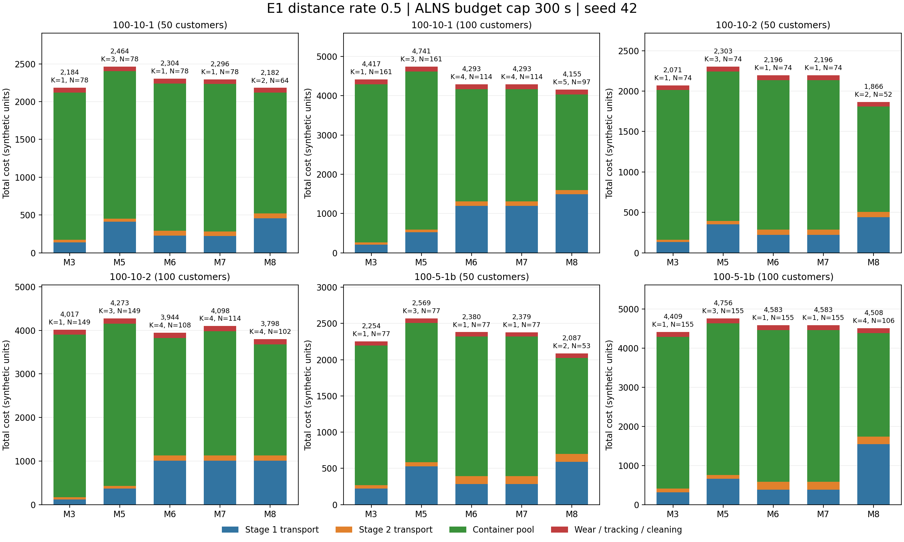

# 一级距离成本0.5：六例五模型正式实验

完成30/30组，独立路线及双周期审计通过30组。

一级距离系数0.5、二级0.05647058823529412、箱池25、追踪0.1、磨损0.5、实际回库清洗0.2。
每例每模型一次ALNS调用，总时间预算300秒，迭代上限1000000，seed42，4路并行。
M6–M8允许K=1至390，范围由780分钟周期和每阶段至少1分钟推导。等长模型自动细分非整除K的时钟。

| 算例 | 客户数 | 需求箱次 | M3成本 | M5成本 | M6成本 | M7成本 | M8成本 | 本轮最低 |
|---|---:|---:|---:|---:|---:|---:|---:|---|
| zhou_Set2_100-10-1_subset50 | 50 | 78 | 2183.84 | 2464.14 | 2303.88 | 2296.02 | 2182.34 | M8 |
| zhou_Set2_100-10-1 | 100 | 161 | 4416.75 | 4741.11 | 4292.67 | 4292.67 | 4155.18 | M8 |
| zhou_Set2_100-10-2_subset50 | 50 | 74 | 2071.36 | 2303.03 | 2195.97 | 2195.97 | 1866.46 | M8 |
| zhou_Set2_100-10-2 | 100 | 149 | 4016.90 | 4272.71 | 3943.91 | 4097.64 | 3797.58 | M8 |
| zhou_Set2_100-5-1b_subset50 | 50 | 77 | 2254.41 | 2569.39 | 2379.94 | 2379.13 | 2086.53 | M8 |
| zhou_Set2_100-5-1b | 100 | 155 | 4408.93 | 4755.79 | 4582.95 | 4582.95 | 4507.96 | M3 |

## 批次、箱池与搜索覆盖

| 算例 | 模型 | 日历K | 实际配送批次 | 箱池N | 需求Q | 已进入K数 | 有效候选 | 已证不可行K | 未运行K | 求解秒数 |
|---|---:|---:|---:|---:|---:|---:|---:|---:|---:|---:|
| zhou_Set2_100-10-1 | 6 | 4 | 2 | 114 | 161 | 390 | 4 | 373 | 0 | 71.59 |
| zhou_Set2_100-10-1 | 7 | 4 | 2 | 114 | 161 | 390 | 4 | 373 | 0 | 72.49 |
| zhou_Set2_100-10-1 | 8 | 5 | 4 | 97 | 161 | 330 | 6 | 0 | 60 | 300.12 |
| zhou_Set2_100-10-1_subset50 | 6 | 1 | 1 | 78 | 78 | 390 | 5 | 373 | 0 | 35.81 |
| zhou_Set2_100-10-1_subset50 | 7 | 1 | 1 | 78 | 78 | 390 | 4 | 373 | 0 | 35.69 |
| zhou_Set2_100-10-1_subset50 | 8 | 2 | 2 | 64 | 78 | 379 | 6 | 0 | 11 | 300.14 |
| zhou_Set2_100-10-2 | 6 | 4 | 2 | 108 | 149 | 390 | 4 | 373 | 0 | 71.31 |
| zhou_Set2_100-10-2 | 7 | 4 | 3 | 114 | 149 | 390 | 4 | 373 | 0 | 76.27 |
| zhou_Set2_100-10-2 | 8 | 4 | 3 | 102 | 149 | 331 | 6 | 0 | 59 | 300.35 |
| zhou_Set2_100-10-2_subset50 | 6 | 1 | 1 | 74 | 74 | 390 | 4 | 372 | 0 | 37.05 |
| zhou_Set2_100-10-2_subset50 | 7 | 1 | 1 | 74 | 74 | 390 | 4 | 372 | 0 | 35.26 |
| zhou_Set2_100-10-2_subset50 | 8 | 2 | 2 | 52 | 74 | 380 | 6 | 0 | 10 | 300.14 |
| zhou_Set2_100-5-1b | 6 | 1 | 1 | 155 | 155 | 390 | 3 | 375 | 0 | 72.13 |
| zhou_Set2_100-5-1b | 7 | 1 | 1 | 155 | 155 | 390 | 4 | 375 | 0 | 77.71 |
| zhou_Set2_100-5-1b | 8 | 4 | 3 | 106 | 155 | 314 | 6 | 0 | 76 | 300.47 |
| zhou_Set2_100-5-1b_subset50 | 6 | 1 | 1 | 77 | 77 | 390 | 4 | 374 | 0 | 36.50 |
| zhou_Set2_100-5-1b_subset50 | 7 | 1 | 1 | 77 | 77 | 390 | 4 | 374 | 0 | 34.63 |
| zhou_Set2_100-5-1b_subset50 | 8 | 2 | 2 | 53 | 77 | 379 | 6 | 0 | 11 | 300.13 |

## 解释范围

M3/M5保持原距离目标并按本轮同一费用计价；M6–M8优化总成本。单种子、有限时间结果属于已找到的可行解，不代表全局最优。
搜索完全部K也不代表每个K均已求得最优；未搜索或限时未找到可行解均不能等同于不可行。日历K与实际配送批次分别报告。
代码和输入分别冻结在source_snapshot与inputs/cases，逐次结果、独立审计和费用在results。
相对旧实验同时改变了价格和K允许域，未经同价重计不能把全部费用差异归因于算法改进。

## 搜索预算利用率

300秒是一次调用的预算上限。当前实现按尚未遍历的K均分剩余时间，起初每个K约获得300/390=0.77秒。若后段大量K被快速证明不可行，遍历结束后不会重新搜索前面的K，因此可能留下大量未使用预算。这会削弱本轮的搜索质量；返回K=1或成本更高不能据此解释为多批次机制无效。

| 模型 | 完成组数 | 平均求解秒数 | 最短秒数 | 最长秒数 | 平均预算利用率 |
|---|---:|---:|---:|---:|---:|
| M3 | 6 | 300.64 | 300.08 | 303.14 | 100.2% |
| M5 | 6 | 300.46 | 300.05 | 302.34 | 100.2% |
| M6 | 6 | 54.07 | 35.81 | 72.13 | 18.0% |
| M7 | 6 | 55.34 | 34.63 | 77.71 | 18.4% |
| M8 | 6 | 300.22 | 300.12 | 300.47 | 100.1% |

本轮保持冻结算法完整执行，预算分配策略未在实验中途修改。未使用时间和未运行K均原样保留，不能作为最优性证明。

## 成本组成

## 上一轮方案按同一0.5价格重计

上一轮30条路线重新独立审计后，使用本轮价格计价。下表正数表示本轮找到的方案费用更低，负数表示本轮搜索结果更差。两轮的K允许域、代码版本、机器和预算分配不同，不能视为严格算法性能对照。

| 算例 | 模型 | 旧方案按0.5计价 | 新方案成本 | 新方案费用降幅 | 旧K→新K |
|---|---:|---:|---:|---:|---|
| zhou_Set2_100-10-1 | M3 | 4415.63 | 4416.75 | -0.03% | 1→1 |
| zhou_Set2_100-10-1 | M5 | 4693.25 | 4741.11 | -1.02% | 3→3 |
| zhou_Set2_100-10-1 | M6 | 3437.59 | 4292.67 | -24.87% | 2→4 |
| zhou_Set2_100-10-1 | M7 | 3436.52 | 4292.67 | -24.91% | 2→4 |
| zhou_Set2_100-10-1 | M8 | 3512.95 | 4155.18 | -18.28% | 2→5 |
| zhou_Set2_100-10-1_subset50 | M3 | 2183.05 | 2183.84 | -0.04% | 1→1 |
| zhou_Set2_100-10-1_subset50 | M5 | 2463.86 | 2464.14 | -0.01% | 3→3 |
| zhou_Set2_100-10-1_subset50 | M6 | 1835.48 | 2303.88 | -25.52% | 2→1 |
| zhou_Set2_100-10-1_subset50 | M7 | 1837.86 | 2296.02 | -24.93% | 2→1 |
| zhou_Set2_100-10-1_subset50 | M8 | 1821.20 | 2182.34 | -19.83% | 3→2 |
| zhou_Set2_100-10-2 | M3 | 4014.32 | 4016.90 | -0.06% | 1→1 |
| zhou_Set2_100-10-2 | M5 | 4261.20 | 4272.71 | -0.27% | 3→3 |
| zhou_Set2_100-10-2 | M6 | 3086.46 | 3943.91 | -27.78% | 2→4 |
| zhou_Set2_100-10-2 | M7 | 3136.97 | 4097.64 | -30.62% | 2→4 |
| zhou_Set2_100-10-2 | M8 | 3139.81 | 3797.58 | -20.95% | 2→4 |
| zhou_Set2_100-10-2_subset50 | M3 | 2071.37 | 2071.36 | +0.00% | 1→1 |
| zhou_Set2_100-10-2_subset50 | M5 | 2302.42 | 2303.03 | -0.03% | 3→3 |
| zhou_Set2_100-10-2_subset50 | M6 | 1554.01 | 2195.97 | -41.31% | 2→1 |
| zhou_Set2_100-10-2_subset50 | M7 | 1732.74 | 2195.97 | -26.73% | 2→1 |
| zhou_Set2_100-10-2_subset50 | M8 | 1738.23 | 1866.46 | -7.38% | 3→2 |
| zhou_Set2_100-5-1b | M3 | 4404.48 | 4408.93 | -0.10% | 1→1 |
| zhou_Set2_100-5-1b | M5 | 4757.52 | 4755.79 | +0.04% | 3→3 |
| zhou_Set2_100-5-1b | M6 | 3902.76 | 4582.95 | -17.43% | 2→1 |
| zhou_Set2_100-5-1b | M7 | 3632.16 | 4582.95 | -26.18% | 2→1 |
| zhou_Set2_100-5-1b | M8 | 3668.86 | 4507.96 | -22.87% | 2→4 |
| zhou_Set2_100-5-1b_subset50 | M3 | 2254.31 | 2254.41 | -0.00% | 1→1 |
| zhou_Set2_100-5-1b_subset50 | M5 | 2567.66 | 2569.39 | -0.07% | 3→3 |
| zhou_Set2_100-5-1b_subset50 | M6 | 1950.42 | 2379.94 | -22.02% | 2→1 |
| zhou_Set2_100-5-1b_subset50 | M7 | 2229.88 | 2379.13 | -6.69% | 1→1 |
| zhou_Set2_100-5-1b_subset50 | M8 | 2204.85 | 2086.53 | +5.37% | 1→2 |

同价比较中，本轮3组更低、27组更高。最终复核30/30通过。
