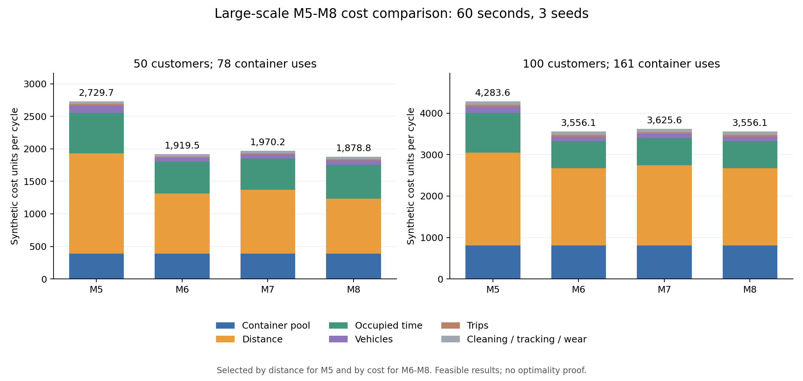

# 大规模模型 5、6、7、8 同成本参数对比

运行日期：2026-10-06。两个预先选定的 50/100 点共享 spread_medium 场景，每场景四模型使用相同订单、网络、车队、周期、清洗参数及同一份 common_economic.json。

ALNS：每次 60 秒、最多 60000 次迭代，种子 42/43/44；两个进程。M6–M8 的总预算在 K=1/2/3 间共享。本轮只比较大规模 ALNS，不包含精确法。

全部尝试 24/24，通过独立物理与成本审计 24 次。共同成本参数哈希：`a931fc2c3f0793d8fc7c0505866471c64335a681ba5b5133d17a8384cfae2ead`。

## 代表方案总成本

M5 按最短距离选择（同距离按成本排序），M6–M8 按最低已观察成本选择；各模型均从三个 ALNS 种子的有效方案中选择。

| 算例 | 点数 | 需求箱次 | M5 | M6 | M7 | M8 | M8 比 M5 降低 |
|---|---:|---:|---:|---:|---:|---:|---:|
| zhou_Set2_100-10-1_subset50 | 50 | 78 | 2,729.71 | 1,919.52 | 1,970.24 | 1,878.80 | 31.17% |
| zhou_Set2_100-10-1 | 100 | 161 | 4,283.60 | 3,556.06 | 3,625.65 | 3,556.06 | 16.98% |

## 同预算 ALNS 的三个种子

| 算例 | 模型 | 有效/尝试 | 最低成本 | 平均成本 | 最高成本 | 样本标准差 |
|---|---|---:|---:|---:|---:|---:|
| zhou_Set2_100-10-1_subset50 | M5 | 3/3 | 2,613.01 | 2,662.35 | 2,729.71 | 60.40 |
| zhou_Set2_100-10-1_subset50 | M6 | 3/3 | 1,919.52 | 1,987.82 | 2,065.05 | 73.18 |
| zhou_Set2_100-10-1_subset50 | M7 | 3/3 | 1,970.24 | 2,043.70 | 2,088.71 | 64.15 |
| zhou_Set2_100-10-1_subset50 | M8 | 3/3 | 1,878.80 | 1,984.79 | 2,065.11 | 95.77 |
| zhou_Set2_100-10-1 | M5 | 3/3 | 4,256.64 | 4,288.01 | 4,323.80 | 33.80 |
| zhou_Set2_100-10-1 | M6 | 3/3 | 3,556.06 | 3,761.24 | 4,013.52 | 232.34 |
| zhou_Set2_100-10-1 | M7 | 3/3 | 3,625.65 | 3,670.89 | 3,709.64 | 42.37 |
| zhou_Set2_100-10-1 | M8 | 3/3 | 3,556.06 | 3,695.23 | 3,792.80 | 123.73 |

## 代表方案资源及证明

| 算例 | 模型 | 方法/种子 | 成本 | 箱池 | 原时间表最低需箱 | 周期K/配送批次 | 状态 | 证明目标 |
|---|---|---|---:|---:|---:|---|---|---|
| zhou_Set2_100-10-1_subset50 | M5 | alns/43 | 2,729.71 | 78 | 71 | 3/3 | FEASIBLE | 未证最优 |
| zhou_Set2_100-10-1_subset50 | M6 | alns/43 | 1,919.52 | 78 | 78 | 1/1 | FEASIBLE | 未证最优 |
| zhou_Set2_100-10-1_subset50 | M7 | alns/42 | 1,970.24 | 78 | 78 | 1/1 | FEASIBLE | 未证最优 |
| zhou_Set2_100-10-1_subset50 | M8 | alns/43 | 1,878.80 | 78 | 78 | 1/1 | FEASIBLE | 未证最优 |
| zhou_Set2_100-10-1 | M5 | alns/44 | 4,283.60 | 161 | 148 | 3/3 | FEASIBLE | 未证最优 |
| zhou_Set2_100-10-1 | M6 | alns/42 | 3,556.06 | 161 | 161 | 1/1 | FEASIBLE | 未证最优 |
| zhou_Set2_100-10-1 | M7 | alns/42 | 3,625.65 | 161 | 161 | 1/1 | FEASIBLE | 未证最优 |
| zhou_Set2_100-10-1 | M8 | alns/42 | 3,556.06 | 161 | 161 | 1/1 | FEASIBLE | 未证最优 |

## 模型5原时间表最低需箱量参考

仅对原方案按审计得到的最低需箱量重新计价，路线及时间表保持原值；不是重新求解模型5或箱数全局最优证明。

| 算例 | M5 原配置成本 | M5 最低池参考成本 | M6 | M7 | M8 |
|---|---:|---:|---:|---:|---:|
| zhou_Set2_100-10-1_subset50 | 2,729.71 | 2,694.71 | 1,919.52 | 1,970.24 | 1,878.80 |
| zhou_Set2_100-10-1 | 4,283.60 | 4,218.60 | 3,556.06 | 3,625.65 | 3,556.06 |

## 代表方案成本分项

| 算例 | 模型 | 箱池 | 距离 | 占用工时 | 车辆 | 趟次 | 清洗/追踪/磨损 |
|---|---|---:|---:|---:|---:|---:|---:|
| zhou_Set2_100-10-1_subset50 | M5 | 390.00 | 1,542.47 | 623.24 | 110.00 | 25.00 | 39.00 |
| zhou_Set2_100-10-1_subset50 | M6 | 390.00 | 924.17 | 488.35 | 60.00 | 18.00 | 39.00 |
| zhou_Set2_100-10-1_subset50 | M7 | 390.00 | 983.37 | 474.87 | 65.00 | 18.00 | 39.00 |
| zhou_Set2_100-10-1_subset50 | M8 | 390.00 | 846.16 | 517.63 | 70.00 | 16.00 | 39.00 |
| zhou_Set2_100-10-1 | M5 | 805.00 | 2,240.06 | 960.04 | 155.00 | 43.00 | 80.50 |
| zhou_Set2_100-10-1 | M6 | 805.00 | 1,863.57 | 658.99 | 110.00 | 38.00 | 80.50 |
| zhou_Set2_100-10-1 | M7 | 805.00 | 1,934.66 | 659.49 | 105.00 | 41.00 | 80.50 |
| zhou_Set2_100-10-1 | M8 | 805.00 | 1,863.57 | 658.99 | 110.00 | 38.00 | 80.50 |

## 最优证明

本轮均为 ALNS 可行解，没有全局最优证明。

## 解释范围

- 单位均为 synthetic_units（合成成本单位），不是人民币实测费用；箱体初始投入在 comparison_cost.json 单列，不并入周期成本。
- M5 固定分批与箱池并优化距离，成本表是同价重算；M6–M8 直接优化成本。M5 的距离最优证明不能称为成本最优。
- 充分求解时 M8≤M7≤M6；短预算搜索可能返回相反排序。未找到解不等于已证明不可行。
- 全部运行（包含无解、限时和错误）保留在 runs.csv/rows.json，不能把失败成本写成零。
- 这是 50 点子集与完整 100 点算例的有限预算比较，两者来自同一底图，不是独立总体样本；不能外推为全数据集平均收益或算法收敛结论。

输入与源码分别冻结在 inputs/、cases/、source_snapshot/；各次原始解、独立审计和费用分项位于 results/；运行日志位于 logs/。

## 与上一轮价格核对

本轮与 7/10/20/30 点实验的经济参数哈希完全相同。

| 参数 | 数值 |
|---|---:|
| 箱池每箱每周期 | 5 |
| 一级每距离单位 | 1 |
| 二级每距离单位 | 1 |
| 一级每占用车辆分钟 | 0.1 |
| 二级每占用车辆分钟 | 0.1 |
| 一级每启用车辆每周期 | 10 |
| 二级每启用车辆每周期 | 5 |
| 一级每趟 | 1 |
| 二级每趟 | 1 |
| 每次回箱清洗 | 0.2 |
| 每次用箱追踪 | 0.1 |
| 箱体价格（初始投入单列） | 10 |
| 箱体寿命（次数） | 50 |

## 实际求解用时

| 算例 | 模型 | 有效/尝试 | 最短秒数 | 平均秒数 | 最长秒数 |
|---|---|---:|---:|---:|---:|
| zhou_Set2_100-10-1_subset50 | M5 | 3/3 | 60.05 | 60.16 | 60.28 |
| zhou_Set2_100-10-1_subset50 | M6 | 3/3 | 58.09 | 58.21 | 58.30 |
| zhou_Set2_100-10-1_subset50 | M7 | 3/3 | 58.15 | 59.16 | 61.00 |
| zhou_Set2_100-10-1_subset50 | M8 | 3/3 | 60.13 | 60.14 | 60.16 |
| zhou_Set2_100-10-1 | M5 | 3/3 | 60.09 | 60.25 | 60.54 |
| zhou_Set2_100-10-1 | M6 | 3/3 | 58.58 | 58.72 | 58.97 |
| zhou_Set2_100-10-1 | M7 | 3/3 | 59.10 | 59.61 | 60.14 |
| zhou_Set2_100-10-1 | M8 | 3/3 | 60.12 | 60.18 | 60.24 |

60 秒为算法的软截止，初始化、一次解码及审计可能超出；两个进程共享机器，实际耗时不用于声称算法速度优势。

## 本轮实际使用的决策范围

- 50 点：M6/M7/M8 的代表方案均选择 K=1。单批次下共同分界、独立分界及可变长度的允许日历域相同，本轮三模型成本差异反映有限预算搜索得到的路线与时刻差异，不能归因于日历扩展本身。
- 50 点：四模型代表方案箱池均为 78，箱池收费相同；相对 M5 原配置成本的差异来自距离、占用工时、车辆和趟次费用。M5 不变时间表最低需箱量参考另列。
- 100 点：M6/M7/M8 的代表方案均选择 K=1。单批次下共同分界、独立分界及可变长度的允许日历域相同，本轮三模型成本差异反映有限预算搜索得到的路线与时刻差异，不能归因于日历扩展本身。
- 100 点：四模型代表方案箱池均为 161，箱池收费相同；相对 M5 原配置成本的差异来自距离、占用工时、车辆和趟次费用。M5 不变时间表最低需箱量参考另列。
