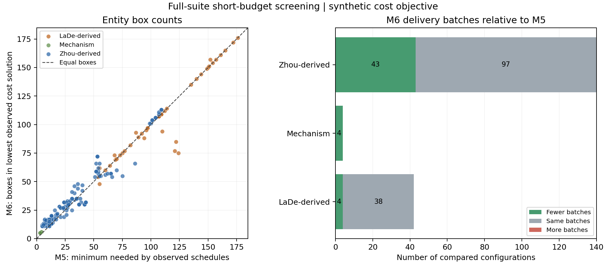

# 模型5与模型6：全部多批次算例

本轮清单中的186个B2/B3配置全部纳入：LaDe派生42个、人工机制4个、Zhou派生140个。对应93个基础场景；单批次B1属于其他模型研究范围，历史V1数据不混入。

每种处理精确求解3秒、ALNS每种子2秒，种子[42, 43, 44]，4个并发进程。这是短预算全量筛查，受初始化时间和并发资源竞争影响，不是收敛性能实验。

已完成2232/2232次运行，1954次有独立审计有效的可行解；186个配置可作M5/M6完整比较，0个缺少可行对照。所有失败、无解和限时状态均保留；未找到解不等于已证明不可行。

## 箱数与配送批次

M5取各次已得可行时间表中的最小需箱量，不把N=Q的预设池当成最低需箱量。M6取已得联合方案中成本最低的一次。正的减少量表示模型6较少，负值表示增加。

| 来源 | 配置数/有效比较 | 箱数减少/相同/增加 | 平均少箱 | 平均箱数减少率 | 批次减少/相同/增加 |
|---|---:|---:|---:|---:|---:|
| LaDe派生 | 42/42 | 7/31/4 | 3.26 | 2.63% | 4/38/0 |
| 人工机制 | 4/4 | 0/0/4 | -2.00 | -58.33% | 4/0/0 |
| Zhou派生 | 140/140 | 22/13/105 | -2.62 | -25.71% | 43/97/0 |
| 全部 | 186/186 | 29/44/113 | -1.28 | -20.01% | 51/135/0 |

减少率是逐配置相对其M5已得最小需箱量的百分比的算术平均；不是总体实测节约率。配对场景、重复几何和算法种子不能当成独立样本，不报告统计显著性。

| 来源 | 配送点/区域数 | 候选批次 | 配置数/有效比较 | M5平均箱数 | M6平均箱数 | 平均少箱 | 平均箱数减少率 | 批次减少/相同/增加 |
|---|---:|---:|---:|---:|---:|---:|---:|---:|
| LaDe派生 | 10 | 2 | 7/7 | 96.71 | 95.71 | 1.00 | 1.06% | 0/7/0 |
| LaDe派生 | 10 | 3 | 7/7 | 62.00 | 62.71 | -0.71 | -1.05% | 4/3/0 |
| LaDe派生 | 20 | 2 | 7/7 | 141.57 | 142.29 | -0.71 | -0.47% | 0/7/0 |
| LaDe派生 | 20 | 3 | 7/7 | 91.71 | 77.14 | 14.57 | 12.06% | 0/7/0 |
| LaDe派生 | 30 | 2 | 7/7 | 161.29 | 161.29 | 0.00 | 0.00% | 0/7/0 |
| LaDe派生 | 30 | 3 | 7/7 | 103.14 | 97.71 | 5.43 | 4.21% | 0/7/0 |
| 人工机制 | 6 | 2 | 2/2 | 4.00 | 6.00 | -2.00 | -50.00% | 2/0/0 |
| 人工机制 | 6 | 3 | 2/2 | 3.00 | 5.00 | -2.00 | -66.67% | 2/0/0 |
| Zhou派生 | 7 | 2 | 10/10 | 10.20 | 12.00 | -1.80 | -18.38% | 8/2/0 |
| Zhou派生 | 7 | 3 | 10/10 | 5.90 | 11.90 | -6.00 | -106.17% | 10/0/0 |
| Zhou派生 | 10 | 2 | 10/10 | 12.50 | 14.30 | -1.80 | -15.62% | 6/4/0 |
| Zhou派生 | 10 | 3 | 10/10 | 8.60 | 14.50 | -5.90 | -75.24% | 10/0/0 |
| Zhou派生 | 12 | 2 | 10/10 | 13.00 | 16.00 | -3.00 | -23.87% | 1/9/0 |
| Zhou派生 | 12 | 3 | 10/10 | 9.90 | 15.30 | -5.40 | -62.69% | 8/2/0 |
| Zhou派生 | 20 | 2 | 10/10 | 24.00 | 29.50 | -5.50 | -23.79% | 0/10/0 |
| Zhou派生 | 20 | 3 | 10/10 | 18.50 | 21.80 | -3.30 | -20.41% | 0/10/0 |
| Zhou派生 | 30 | 2 | 10/10 | 33.90 | 38.20 | -4.30 | -13.00% | 0/10/0 |
| Zhou派生 | 30 | 3 | 10/10 | 27.40 | 28.10 | -0.70 | -2.73% | 0/10/0 |
| Zhou派生 | 50 | 2 | 10/10 | 55.50 | 62.90 | -7.40 | -14.50% | 0/10/0 |
| Zhou派生 | 50 | 3 | 10/10 | 39.60 | 35.10 | 4.50 | 10.22% | 0/10/0 |
| Zhou派生 | 100 | 2 | 10/10 | 104.10 | 106.80 | -2.70 | -2.58% | 0/10/0 |
| Zhou派生 | 100 | 3 | 10/10 | 63.50 | 56.90 | 6.60 | 8.75% | 0/10/0 |

## 路线与分批的作用

相对于模型5最短距离方案，模型6所选方案平均距离减少率为-18.45%（负值表示变长），一级/二级趟数平均分别少-1.39/-0.38趟。成本目标可能用更长路线换取更少的箱子或占用工时，不能将成本下降解释成所有资源同时减少。

例如zhou_Set1_7-2-1_b2，模型5已得时间表需9箱/2批，模型6已证明测试成本最优的解为12箱/2批。这直接说明总成本目标不能保证箱数和配送批次各自最小。

与固定原分批、优化箱池与路径的成本对照相比，有186例可比，其中82例的联合搜索找到了更低测试成本。联合问题包含固定分批方案，但短时ALNS可能未找到它；不得把全部箱数收益都归于重新分批。

CSV另列每例已观察到的箱数/批次数取舍，汇集联合搜索和固定分批对照中经审计的模型6方案，按箱数与批次数筛选互不支配的组合，JSON记录每一组合的运行证据。这不是已证明完整的资源前沿，也不能记作联合算法单独找到的结果。

## 证明与求解状态

所选方案中，40例达到箱池必要下界，144例达到给定箱池下的配送批次必要下界，24例所选结果有成本最优证明。联合精确法在全部运行中共证明24个配置成本最优；同值ALNS结果仍保留自己的启发式标记。资源与成本证明分别记录。

模型6联合ALNS的逐种子成本、箱数、批次与迭代数保存在JSON中；其中0次有效运行预算仅够初始化、未完成搜索迭代。

| 状态 | 次数 |
|---|---:|
| FEASIBLE | 1674 |
| OPTIMAL | 113 |
| TIME_LIMIT | 345 |
| TIME_LIMIT_BUILD | 100 |

## 数据与费用边界

保留当前V2原需求、重量、顾客和仓库、服务窗、原批次、道路矩阵、车队、回收截点与清洗闭合。显式新增假设是全部货物在周期开始可领用，允许在原候选批次内重分配。Zhou货量到箱量、LaDe一包裹一箱、预约与回收等仍是研究情景。

费用全部使用synthetic_units测试系数。Zhou距离是坐标单位，LaDe使用既有道路矩阵；本轮不提供真实人民币节约或实测成本标定结论。

逐例箱数和批次见 [完整箱数表](resources.md) 与 [186例对比CSV](case_comparison.csv)；逐次状态、成本、路线及种子见 [运行报告](report.md)、[rows.csv](rows.csv)。输入和求解源码冻结于experiment.json；独立审计、下界证据和种子差异分别保留在各运行目录与JSON。
