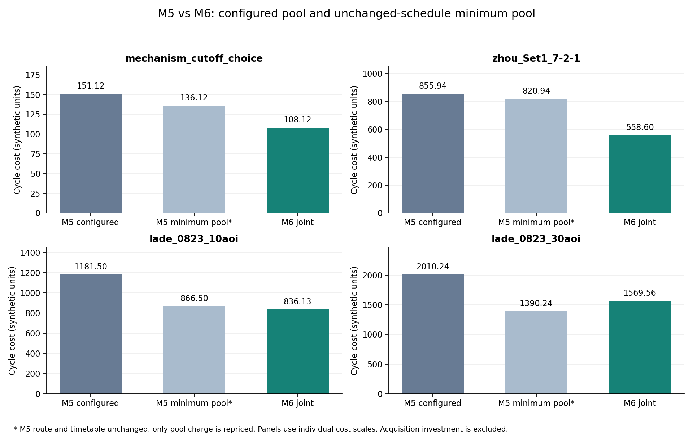
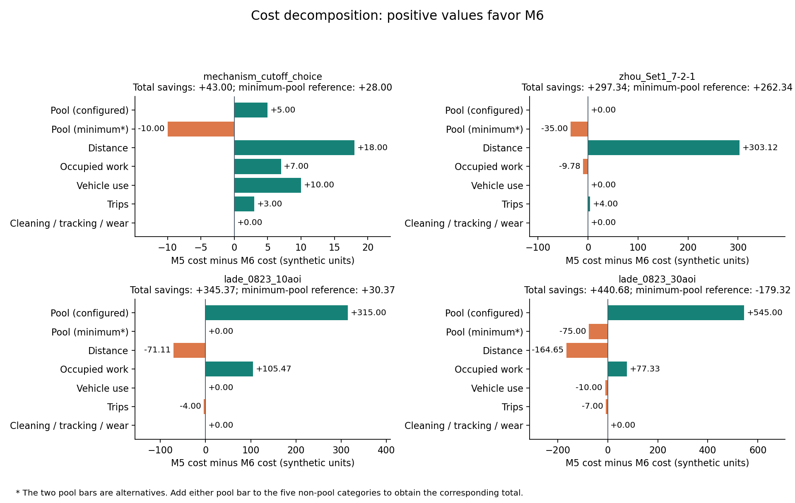

# 模型五与模型六对比实验分析报告

日期：2026-10-05。费用单位：合成成本单位。

## 主要发现

模型五保持原有固定分批和箱池，以运输距离为目标；求解后用模型六相同的经济参数计算周期成本。模型六在均匀周期中联合选择批数、阶段分界、箱池、订单分配、路线与车辆。

本次完成32次尝试，31次得到通过独立审计的方案。按模型五原配置箱池，模型六在4/4个案例中成本较低；按模型五同一路线与时间表的最低需箱量重新计价后，模型六在3/4个案例中成本较低。后一口径消除了模型五已配置但调度无需占用的箱池持有费，能帮助判断收益来自箱池配置还是运输运营。

较大案例未证明成本最优，因而不能推出“模型六总是更省”或“大规模已收敛”。本报告保留不利于模型六的结果。

## 实验设计与计价口径

- 每个案例、每个模型：1次精确法（30秒）和3次ALNS（种子42, 43, 44，每次15秒，最多30000次迭代）。运行并行度为2。
- 模型六候选K为1、2、3，共享每次求解的总时间预算。K是划分完整周期的等长批数；实际配送批数可更少。
- 同案例的原始订单、道路、车辆容量与车队、客户窗口、操作政策、完整周期和经济配置相同。均匀日历及其订单分配属于模型六的决策变化。静态订单在周期起点全部可用，这是本次适配的明确假设。
- 模型五代表方案按最短距离选择，距离相同时选成本较低者；模型六代表方案按最低已观察周期成本选择。下表结合精确法与ALNS选代表，不是同算法的单次对照；同算法结果另列。
- 周期成本包括箱池持有、两级运输距离、占用路线工时、车辆启用、发车次数、清洗、追踪和磨损。购置投入单列，避免与周期费用直接相加。工时不包含两趟之间的闲置工资。
- 本实验价格为人工系数：每箱每周期5；两级距离每单位1；占用工时每分钟0.1；一级/二级车辆启用每周期10/5；每趟1；每次清洗0.2、追踪0.1、磨损0.2；单箱购置价10。Zhou距离仍为坐标单位，不解释为实测公里；各案例周期长度也不同，不跨案例加总为经营收益。

| 案例 | 订单数 | 累计箱使用量 | M5原配置箱池 | M5同调度最低需箱 | M6箱池 |
| --- | --- | --- | --- | --- | --- |
| mechanism_cutoff_choice | 6 | 6 | 6 | 3 | 5 |
| zhou_Set1_7-2-1 | 7 | 12 | 12 | 5 | 12 |
| lade_0823_10aoi | 10 | 131 | 131 | 68 | 68 |
| lade_0823_30aoi | 30 | 255 | 255 | 131 | 146 |

“累计箱使用量”允许同一箱循环使用，不等于必须购置的实体箱数。

## 总成本与箱池参考

| 案例 | M5原配置成本 | M6成本 | 节省额 | 节省% | M5最低箱池参考成本 | 相对参考节省% |
| --- | --- | --- | --- | --- | --- | --- |
| mechanism_cutoff_choice | 151.12 | 108.12 | 43.00 | 28.45 | 136.12 | 20.57 |
| zhou_Set1_7-2-1 | 855.94 | 558.60 | 297.34 | 34.74 | 820.94 | 31.96 |
| lade_0823_10aoi | 1181.50 | 836.13 | 345.37 | 29.23 | 866.50 | 3.50 |
| lade_0823_30aoi | 2010.24 | 1569.56 | 440.68 | 21.92 | 1390.24 | -12.90 |

节省额=M5−M6；节省比例=(M5−M6)/M5。负值表示模型六更贵。最低箱池参考只重算模型五原调度的箱池费用，不重新优化路线或时间，不能称为模型五成本最优值。



## 成本变化来自哪里

下表均为M5原配置费用减M6费用。正数贡献节省，负数增加成本；各项合计等于总节省。

| 案例 | 箱池持有 | 运输距离 | 占用工时 | 车辆启用 | 发车次数 | 清洗/追踪/磨损 | 运营部分合计 | 最低箱池参考中的箱池项 |
| --- | --- | --- | --- | --- | --- | --- | --- | --- |
| mechanism_cutoff_choice | 5.00 | 18.00 | 7.00 | 10.00 | 3.00 | 0.00 | 38.00 | -10.00 |
| zhou_Set1_7-2-1 | 0.00 | 303.12 | -9.78 | 0.00 | 4.00 | 0.00 | 297.34 | -35.00 |
| lade_0823_10aoi | 315.00 | -71.11 | 105.47 | 0.00 | -4.00 | 0.00 | 30.37 | 0.00 |
| lade_0823_30aoi | 545.00 | -164.65 | 77.33 | -10.00 | -7.00 | 0.00 | -104.32 | -75.00 |

“运营部分合计”包含除箱池持有外的所有项；最低箱池口径的总节省等于该合计加最后一列。



### mechanism_cutoff_choice

M5原配置成本151.12，M6成本108.12，差额+43.00。箱池项贡献+5.00，运营项贡献+38.00；去掉M5多配箱池的15.00后，相对参考差额为+28.00。

M5配置6箱、原调度最低需3箱；M6使用5箱。运输距离由55.31变为37.31；距离费用变化+18.00，占用工时费用变化+7.00。成本目标同时权衡资源、路线和时间，距离或箱数单项并不必然改善。

### zhou_Set1_7-2-1

M5原配置成本855.94，M6成本558.60，差额+297.34。箱池项贡献+0.00，运营项贡献+297.34；去掉M5多配箱池的35.00后，相对参考差额为+262.34。

M5配置12箱、原调度最低需5箱；M6使用12箱。运输距离由635.59变为332.47；距离费用变化+303.12，占用工时费用变化-9.78。成本目标同时权衡资源、路线和时间，距离或箱数单项并不必然改善。

### lade_0823_10aoi

M5原配置成本1181.50，M6成本836.13，差额+345.37。箱池项贡献+315.00，运营项贡献+30.37；去掉M5多配箱池的315.00后，相对参考差额为+30.37。

M5配置131箱、原调度最低需68箱；M6使用68箱。运输距离由230.30变为301.40；距离费用变化-71.11，占用工时费用变化+105.47。成本目标同时权衡资源、路线和时间，距离或箱数单项并不必然改善。

### lade_0823_30aoi

M5原配置成本2010.24，M6成本1569.56，差额+440.68。箱池项贡献+545.00，运营项贡献-104.32；去掉M5多配箱池的620.00后，相对参考差额为-179.32。

M5配置255箱、原调度最低需131箱；M6使用146箱。运输距离由290.89变为455.54；距离费用变化-164.65，占用工时费用变化+77.33。成本目标同时权衡资源、路线和时间，距离或箱数单项并不必然改善。

该案例发生结论反转：M6比M5最低箱池参考多花179.32。其中箱池项增加75.00，运营项增加104.32。因此原配置下的降本主要依赖削减M5过量配置的箱池。原固定日历不一定包含在均匀日历可行域中，M6短预算也未证明最优，不能要求本次M6解必然支配该参考。

## 调度选择与求解证明

| 案例 | M5→M6配送批数 | M6 K | 批长/第一段/第二段(分钟) | M5代表运行 | M6代表运行 | M6成本最优证明 |
| --- | --- | --- | --- | --- | --- | --- |
| mechanism_cutoff_choice | 3→2 | 3 | 63.33/21.67/41.67 | [alns/42](00_M5_distance_alns_42/result.json) | [exact/42](00_M6_uniform_exact_42/result.json) | 有（配置K与时间离散域内） |
| zhou_Set1_7-2-1 | 3→1 | 1 | 780.00/577.28/202.72 | [alns/42](01_M5_distance_alns_42/result.json) | [exact/42](01_M6_uniform_exact_42/result.json) | 有（配置K与时间离散域内） |
| lade_0823_10aoi | 3→2 | 3 | 260.00/123.87/136.13 | [exact/42](02_M5_distance_exact_42/result.json) | [exact/42](02_M6_uniform_exact_42/result.json) | 无 |
| lade_0823_30aoi | 3→2 | 3 | 260.00/162.25/97.75 | [alns/44](03_M5_distance_alns_44/result.json) | [alns/42](03_M6_uniform_alns_42/result.json) | 无 |

证明范围仅涵盖输入配置的K集合、整数时间分界网格和其他建模约束。前两个案例的模型六精确法证明了成本最优；LaDe10得到可行方案，LaDe30精确法限时未找到可行解。模型五前三个案例的精确法证明的是距离最优；LaDe30仅有有效限时解。模型五代表方案即便与最优距离相同，也没有成本最优证明。相同距离方案的时间安排可不同，故精确法的事后成本也可能高于ALNS。

失败尝试单独保留，不填作零成本，不参与有效成本均值：

| 运行 | 状态 | 对统计的影响 |
| --- | --- | --- |
| [03_M6_uniform_exact_42](03_M6_uniform_exact_42/result.json) | TIME_LIMIT | 无有效成本，保留失败记录 |

## ALNS重复运行与稳定性

以下为每模型每案例3个种子的全部有效成本，标准差为样本标准差。模型五每个种子仍优化距离，这里的“最低成本”只是该组三个事后价格的最小值。

| 案例 | 模型 | 有效/尝试 | 最低成本 | 平均成本 | 最高成本 | 样本标准差 |
| --- | --- | --- | --- | --- | --- | --- |
| mechanism_cutoff_choice | M5_distance | 3/3 | 151.12 | 153.36 | 157.86 | 3.89 |
| mechanism_cutoff_choice | M6_uniform | 3/3 | 115.38 | 115.92 | 117.01 | 0.94 |
| zhou_Set1_7-2-1 | M5_distance | 3/3 | 855.94 | 855.94 | 855.94 | 0.00 |
| zhou_Set1_7-2-1 | M6_uniform | 3/3 | 565.60 | 565.60 | 565.60 | 0.00 |
| lade_0823_10aoi | M5_distance | 3/3 | 1222.37 | 1264.19 | 1285.59 | 36.23 |
| lade_0823_10aoi | M6_uniform | 3/3 | 848.83 | 852.83 | 859.52 | 5.83 |
| lade_0823_30aoi | M5_distance | 3/3 | 2010.24 | 2199.20 | 2325.55 | 166.72 |
| lade_0823_30aoi | M6_uniform | 3/3 | 1569.56 | 1671.67 | 1726.71 | 88.52 |

同种子成对对照如下；各自的最低箱池参考按该种子M5的原调度计算，未用代表方案的最低需箱量替代。

| 案例 | 有效种子对数 | 原配置节省%均值 | 原配置节省%范围 | 最低箱池参考节省%均值 | 参考节省%范围 |
| --- | --- | --- | --- | --- | --- |
| mechanism_cutoff_choice | 3 | 24.37 | 22.57～26.91 | 16.17 | 14.03～19.23 |
| zhou_Set1_7-2-1 | 3 | 33.92 | 33.92～33.92 | 31.10 | 31.10～31.10 |
| lade_0823_10aoi | 3 | 32.49 | 29.68～33.92 | 18.90 | 12.06～25.19 |
| lade_0823_30aoi | 3 | 23.56 | 14.50～32.51 | -6.33 | -23.63～14.49 |

Zhou的两个模型成本在三次运行中几乎不变；其余三个案例的M6成本样本标准差较小。这只是当前种子与预算下的观察。3个种子和4个选定案例不足以证明统计显著性、规模趋势或运行时间收敛。

## 可信度与限制

- 31个有效方案均重新独立重放并复核成本；冻结源码262个哈希、输入36个哈希已检查。成本表与资源表使用同一代表方案，费用分项和两种参考总额已逐项核对。
- 相关回归测试95项通过；随后代表方案并列规则调整后，新增成本对比的4项测试再次通过。
- 运行环境为Windows、Python3.11.3、Gurobi11.0.3，详细预算和模块哈希保留在environment.json。源码快照与输入快照对应实际求解版本；报告生成器有独立源码哈希，不改写求解快照。
- 费用是合成系数，未引入企业采购、工资、燃料实测数据。全量静态订单起点可用的假设可能高估集中配送机会。
- 模型六同时改变日历、目标函数、箱池和分配，因此本次结论属于整体方案比较，无法单独归因于某一个机制。
- 代表方案汇合不同算法的最好结果，同方法同种子的对照已另列。短时限结果属于当前预算下的观察，M6较大案例的优化差距仍不确定。

## 后续实验建议

优先延长LaDe10和LaDe30的M6预算并记录目标随时间变化、下界与各K可行性，判断参考口径下的增本是否会消失。再加入“固定原日历+成本目标”“均匀日历+固定箱池”等消融，分离目标、日历和箱池的作用。如要报告企业收益，应先校准费用与库存释放假设，并增加种子和案例覆盖。

## 数据与复现

- [成本汇总](cost_summary.json)、[逐对对照](cost_pairs.csv)、[逐项成本](cost_components.csv)、[所有尝试](rows.json)、[资源汇总](uniform_summary.json)。
- [实验预算](experiment.json)、[运行环境](environment.json)、[检查记录](validation_checks.json)、[本报告计算数据与来源哈希](analysis_results.json)。
- [运行与事后计价说明](../../../docs/model5_model6_cost_comparison.md)。历史快照包含本机绝对路径；换机器时按说明从原始相对路径重建输入，原结果保留用于审计。

```powershell
python -m experiments.analysis.analyze_model5_model6_costs --directory "output/model6_comparison/20261005_m5_m6_cost_comparison"
```
