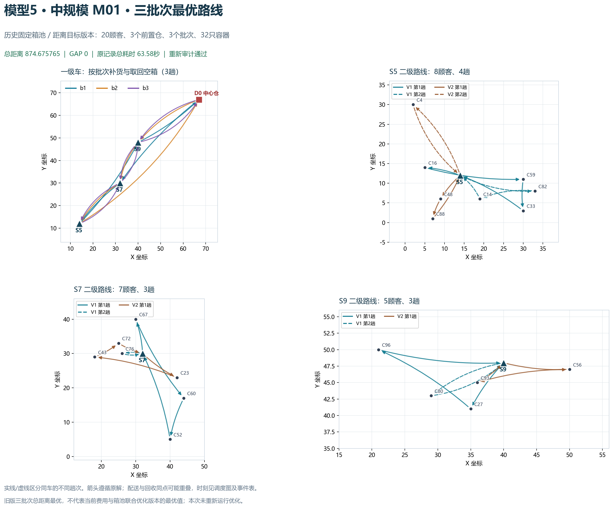
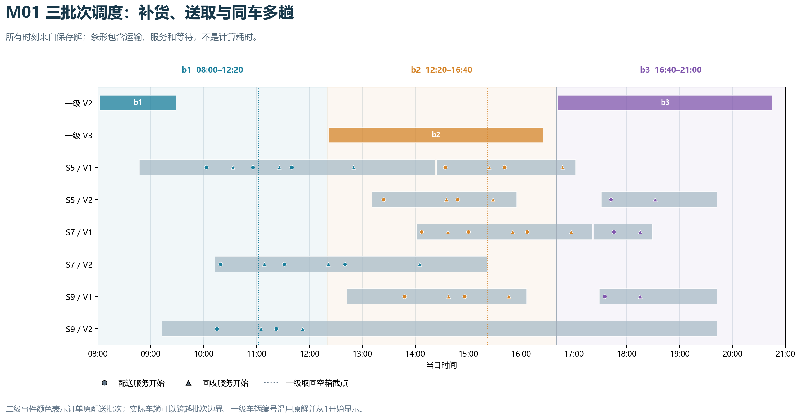

# 多批次中规模：历史模型5距离最优方案

本次只核对和绘图，没有重新运行优化、增加随机种子或改变业务数据。
历史记录为固定箱池、三批次、总距离最小化。当前模型5默认费用与箱池联合优化，目标不同。
审计时仅在内存中按原结果声明恢复objective_mode=distance，冻结输入和原始结果逐字节保持；已核验登记清单、输入、完成文件和结果哈希，并用当前独立回放器重新检查两周期。

| 算例 | 顾客 | 批次 | 固定箱池 | 最优总距离 | 原记录总秒数 | 状态 |
| --- | ---: | ---: | ---: | ---: | ---: | --- |
| M01 | 20 | 3 | 32 | 874.675765 | 63.583 | OPTIMAL / GAP 0 |
| M04 | 20 | 3 | 28 | 810.332612 | 285.275 | OPTIMAL / GAP 0 |

## M01批次安排

| 批次 | 开始装载 | 一级取箱截点 | 结束 | 订单 | 需求箱量 |
| --- | --- | --- | --- | ---: | ---: |
| b1 | 08:00:00 | 11:02:00 | 12:20:00 | 8 | 13 |
| b2 | 12:20:00 | 15:22:00 | 16:40:00 | 9 | 14 |
| b3 | 16:40:00 | 19:42:00 | 21:00:00 | 3 | 5 |

M01一级3趟、二级10趟；同车多趟串行、配送与回收事件和原始服务时刻均保留。未把原来的距离最优解释为按当前价格重新计费后的成本最优。

当前查到的模型八20顾客M01记录仍未证明全域最优；见`output/experiments/m8_m01_compact_prefix_20261029_v2/report.md`。
